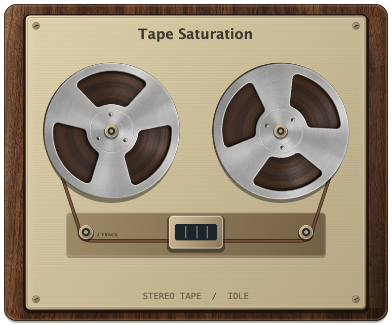

# Fire 2.1 Manual de usuario

**Español / Edición en desarrollo / 24 de octubre de 2026**

[English](Fire-2.1-User-Manual.md) | [简体中文](Fire-2.1-User-Manual-zh-CN.md) | [日本語](Fire-2.1-User-Manual-ja.md) | [Français](Fire-2.1-User-Manual-fr.md) | [Español](Fire-2.1-User-Manual-es.md)

Instrucciones detalladas con capturas auténticas de la interfaz. Revisión de referencia del producto: `9ea20d2`. Los nombres de los controles y presets se conservan en inglés para facilitar su identificación. El PDF incluye un índice y marcadores que permiten navegar por el documento. Al compartir este Markdown, mantén la carpeta `images` junto al archivo.

## Índice

- [01. Primeros pasos](#01-primeros-pasos)
- [02. Interfaz y espectro](#02-interfaz-y-espectro)
- [03. Preajustes y Sound Library](#03-preajustes-y-sound-library)
- [04. A/B, igualación de sonoridad Match e historial de edición](#04-ab-igualación-de-sonoridad-match-e-historial-de-edición)
- [05. Cadenas, enrutamiento paralelo y Mid/Side](#05-cadenas-enrutamiento-paralelo-y-midside)
- [06. Drive y Shape](#06-drive-y-shape)
- [07. Compressor y OTT](#07-compressor-y-ott)
- [08. Stereo](#08-stereo)
- [09. EQ y Dynamic EQ](#09-eq-y-dynamic-eq)
- [10. Chorus, Flanger y Phaser](#10-chorus-flanger-y-phaser)
- [11. Delay](#11-delay)
- [12. Reverb](#12-reverb)
- [13. Lo-Fi](#13-lo-fi)
- [14. Chord Resonator](#14-chord-resonator)
- [15. Granular, Freeze y archivos de muestras](#15-granular-freeze-y-archivos-de-muestras)
- [16. Rutas de modulación y macros](#16-rutas-de-modulación-y-macros)
- [17. Formas de LFO y reproducción](#17-formas-de-lfo-y-reproducción)
- [18. Envolventes y sidechain externo](#18-envolventes-y-sidechain-externo)
- [19. Control MIDI](#19-control-midi)
- [20. Recetas prácticas de diseño sonoro](#20-recetas-prácticas-de-diseño-sonoro)
- [21. Ajustes, rendimiento y solución de problemas](#21-ajustes-rendimiento-y-solución-de-problemas)
- [22. Referencia rápida y asistencia](#22-referencia-rápida-y-asistencia)

<!-- manual:body -->

## 01. Primeros pasos

Esta edición describe **Fire 2.1.0 en desarrollo**, incluido el sistema de modulación ampliado, Dynamic EQ, las cadenas paralelas, la importación y exportación de muestras y la visualización unificada de OTT. Se preparó el **24 de octubre de 2026** a partir de la revisión **9ea20d2** del código del producto. Consulta **Menu > Settings** para identificar la versión que ha cargado tu programa anfitrión. La descarga pública puede ofrecer un conjunto de funciones anterior.

Los ejemplos utilizan capturas auténticas de la interfaz del plugin actual, con audio generado para demostración. Los ajustes de las imágenes son ilustrativos: no son preajustes calibrados ni valores obligatorios. La mayoría de las figuras utilizan Ink; Vintage muestra las visualizaciones de aspecto físico. La apariencia no cambia el sonido.

### Instalar y cargar Fire

Fire se distribuye en formatos de plugin que pueden utilizar los programas anfitriones compatibles. Elige un formato que admita tu DAW; Audio Unit es un formato de macOS. Conserva intacto el paquete del plugin al copiarlo.

| Plataforma | Formato | Carpeta de instalación habitual |
| --- | --- | --- |
| macOS | Audio Unit | `~/Library/Audio/Plug-Ins/Components/` |
| macOS | VST3 | `~/Library/Audio/Plug-Ins/VST3/` |
| macOS | CLAP | `~/Library/Audio/Plug-Ins/CLAP/` |
| Windows | VST3 | `C:\Program Files\Common Files\VST3\` |
| Windows | CLAP | `C:\Program Files\Common Files\CLAP\` |
| Linux | VST3 | `~/.vst3/` |
| Linux | CLAP | `~/.clap/` |

1. Descarga la compilación adecuada desde las [versiones oficiales de Fire](https://github.com/jerryuhoo/Fire/releases). Comprueba el sistema operativo y la arquitectura del procesador indicados en el paquete. Las compilaciones de desarrollo locales pueden incluir únicamente la arquitectura del equipo en el que se crearon.
2. Cierra la DAW antes de sustituir una instalación existente. Copia el formato que necesites en su carpeta de plugins; si falta una carpeta de usuario, créala. Las carpetas del sistema en Windows pueden requerir permisos de administrador.
3. Reinicia la DAW y vuelve a explorar los plugins si es necesario. Busca **Fire** como **efecto de audio**, bajo Blue Wings Music si el anfitrión agrupa los plugins por fabricante.
4. Insértalo en una pista de audio, después de un instrumento virtual o en un bus de audio. Comprueba que la pista esté dirigida a una salida audible.
5. Abre Settings y confirma la versión cargada. Si aparece una versión anterior, revisa el formato elegido por el anfitrión y sus carpetas de búsqueda antes de crear otra copia.

En macOS, una compilación descargada de desarrollo o con firma ad hoc puede requerir autorización de seguridad del sistema. Sigue las instrucciones de firma de esa versión y el aviso del sistema operativo. Si un paquete no supera la validación, obtén una copia oficial nueva; modificar sus archivos internos invalida la firma.

<!-- pagebreak -->

### Una primera sesión de cinco minutos

Fire es un efecto de audio. Necesita una señal de audio de entrada: insértalo después de un instrumento virtual, en una pista de audio o en un bus que reciba audio. No genera sonido de instrumento únicamente a partir de notas MIDI. MIDI puede controlar la modulación cuando el anfitrión lo envía al plugin.

1. Reproduce o repite en bucle un fragmento breve que contenga momentos suaves y fuertes. Empieza con un volumen de escucha cómodo.
2. Haz clic en el nombre del sonido en la cabecera de Fire. Se abre **Sound Library** a página completa. Elige **Analog Drive** y haz clic en una escena como **Valve Bloom**, **Tweed Touch**, **Iron Program Bus** o **Tape Studio Print**. Un solo clic carga el sonido y mantiene abierta la biblioteca.
3. Haz clic en **Back to Reactor**. Fire selecciona la página Shape correspondiente a la escena; algunas escenas sitúan su etapa de coloración en Master Lab y otras utilizan una o varias bandas.
4. Gira los cuatro controles macro junto a las pestañas del espacio de trabajo. En las escenas Analog Drive son **Drive**, **Tone**, **Output trim** y **Dry blend**. Los nombres describen las asignaciones de esa escena; no son cuatro procesadores de efectos adicionales.
5. Activa **Match** y reproduce unos tres segundos del bucle. Espera a que aparezca un valor de compensación. Así podrás comparar el timbre sin dejarte convencer únicamente por una salida más fuerte.
6. Pulsa **Copy**, cambia de **A/B** y edita la segunda memoria de sonido. Haz clic en el control de valor/Learn de Match y vuelve a reproducir el mismo fragmento para medir una nueva compensación. Cambia de A/B para comparar ambas.
7. Haz clic en **Save** para conservar el resultado como preajuste de usuario. Guarda también el proyecto de la DAW si quieres mantener los ajustes de comparación específicos del proyecto, los bloqueos y la sesión completa del anfitrión.


## 02. Interfaz y espectro

La cabecera ofrece la comparación A/B, Copy, Match, el nombre del preajuste y los controles anterior/siguiente, Save, el menú de la aplicación y HQ. El espectro superior muestra el audio de entrada y el procesado, y permite editar las bandas de frecuencia. Debajo, tres espacios de trabajo organizan los controles.

| Espacio de trabajo | Finalidad |
| --- | --- |
| **Band Lab** | Editar la cadena de la banda de frecuencia seleccionada, además de su Output y Mix. |
| **Mod Forge** | Editar formas de LFO, comportamiento de reproducción y configuración MIDI; abrir la matriz de modulación. |
| **Master Lab** | Editar la cadena que procesa la salida combinada de las bandas. |

Cada espacio de audio tiene una columna **CHAIN**. Haz clic en una fila para abrir ese módulo. El pequeño interruptor junto a una fila de procesamiento cambia su estado de activación; su aspecto depende del tema. El Shape original de banda tiene una excepción de compatibilidad en modo Serial, descrita en el capítulo 06. Pasa el puntero por una fila o dale el foco para mostrar su control de eliminación **-**. Usa **+** para añadir un módulo y **...** para copiar, pegar y realizar operaciones de archivo con la cadena. El botón compacto que indica **Stereo**, **Mid** o **Side** abre Routing.

Los cuatro controles macro permanecen accesibles junto a las pestañas del espacio de trabajo. Sus valores y nombres forman parte del sonido. Haz doble clic en el nombre de una macro para cambiarlo; pulsa Enter para aplicar o Escape para cancelar. Los nombres pueden tener hasta 32 caracteres; dejar el nombre vacío restaura "Macro 1", etc. El doble clic en el control giratorio de una macro devuelve su valor a cero. Cambiarle el nombre no altera su identidad de automatización en la DAW.

Cuando está disponible el menú **VIEW** de una gráfica, **Auto** sigue el módulo seleccionado. Elegir explícitamente Waveform, Transfer, Meters o Stereo permite examinar otro aspecto de la misma señal. Por ejemplo, una curva de transferencia ayuda al ajustar la distorsión, mientras que Meters facilita valorar los cambios de nivel. OTT dispone de su propia visualización **LIFT / PRESS**, incluidas las instancias OTT insertadas de forma independiente en Band y Master. El icono de ampliación agranda la gráfica; utiliza su icono de restauración para volver a la disposición de controles.

### Controles del espectro y edición de bandas

Haz clic en la parte inferior de una banda del espectro para seleccionarla en Band Lab. Haz clic en la franja superior del espectro, en la frecuencia deseada, para crear un cruce, hasta un máximo de cuatro bandas. Arrastra una línea de cruce para cambiar su frecuencia o edita su lectura numérica. Los controles de activación y **S** permiten poner en bypass o escuchar en solo cada banda. El control de eliminación de la banda la suprime; siempre debe quedar al menos una.

Cuando el propio fondo del espectro tiene el foco, **Return** o **+** divide la banda seleccionada, mientras que **Delete** o **Backspace** la elimina. Estas órdenes no se aplican si tiene el foco un control secundario, como un campo de frecuencia.

La barra compacta del espectro reúne el selector de canal y los controles de ampliación/restauración y plegado. Se vuelve translúcida cuando está inactiva y completamente legible al pasar el puntero, recibir el foco de teclado o abrir su menú. Plegar el espectro libera espacio en los tres espacios de trabajo. Un pequeño control de restauración junto a los controles del espacio de trabajo permite recuperarlo.

| Modo del espectro | Qué mide |
| --- | --- |
| **Left / Right** | Un canal de entrada/salida. |
| **Stereo** | Energía combinada de los canales; los canales con polaridad opuesta no se cancelan. |
| **Mono** | `(L + R) / 2`, incluidas las cancelaciones de la suma mono. |
| **Side** | `(L - R) / 2`, que revela las diferencias estéreo. |

Esta selección solo cambia la visualización. Elige el canal en Routing de la cadena si quieres cambiar el procesamiento de audio. Un audio idéntico a izquierda y derecha desaparece en Side; un audio de polaridad opuesta desaparece en Mono. Es el comportamiento esperado. Para una señal presente en un solo canal, Stereo indica unos 3 dB menos que la curva de ese canal por separado, y Mono/Side unos 6 dB menos.

### Interpretar los controles

El valor de un control giratorio puede aparecer al arrastrarlo, darle el foco o editarlo, en vez de permanecer siempre visible. Una descripción emergente explica el control. La modulación añade un intervalo del color de la fuente y un marcador móvil; el valor base y el valor modulado son distintos. El botón de gráfica a pantalla completa amplía la vista seleccionada y oculta temporalmente los controles situados debajo. Contrae la vista para recuperarlos.

El editor mantiene una relación de aspecto 2:1 y admite tamaños de 1000 x 500 a 2000 x 1000. Arrastra su esquina para cambiar el tamaño; una ventana mayor da más espacio a las etiquetas de parámetros y a los detalles de las gráficas.


## 03. Preajustes y Sound Library


Haz clic en el nombre del preajuste para abrir Sound Library. Las colecciones aparecen a la izquierda y los sonidos individuales a la derecha. El catálogo de fábrica contiene 236 escenas: 20 en cada una de las categorías Vocals, Synths, Drums, Bass, Guitar, Keys, Spaces, Lo-Fi, Rhythm y Effects, más 36 en Analog Drive. Los sonidos de usuario aparecen en **User**. Los sonidos de fábrica son puntos de partida: guarda una escena editada como preajuste de usuario.

Escribe en el campo de búsqueda para filtrar los sonidos por su información descriptiva. Haz clic en una fila para escucharla al instante. Haz doble clic en una fila, pulsa **Back to Reactor** o presiona Escape para volver al procesamiento. Cuando el campo de búsqueda no tiene el foco, las flechas arriba/abajo permiten escuchar los sonidos vecinos. El sonido actual permanece resaltado. Las flechas anterior/siguiente de la cabecera también recorren los preajustes.

El editor recuerda la colección, la búsqueda y la posición de desplazamiento actuales mientras trabajas. **Recent** conserva hasta 24 sonidos escuchados recientemente. **Locate current** borra la búsqueda y muestra el preajuste que suena dentro de su colección. El historial reciente y la posición de navegación son ayudas de la sesión; no forman parte de los archivos de sonido ni de los proyectos de la DAW.

### Favoritos, ocultar y restaurar

Haz clic en la estrella de un sonido para añadirlo o quitarlo de **Favourites**. Los favoritos se recuerdan en la biblioteca local. El control de eliminación de un preajuste se comporta de forma distinta según su origen:

| Tipo de sonido | Acción al eliminar | Recuperación |
| --- | --- | --- |
| Preajuste de usuario | Mueve el archivo a **Recycle Bin** de Fire. | Restáuralo en su colección original. |
| Preajuste de fábrica | Oculta la entrada de fábrica. | Restaura el sonido oculto desde Recycle Bin. |

Restaurar un sonido no lo carga ni sobrescribe un archivo de usuario existente. Por tanto, eliminar una entrada no equivale a inicializar el sonido que está sonando. Usa **Menu  >  Init** cuando quieras volver al estado inicial del sonido.

### Etiquetas y descripciones


Selecciona un sonido y haz clic en el icono del lápiz/edición de detalles para modificar sus etiquetas y descripción. Separa las etiquetas con comas; encierra una etiqueta entre comillas si contiene una coma. Fire admite hasta 16 etiquetas de 32 caracteres cada una y una descripción de hasta 2 048 caracteres.

En un preajuste de usuario, esta información viaja dentro de su archivo `.fire`. Editar los detalles conserva los ajustes de audio y cualquier grabación granular congelada. Guardar sobre el preajuste mantiene sus notas; guardar una versión nueva hereda las notas del sonido seleccionado. Los cambios de fábrica son modificaciones personales de la biblioteca: **Restore original** recupera las etiquetas y la descripción originales. Restaura un preajuste de usuario archivado antes de editar sus detalles. Si el archivo cambió mientras estaba abierto el editor de detalles, vuelve a abrirlo antes de guardar.

### Conservar valores al explorar sonidos

> Si varios módulos tienen un control con el mismo nombre, utiliza preferiblemente el menú contextual del control exacto para bloquear un valor concreto. Un bloqueo conserva el valor base al cargar un sonido; no congela el audio de entrada, no desactiva la modulación ni bloquea automáticamente un módulo completo.

Los bloqueos de parámetros de preajustes conservan los **valores base de los controles** elegidos al cargar o recorrer preajustes del plugin completo. Son útiles, por ejemplo, para escuchar sonidos manteniendo un valor concreto de Output o Mix.

1. Haz clic derecho en un control compatible y elige **Keep value when loading presets**. También puedes abrir **Menu  >  Preset parameter locks...**.
2. En la ventana de bloqueos, busca los parámetros y activa los que quieras conservar. **Locked only** limita la lista a los bloqueos actuales; **Unlock all** los elimina todos.
3. Carga otro preajuste. Los valores base bloqueados se mantienen. El sonido puede mostrar el indicador normal de modificación `*`, porque difiere del preajuste guardado.


Los bloqueos no impiden la edición manual, la automatización del anfitrión ni la modulación. Las rutas de modulación y definiciones de fuentes del sonido entrante se siguen cargando, de modo que un valor base bloqueado puede seguir moviéndose por la modulación. Los ajustes estructurales (número de bandas, cruces, presencia/orden de módulos, modo de enrutamiento y asignaciones de ramas) no se pueden bloquear. Las preferencias de bloqueo pertenecen al estado de proyecto de la instancia, no a los sonidos `.fire`. Cambiar A/B, deshacer/rehacer y restaurar un proyecto recupera estados completos en lugar de aplicar los bloqueos de exploración.

### ¿Qué se guarda y dónde?

| Almacenamiento | Contenido principal |
| --- | --- |
| Preajuste `.fire` del plugin completo | Parámetros del sonido, cadenas, fuentes y asignaciones, nombres de macros, audio granular congelado y notas del usuario. |
| Preajuste `.firechain` | Módulos y ajustes de una cadena, canal y enrutamiento paralelo; opcionalmente sus rutas de modulación hacia destinos. |
| Proyecto de la DAW | Estado completo de la instancia, incluida la información Match de A/B y las preferencias de bloqueo de preajustes. |
| Preferencias/biblioteca locales | Tema visual, favoritos, entradas de fábrica ocultas y modificaciones de metadatos de fábrica. |
| Sesión actual del editor | Estado de búsqueda/desplazamiento/navegación reciente de la biblioteca; escucha temporal del detector. |

Usa **Menu  >  Open Preset Folder** para localizar tu biblioteca y **Rescan Preset Folder** después de gestionar archivos de sonido fuera de Fire. Conserva copias de seguridad de tus propios preajustes y proyectos.

<!-- figure:landscape -->


## 04. A/B, igualación de sonoridad Match e historial de edición

**A/B** en la cabecera alterna entre dos memorias de sonido completas. **Copy** copia la memoria actual a la otra. Esto es independiente de las **ramas A/B** de una cadena de efectos paralela: las memorias comparan estados completos, mientras que las ramas procesan audio simultáneamente.

Para comparar a igual sonoridad, repite el mismo fragmento representativo con ambas memorias. Activa **Match** y deja que la memoria actual mida durante unos tres segundos. Cambia A/B y deja que mida la otra. Cada memoria conserva su propia compensación fija en dB. Copy también copia esa compensación.

Haz clic en el control de valor/Learn para volver a medir; haz clic durante una medición para cancelarla. Desactivar Match permite escuchar el nivel sin corrección. Match no mueve Output ni su automatización. El bypass del anfitrión deja pasar la señal de bypass y pausa la medición.

**Play audio** indica que la medición no recibió suficiente entrada y salida utilizables; se conserva un resultado válido anterior. **LIMIT** indica que la corrección superaría los ±18 dB disponibles. Match es una herramienta de comparación con ventana breve, no un medidor LUFS integrado. La compensación permanece fija mientras editas, por lo que conviene medir de nuevo tras un cambio importante. Cargar un preajuste de sonido borra la medición de esa memoria y vuelve a medir si Match sigue activado. Match y las ganancias medidas se guardan en los proyectos, por separado de los archivos `.fire`.

### Deshacer y rehacer

Usa **Menu  >  Undo / Redo**, **Cmd/Ctrl-Z**, **Cmd/Ctrl-Shift-Z** o **Ctrl-Y**. Undo agrupa los gestos normales de controles y operaciones como duplicar módulos o sustituir cadenas en ediciones coherentes. También abarca formas de LFO, rutas, puntos de EQ y cambios de material congelado. El historial sigue disponible al cerrar y volver a abrir el editor, pero cargar un proyecto de la DAW inicia un historial nuevo. La automatización del hilo de audio no crea una entrada de deshacer por cada actualización de parámetro. Fire conserva hasta 100 ediciones dentro de un presupuesto de instantáneas de 64 MiB; deshacer no cambia el tamaño actual del editor.

## 05. Cadenas, enrutamiento paralelo y Mid/Side

Fire divide la entrada en entre una y cuatro regiones de frecuencia. La cadena de banda seleccionada procesa su región; después se combinan las salidas de las bandas y se procesan mediante la cadena Master.

```text
Entrada -> dividir frecuencias -> cadenas Band -> sumar -> cadena Master -> Salida
                                     |  |  |  |
                                 hasta cuatro bandas
```

Band Lab y Master Lab comparten Drive, Shape, Compressor, OTT, Stereo, EQ, Lo-Fi, Chorus, Flanger, Phaser, Delay, Reverb, Granular y Chord Resonator. Las filas originales se pueden eliminar y volver a añadir, igual que los módulos adicionales. Cada cadena dispone de hasta ocho espacios adicionales de inserción independientes. Analysis es una página de visualización Master que se puede eliminar y no procesa audio.

Haz clic en **+** y elige un módulo. Haz clic en su fila para editarlo. Arrastra el nombre o el cuerpo de la fila para cambiar el orden; la línea de inserción muestra la nueva posición. Mantén el puntero cerca del borde de la columna para desplazarte hacia filas ocultas. Suelta para confirmar. Escape, soltar fuera de la columna o cambiar de espacio de trabajo/banda cancela el arrastre. Reordenar conserva los parámetros y las rutas del módulo. Los módulos de audio procesan en el orden de la lista; Output/Mix de la banda se aplica después de su cadena.

### Serial, paralelo, Mid y Side


Haz clic en el botón compacto Stereo/Mid/Side junto a CHAIN para abrir Routing.

| Control | Funcionamiento |
| --- | --- |
| **Serial** | Los módulos funcionan uno después de otro. |
| **Parallel A/B** | Ambas ramas reciben la misma entrada de cadena; sus salidas se mezclan. |
| **To A / To B** | Mueve un módulo a la otra rama. El menú de la fila también ofrece **Move to Branch A/B**. |
| **Up / Down** | Cambia el orden de los módulos dentro de una rama. |
| **Blend** | Porcentaje de la rama B: 0% = solo A, 100% = solo B. |
| **Stereo** | Procesa la señal estéreo. |
| **Mid** | Procesa su componente central y conserva la componente Side original. |
| **Side** | Procesa su componente de diferencia y conserva la componente Mid original. |

Las ramas paralelas comparten los espacios de módulo existentes; no crean un segundo rack independiente de ocho espacios. Una rama vacía deja pasar la entrada sin cambios. La mezcla es lineal, por lo que dos ramas idénticas mantienen ganancia unitaria. Ambas ramas siguen funcionando en los extremos de Blend, lo que mantiene actualizados los historiales de delay y reverb. Las ramas se alinean en retardo antes de combinarse; Output/Mix del ámbito correspondiente se aplica después de la combinación. Mid/Side engloba la cadena completa, incluidas ambas ramas.

Para compresión paralela, coloca Compressor u OTT en B y deja A vacía; después sube Blend desde 0% hasta que el detalle y la densidad sean adecuados para la fuente. Para contrastar colores, coloca dos módulos Shape distintos en A y B. Blend admite modulación normal y automatización del anfitrión; busca **Routing / Blend** en la matriz. El modo Serial recuerda sus asignaciones de ramas y Blend para usarlos más adelante. El enrutamiento estructural y la asignación de ramas se pueden automatizar desde el anfitrión, pero no son destinos de modulación interna.

Con Mid o Side seleccionado, los controles de salida aplicables a ese ámbito actúan sobre dicha componente. Los efectos estéreo se promedian de nuevo hacia la componente seleccionada, de modo que el procesamiento no afecte a la que se conserva intacta. Con entrada mono, Mid actúa como Stereo y Side deja pasar la señal con la misma latencia. Elegir **Side** en el analizador solo muestra diferencias; no activa este modo de procesamiento.

### Copiar un módulo

Haz clic derecho en una fila de módulo, o dale el foco y pulsa **Shift+F10**.

- **Copy settings** copia el módulo sin sus rutas de modulación hacia destinos.
- **Copy with routing** incluye esas rutas.
- **Duplicate settings** inserta una copia solo de los ajustes inmediatamente después del original.
- **Paste ... after** inserta el módulo copiado después de la fila elegida. Para pegar en una cadena vacía, usa la entrada del módulo copiado en **+**.

Un módulo copiado conserva su asignación de rama, pero no cambia el modo de enrutamiento, Blend ni el modo Stereo/Mid/Side del destino. Los portapapeles de módulos y cadenas son independientes. Se pueden compartir entre instancias de Fire del mismo formato de plugin dentro de un mismo proceso.

### Copiar o guardar una cadena completa

Abre el menú **...** de la cadena. **Copy chain settings** o **Copy chain with routing** copia los módulos de audio en orden. **Paste chain** sustituye únicamente la cadena de destino; conserva las demás bandas, Master, los cruces, Output/Mix y las fuentes de modulación globales. Copiar una cadena vacía permite borrar los módulos de audio de otra cadena. Analysis queda excluido.

Usa **Save chain preset...** para crear un `.firechain` solo de ajustes, o **Save chain preset with routing...** para incluir las asignaciones. **Load chain preset - replace...** sustituye la cadena actual desde un archivo. Los archivos de cadena utilizan la carpeta **Chains** dentro de la carpeta de preajustes. Incluyen el enrutamiento de canal/paralelo y datos de los módulos, como modelos, puntos de EQ y audio congelado.

"With routing" copia las asignaciones hacia destinos, los intervalos, las curvas y las asignaciones de macro de profundidad. Utiliza los LFO, las envolventes, las macros y la configuración MIDI CC actuales de la instancia de destino; no sobrescribe esas definiciones de fuentes. Usa un preajuste del plugin completo si necesitas el sonido de origen íntegro.

Fire comprueba que el contenido completo quepa en espacios compatibles antes de modificar el destino. Algunos módulos originales necesitan su representación básica compatible: el Lo-Fi original de Master utiliza un motor distinto, y un Drive con Legacy Link puede necesitar su espacio Drive original o convertirse a Drive Comp. Si al pegar no se pueden conservar los ajustes o el enrutamiento requeridos, Fire explica el problema y deja el destino sin cambios.

### Orden y los tres niveles de Mix

El orden afecta tanto al timbre como a la dinámica. Un EQ antes de la distorsión determina qué frecuencias la excitan con más fuerza; un EQ después da forma a los armónicos ya generados. Un compresor antes de la distorsión estabiliza el nivel que la alimenta, mientras que uno después controla la señal resultante. Un delay antes de la distorsión puede hacer que cada repetición interactúe con ella; colocado después repite el sonido ya distorsionado.

El **Mix** de un módulo suele mezclar su entrada con la señal procesada de ese módulo. En la ruta original de banda con Drive  >  Shape adyacentes, Shape Mix mezcla toda la etapa de distorsión conjunta, incluido Drive. **Band Mix** mezcla la cadena completa de banda con su señal seca, y el **Mix** global mezcla el efecto completo con su ruta seca. Estas capas se acumulan: un Mix de módulo bajo seguido de un Band Mix bajo puede hacer que el efecto resulte muy sutil. **Output** controla el nivel, no la cantidad de distorsión. Usa el ajuste de salida para equilibrar niveles y vuelve a revisarlo tras modificar la cadena.

> Para que una rama paralela sea realmente seca, mueve o elimina sus módulos de procesamiento antes de usarla como referencia. En la captura de ejemplo de Routing, A contiene módulos y no es una rama seca vacía. El Shape original de banda en modo Serial mantiene una ruta de compatibilidad; consulta el capítulo 06.


## 06. Drive y Shape

Drive y Shape forman el núcleo del flujo de distorsión de Fire. **Drive** aumenta el nivel que entra en la etapa no lineal. **Shape** elige la curva de transferencia o la coloración analógica y ajusta su asimetría. En la cadena de banda original, los módulos Drive  >  Shape adyacentes utilizan su ruta de procesamiento conjunta. Separarlos los convierte en etapas independientes, de modo que los efectos intercalados influyen en lo que llega a Shape.


### Drive, Safe y compensación

| Control | Significado práctico |
| --- | --- |
| Drive | Cantidad de ganancia de entrada, en una escala de control de 0-100. Un valor mayor suele producir más densidad y distorsión, pero el resultado depende de la fuente y de Shape. |
| Safe | Limita el drive efectivo en respuesta a los picos de entrada. Puede hacer que el drive aplicado sea menor que el valor solicitado por el control. |
| Extreme | Aumenta considerablemente la ganancia disponible con el mismo ajuste Drive. Empieza con un valor bajo al activarlo. |
| Gain Comp / Comp | Aplica una reducción de nivel estimada a partir del drive realmente utilizado. Facilita la comparación y mantiene Output ajustable de forma independiente. |
| Output | Ajuste manual de nivel después de la cadena correspondiente. No es otro control de distorsión. |

Safe es una función de gestión del drive, no un limitador final del máster. Gain Comp es una estimación, no una medición de sonoridad. Su lectura sigue la compensación aplicada; el símbolo de aproximación identifica una estimación cuando no hay telemetría actual de audio disponible. Usa el flujo de igualación de sonoridad Match de la barra superior cuando necesites comparar el nivel real de la cadena completa.

Los sonidos antiguos pueden mostrar **Legacy Link**. Ese modo conserva la relación original entre Drive y el Output final de banda. **Use Drive Comp** cambia explícitamente la banda al método de compensación más reciente y reactiva su ajuste manual de Output almacenado. Esto puede cambiar el sonido. En una cadena paralela, Legacy Link afecta al Output final de banda y, por tanto, a ambas ramas; la compensación moderna permanece asociada a Drive.

### Controles de Shape

Elige un modelo en el selector Shape. **Bias** desplaza la señal respecto a la curva de conformación para crear asimetría; su intervalo es de -1 a +1. **Rectification** altera la parte negativa de la onda conformada: 0 conserva su polaridad, 0.5 elimina la mitad negativa y 1 convierte esa mitad en positiva. Los ajustes intermedios mezclan estos comportamientos. Bias y la rectificación pueden introducir una componente continua; activa **DC** o **DC Filter** cuando corresponda. **Mix** mezcla el resultado de Shape con su entrada; en la ruta original de banda con Drive  >  Shape adyacentes, engloba toda la etapa de distorsión conjunta, incluido Drive.

> **Shape original de banda en modo Serial:** al desactivarlo se conserva la curva de distorsión seleccionada por compatibilidad, mientras se desactivan Bias, Rectification y el filtrado DC y se ignora el Shape Mix almacenado. Eliminar la fila original de Shape también mantiene este comportamiento Serial. Por tanto, que los controles de Shape aparezcan atenuados no garantiza una señal limpia. Pon Band Mix a cero o desactiva la banda completa para comparar con la señal seca. Un Shape añadido de forma independiente tiene un bypass convencional entre señal procesada y seca, y el modo Parallel A/B omite la curva del Shape original cuando está desactivado o eliminado.

La página analógica original de Band utiliza el control Drive de la banda. Los módulos Shape analógicos añadidos de forma independiente tienen su propio Drive, lo que permite varias etapas de coloración con distintos niveles de drive en una cadena. En ese Shape analógico independiente, el Drive local controla directamente el modelo; no debes confundir los interruptores de un módulo Drive separado con controles de esa instancia de Shape.

**HQ** utiliza una ruta de distorsión a mayor frecuencia de muestreo para reducir el aliasing no deseado. Puede ser especialmente útil con material brillante, mucha saturación y ajustes de plegado de onda. Requiere más CPU; escucha con el ajuste de calidad que preveas utilizar. Una gráfica de transferencia ayuda a explicar una curva estática de conformación de onda, pero no describe todas las características dependientes del tiempo de un modelo analógico magnético o sensible a la alimentación.

### Modelos Shape digitales


| Modelo | Carácter y punto de partida útil |
| --- | --- |
| Arctan | Curva redondeada de saturación progresiva; útil para una coloración moderada. |
| Exp | Saturación suave exponencial con una transición distinta hacia el recorte. |
| Tanh | Saturación suave y simétrica para dar cuerpo de forma general. |
| Cubic | Recorte polinómico redondeado; la selección digital predeterminada. |
| Hard | Recorte abrupto en los límites de la curva para obtener armónicos superiores intensos. |
| Sausage | Curva firme con esquinas suavizadas cerca del recorte. |
| Sin | Plegado sinusoidal repetido; aumentar Drive puede crear cambios complejos en vez de únicamente más recorte. |
| Linear | Plegado de tipo triangular con transiciones angulares. |
| Limit | Recorta a un intervalo de nivel estrecho. Compensa el nivel de oído después de elegirlo. |
| Single Sin | Utiliza una región sinusoidal y suprime las muestras fuera de ella, creando texturas inusuales con drive alto. |
| Logic | Selector histórico cuya curva de transferencia estable actual equivale a Tanh. |
| Pit | Curva de saturación con una componente sustractiva a niveles altos; útil para movimientos menos convencionales con drive elevado. |

Los nombres describen las curvas disponibles en Fire. No prometen el sonido de un procesador comercial de distorsión concreto. Para comparar de forma controlada, mantén Bias y Rectification a cero, selecciona una curva cada vez y equilibra el nivel de salida antes de decidir.

### Colores Analog Hardware

<!-- figure:max-height=155 -->


Estos modelos son coloraciones inspiradas en circuitos, no réplicas calibradas de equipos concretos. Los modelos de amplificador incluyen comportamiento de alimentación y de punto de funcionamiento; Transformer y Tape Saturation incluyen memoria magnética. Su respuesta depende del nivel y del historial del audio, por lo que una nota sostenida y un transitorio brusco no tienen por qué comportarse igual.

| Modelo | Uso sugerido |
| --- | --- |
| Warm Triode | Calidez suave y asimétrica de tipo válvula para voces, bajo o teclados. |
| Bright Pentode | Coloración de válvula más presente cuando la fuente necesita destacar. |
| Class A Console | Densidad sutil de tipo consola en pistas individuales o en un bus. |
| Tweed Breakup | Saturación suave y flexible de estilo guitarra, con crunch dinámico. |
| British Crunch | Crunch más intenso y centrado en medios para guitarras y material rítmico. |
| Modern High Gain | Distorsión densa en cascada para timbres agresivos. |
| Diode Overdrive | Overdrive definido para solos, articulación de bajo o acentos de batería. |
| Germanium Fuzz | Fuzz asimétrico de carácter más suave y oscuro. |
| Silicon Fuzz | Fuzz más brillante y firme, con armónicos superiores pronunciados. |
| MOSFET Drive | Coloración asimétrica entre una saturación suave y un overdrive más duro. |
| Transformer | Coloración magnética y saturación dependiente del historial. |
| Tape Saturation | Coloración de grabación magnética con polarización, modelado de grabación/reproducción y pérdidas del cabezal. |

Estas descripciones orientan la escucha; no garantizan un resultado tímbrico. Tape Saturation es un modelo genérico de cinta: no ofrece selectores de velocidad, polarización ni tipo de cabezal. Los controles Tape/Wow/Flutter independientes de Lo-Fi cumplen otra función.

El brillo de la válvula sigue tanto el sonido entrante como Drive, de modo que el silencio no ilumina una válvula solo porque Drive esté alto. Los carretes de cinta responden a la actividad de audio y se detienen gradualmente al cesar el procesamiento. La ilustración informa de la actividad; no es un instrumento eléctrico calibrado. Paper e Ink utilizan versiones esquemáticas de estas visualizaciones; el sonido subyacente no cambia.

## 07. Compressor y OTT

### Compressor

Compressor reduce la señal que supera **Threshold** según **Ratio**. **Attack** determina la rapidez de respuesta de la reducción de ganancia, y **Release**, la rapidez con la que se recupera. Un ataque más lento suele conservar más impacto inicial; uno más rápido captura una mayor parte. Empieza con Ratio entre 2:1 y 4:1, baja Threshold hasta que la compresión sea audible y ajusta los tiempos mientras escuchas el ritmo.

| Control | Compressor original de Band | Instancia Compressor adicional |
| --- | --- | --- |
| Threshold | -48 a 0 dB | -60 a 0 dB |
| Ratio | 1:1 a 20:1 | 1:1 a 20:1 |
| Attack | 0.1-200 ms | 0.1-200 ms |
| Release | 10-2000 ms | 1-1000 ms |
| Mix | De señal seca a totalmente procesada | De señal seca a totalmente procesada |

El módulo original de Band conserva sus intervalos históricos; una instancia añadida en Band o Master utiliza los intervalos de inserción de la tabla. Ratio 1:1 no produce compresión. Compressor no tiene un control dedicado de ganancia de compensación: usa un Output adecuado o la disposición de la cadena para recuperar el nivel. Reduce Mix para obtener compresión paralela dentro del módulo, o usa las ramas paralelas de la cadena para procesar por separado las rutas seca y comprimida.

### OTT: realzar el detalle suave y contener los picos

El módulo original de Band denomina sus umbrales **Up Thresh** y **Down Thresh**, y su ajuste de salida, **Gain**. Los OTT añadidos de forma independiente utilizan **Up**, **Down** y **Output** para las mismas funciones.

OTT combina compresión ascendente y descendente. Eleva el material más suave por debajo de **Up / Up Thresh**, reduce el más fuerte por encima de **Down / Down Thresh** y deja una zona intermedia menos afectada. La división multibanda de Fire proporciona la separación por frecuencias: una instancia OTT de Master actúa sobre toda su señal entrante y no crea por su cuenta otro conjunto de bandas de cruce.


| Control | Intervalo y funcionamiento |
| --- | --- |
| Depth | Intensidad general de la dinámica, de cero al máximo. El Band nativo muestra 0-1; las instancias añadidas muestran porcentaje. |
| Time | 10-400%; escala conjuntamente ataque y recuperación. 100% corresponde a 5 ms de ataque y 100 ms de recuperación. |
| Up / Up Thresh | -72 a -6 dB; umbral de señal suave. Se mantiene al menos 6 dB por debajo del umbral descendente. |
| Down / Down Thresh | -36 a 0 dB; umbral de señal fuerte. |
| Output / Gain | -24 a +24 dB; ajuste de nivel después de la dinámica. |
| Mix | De señal seca a totalmente procesada. |

Las relaciones fijas de compresión ascendente y descendente son 4:1 y 8:1, con transiciones suaves. La ganancia ascendente está limitada y se desvanece cerca del nivel de ruido; OTT no es un generador de ruido. Ambos canales comparten detector y ganancia, lo que conserva su relación estéreo.

La visualización **LIFT / PRESS** muestra la actividad del módulo seleccionado. Las cintas que se elevan indican compresión ascendente; el movimiento de presión indica compresión descendente. Cada OTT añadido de forma independiente tiene sus propias lecturas, incluidas las instancias de Master Lab. El movimiento de la dinámica excluye el ajuste Output, por lo que girar solo Output no indica una compresión más intensa.

Para el OTT original de Band, las líneas de umbral del espectro también permiten ajustar directamente. Arrastra una línea en vertical, haz doble clic para restablecerla o utiliza las flechas para cambios precisos cuando tenga el foco. Empieza con Depth moderado y redúcelo si el ambiente o el ruido se hacen demasiado evidentes. Los valores Time inferiores al 100% acentúan una respuesta rápida; los mayores ralentizan el movimiento.

## 08. Stereo

Stereo contiene **Width**, **Pan** y **Mix**. Width cambia el equilibrio entre las componentes central y de diferencia de una señal estéreo. Su posición neutra es **0.50** en el módulo original de Band, o **50%** en las instancias añadidas. Los valores menores favorecen el centro; los mayores favorecen los lados. En los extremos se elimina la componente opuesta, de modo que 100% no equivale simplemente a "estéreo normal con anchura máxima".

Pan atenúa el canal opuesto al desplazarse hacia la izquierda o la derecha. Mix mezcla el tratamiento estéreo con la entrada del módulo. El efecto necesita información estéreo para ensanchar: una señal centrada sin componente de diferencia no puede adquirir detalle lateral independiente solo con Width. Un bus de procesamiento mono omite esta operación estéreo.

Comprueba los ajustes anchos con el espectro en **Mono** y compara también de oído en mono. Ensanchar mediante el realce de la señal de diferencia puede reducir mucho la suma mono. Usa menos Width, más señal seca en el Mix del módulo o mantén la banda grave más cerca de su anchura neutra.

## 09. EQ y Dynamic EQ

Cada EQ admite hasta **12 puntos**. Selecciona un punto numerado para editar **Frequency**, **Gain**, **Q**, **Filter Type** y **Slope** cuando corresponda. Usa **+** para añadir un punto y **-** para eliminarlo. Cada punto tiene su propio control de activación. Puedes editar el EQ mientras su módulo está en bypass; añadir un punto activa el módulo para escucharlo.


### EQ estático

| Tipo | Uso |
| --- | --- |
| Bell | Realza o atenúa alrededor de una frecuencia elegida. |
| Low cut | Elimina contenido de baja frecuencia por debajo del corte. |
| High cut | Elimina contenido de alta frecuencia por encima del corte. |
| Low shelf | Ajusta una región amplia de bajas frecuencias. |
| High shelf | Ajusta una región amplia de altas frecuencias. |
| Notch | Elimina una región estrecha de frecuencia; Gain no está disponible. |
| Band pass | Conserva una región alrededor de la frecuencia central; Gain no está disponible. |

Los filtros de corte ofrecen pendientes de **12, 24, 36 o 48 dB/oct**. Q da forma al ancho de banda o a la resonancia. Gain abarca de -24 a +24 dB. Frequency cubre 20 Hz-20 kHz; la respuesta utilizable también depende de la frecuencia de muestreo del anfitrión. Los puntos de EQ insertados ofrecen Q 0.1-20. En el EQ original de Master, los tres primeros puntos conservan Q 1-5, mientras que los siguientes ofrecen Q 0.1-18.

El EQ original de Master permite además editar sobre el espectro. Haz doble clic en un espacio vacío del espectro para añadir un Bell en esa posición, arrastra un punto para cambiar frecuencia/ganancia y usa la rueda sobre él para ajustar Q. Delete/Backspace elimina el punto seleccionado cuando ese espectro tiene el foco. Estos gestos pertenecen a la vista de edición de EQ de Master; no deben confundirse con añadir cruces en el espectro de bandas.

### Dynamic EQ


Selecciona **Bell**, **Low shelf** o **High shelf**, abre **Dynamic** en la cabecera del punto y actívalo. Los demás tipos de filtro no ofrecen dinámica.

| Control | Significado |
| --- | --- |
| Threshold, -60 a 0 dB | Nivel a partir del cual el detector solicita un cambio de ganancia. |
| Ratio, 1:1-20:1 | Intensidad de la respuesta dependiente del nivel; 1:1 no produce cambios. |
| Range, -24 a +24 dB | Cambio máximo de ganancia con signo: negativo atenúa y positivo realza. |
| Attack, 0.1-200 ms | Velocidad de respuesta al aumento de nivel. |
| Release, 5-2000 ms | Velocidad de recuperación. |

El detector escucha la entrada original del módulo EQ filtrada alrededor de la frecuencia de ese punto y utiliza el mayor pico de izquierda/derecha. No es un selector de sidechain externo ni recibe en serie la señal de los puntos anteriores del mismo EQ. La suma de Gain base y ganancia dinámica se mantiene dentro de ±24 dB.

Observa las lecturas de cambio de ganancia dinámico y ganancia efectiva mientras reproduces audio. La curva en tiempo real del EQ original de Master sigue la ganancia efectiva, pero su punto arrastrable y el control Gain conservan el ajuste base. Los ajustes dinámicos admiten automatización del anfitrión, preajustes, bloqueos de parámetros y copia de cadenas; no son destinos de la modulación interna de Fire. Frequency, Gain y Q mantienen su compatibilidad normal con la modulación.


## 10. Chorus, Flanger y Phaser

Estos efectos añaden movimiento periódico mediante sus propios barridos internos. Los controles Rate están en hercios; no confundas esos osciladores internos con el banco de LFO independiente. El sistema de modulación de Fire puede seguir moviendo los controles de efecto disponibles.

| Efecto | Controles e intervalos |
| --- | --- |
| Chorus | Rate 0.05-8 Hz; Depth 0-100%; Delay 5-30 ms; Feedback -75 a +75%; Width 0-100%; Mix 0-100%. |
| Flanger | Rate 0.05-8 Hz; Depth 0-100%; Delay 0.1-10 ms; Feedback -90 a +90%; Width 0-100%; Mix 0-100%. |
| Phaser | Rate 0.05-8 Hz; Depth 0-100%; Center 40-6000 Hz; Feedback -85 a +85%; Width 0-100%; Mix 0-100%. |

Chorus utiliza un retardo breve variable para dar cuerpo y movimiento de afinación. Flanger utiliza un retardo barrido más corto para crear un patrón metálico de tipo peine al mezclarlo con el audio seco. Phaser utiliza una cadena de seis etapas de filtros pasa-todo para producir un barrido redondeado de muescas móviles.

Depth establece la amplitud del barrido. Delay fija el retardo central en Chorus/Flanger; Center fija la región de frecuencia del barrido en Phaser. Feedback refuerza la resonancia; los valores negativos ofrecen otro carácter. Width desfasa el barrido entre canales, mientras que cero alinea ambos barridos. Mix determina cómo interactúan las señales seca y procesada.

Empieza cerca del 50% de Mix para obtener cancelaciones pronunciadas de Flanger/Phaser. Un Rate lento y un Depth moderado funcionan bien con pads; un Rate más rápido puede animar percusión o teclados. Con un 100% de señal procesada, el carácter puede cambiar considerablemente porque la señal seca ya no participa en las cancelaciones.

## 11. Delay

Delay ofrece **Time**, **Feedback**, **Tone**, **Ping-Pong**, **Sync** y **Mix**. En el modo de sincronización **Free**, Time abarca **10-2000 ms**. Las opciones de Sync son **1/16, 1/8, 1/8 D, 1/4, 1/4 D, 1/2 y 1 Bar**, donde D significa con puntillo. Los tiempos sincronizados siguen el tempo del anfitrión, dentro de la capacidad de retardo de dos segundos. A tempos lentos, una división larga puede alcanzar ese límite en lugar de su duración nominal completa.

Feedback, de 0-90%, controla las repeticiones. Tone, de 500 Hz-18 kHz, filtra la ruta de realimentación: los valores más bajos oscurecen las repeticiones posteriores. Ping-Pong, de 0-100%, pasa del delay estéreo normal a la alternancia entre canales. Mix fija el nivel de los ecos respecto a la entrada seca.

Para un slap vocal, usa Free alrededor de 80-130 ms, poco Feedback y un Mix bajo. Para movimiento rítmico, selecciona una corchea con puntillo y Feedback moderado; reduce Tone si las repeticiones compiten con el original. En una pista de retorno dedicada, 100% de Mix es un punto de partida útil; como inserción, empieza mucho más bajo.

## 12. Reverb

Selecciona **Classic, Room, Hall, Plate, Spring o Chamber**. Todos utilizan los mismos seis controles, por lo que puedes comparar modelos sin aprender un panel diferente cada vez.


| Control | Significado |
| --- | --- |
| Size, 0-100% | Cambia el carácter del espacio y del decaimiento. No es una lectura calibrada del tiempo de reverberación. |
| Damping, 0-100% | Los valores altos oscurecen la cola recirculante. |
| Pre-delay, 0-200 ms | Retardo antes de la señal reverberada que ayuda a separar la fuente de su cola. |
| Width, 0-100% | Extensión estéreo de la reverberación. |
| Low Cut, 20-1500 Hz | Elimina energía de bajas frecuencias que entra en la reverberación. |
| Mix, 0-100% | Equilibrio entre señal seca y reverberada. |

**Classic** conserva el carácter de la reverberación original de Fire. **Room** es un buen punto de partida para ambientes compactos y primeras reflexiones audibles. **Hall** es adecuado para espacios más amplios y evolutivos. **Plate** genera una cola densa para voces, cajas o sonidos sostenidos. **Spring** añade una coloración dispersiva de tipo muelle, útil para guitarra y diseño sonoro. **Chamber** ofrece otro patrón de primeras reflexiones y decaimiento entre texturas íntimas y espaciosas. Son espacios algorítmicos, no capturas por convolución de salas o equipos específicos.

Cambiar de modelo borra el historial de retardos del modelo anterior mientras se realiza una transición a través de la señal seca; no esperes que la cola anterior continúe sin cambios. Para aclarar una voz, prueba más Pre-delay y Low Cut antes de limitarte a bajar Mix. Para conservar el golpe de la batería, elige un Size que se perciba más corto y usa poca reverberación o colócala en una rama paralela.

## 13. Lo-Fi

Lo-Fi combina reducción de frecuencia de muestreo, cuantización y movimiento de tipo cinta. **Rate** es un factor de reducción: los valores altos mantienen las muestras durante más tiempo y generan un carácter más áspero, de menor frecuencia de muestreo. **Bits** reduce la resolución de amplitud. **Jitter** varía los tiempos de retención de muestras en vez de añadir una pista de ruido independiente.

**Tape** añade saturación y suaviza las altas frecuencias. **Wow** añade una deriva lenta de afinación; **Flutter**, una variación más rápida. **Mix** mezcla el resultado completo de Lo-Fi. Empieza con Tape/Wow/Flutter a cero para escuchar con claridad la reducción de frecuencia y bits; después añade una coloración cada vez.

El Lo-Fi original de Master conserva Rate **1-64** y Bits **4-32**. Las instancias Lo-Fi añadidas utilizan Rate **1-32** y Bits **4-24**, y Tape, Wow, Flutter y Jitter abarcan cada uno de cero a su cantidad máxima. Los controles nativos pueden mostrar valores normalizados de 0-1 donde los insertados muestran porcentajes; sus funciones de diseño sonoro son las mismas.

Para teclados desgastados, usa una reducción de frecuencia ligera, Bits bastante alto, un poco de Tape y Wow lento. Para una batería crujiente, baja primero Bits y aumenta después Rate y Jitter hasta que el ataque adquiera el grano deseado. Tape de Lo-Fi es un control compacto de coloración; **Shape  >  Tape Saturation** es el modelo magnético más detallado.

## 14. Chord Resonator

Chord Resonator excita un banco armónico afinado con el audio entrante. Funciona especialmente bien con percusión, ruido y material rico en armónicos. No detecta la tonalidad de la canción ni reajusta notas arbitrarias a una escala.

Elige **Root**, de **C2 a C5**, y un **Chord**: **Major, Minor, Major 7, Minor 7, Sus 2, Sus 4, Fifth u Octave**. La lectura de notas muestra la disposición del acorde. En la nomenclatura de Fire, el do central es C4.

**Color** equilibra la fundamental y los armónicos superiores. **Decay** establece el tiempo nominal de caída de 60 dB, entre **0.05-3 segundos**. **Width** reparte las voces en estéreo; a cero, cada voz recibe la misma ponderación izquierda/derecha y se conservan los canales estéreo entrantes. **Mix** equilibra el ataque de la fuente con el acorde resonante.

Empieza con el C3 Minor 7 predeterminado, un Decay moderado y Mix bajo en un bucle de percusión. Elige un Root que encaje con la canción. Colócalo en una banda media/aguda si quieres mantener directas las fundamentales graves. No se necesita entrada MIDI: la excitación es audio. Sin audio nuevo, solo continúa la cola existente.

## 15. Granular, Freeze y archivos de muestras

Granular utiliza la adaptación de Fire del **modo granular normal** de Mutable Instruments Clouds. Graba el audio entrante en un búfer circular breve y reproduce fragmentos superpuestos de él. El motor utiliza audio **estéreo de 32 kHz y 16 bits**, con conversión desde y hacia la frecuencia del anfitrión. Esto forma parte de su textura; la señal seca transparente se conserva por separado.


### Controles de los granos

| Control | Funcionamiento |
| --- | --- |
| Position | Selecciona la región de la grabación; girar en sentido horario se desplaza hacia audio más antiguo. |
| Size | Control de duración de los granos, 0-100%. |
| Pitch | Transpone los granos de -24 a +24 semitonos. |
| Density | El lado negativo programa granos regulares; el positivo los distribuye aleatoriamente. El centro no produce granos nuevos. |
| Texture | Recorre envolventes de grano desde más abruptas a más suaves; los ajustes altos añaden difusión. |
| Spread | Distribución estéreo de los granos. |
| Feedback | Devuelve la salida granular a la ruta de procesamiento. |
| Reverb | Añade el ambiente propio del motor Clouds. |
| Mix | Equilibrio entre el audio seco entrante y la salida granular. |
| Freeze | Detiene la actualización de la grabación mientras los granos siguen reproduciéndose. |

Si Freeze está activado pero no hay sonido, comprueba que exista una grabación, que Density esté fuera del centro y que Mix sea mayor que cero. Freeze retiene material; no mantiene automáticamente cada grano o cola de reverberación exactamente en el mismo estado. Con una grabación vacía, el módulo captura audio nuevo antes de retenerlo.

### Capturar una textura en directo

1. Reproduce una fuente breve a través del módulo Granular con Freeze desactivado.
2. Aleja Density del centro y sube Mix lo suficiente para escuchar los granos.
3. Pulsa **Freeze** en el momento que quieras conservar.
4. Explora Position, Size y Pitch mientras el material retenido sigue sonando.
5. Añade un poco de Feedback o Reverb para obtener una textura más sostenida.
6. Guarda el preajuste o el proyecto del anfitrión para conservar la grabación congelada junto al sonido.

Las grabaciones congeladas completas se integran en preajustes, estado del proyecto, instantáneas A/B y archivos portátiles de módulos/cadenas. Al recargar se restaura la grabación, incluido su contenido estéreo y la posición del búfer circular; los granos programados y los historiales de delay/reverb se reinician. El anfitrión debe seguir procesando audio para que una textura congelada se reproduzca.

### Importar un archivo

Haz clic en **Sample**, junto a Freeze, para abrir **Granular / Sample** y luego en **Choose audio**. Elige un archivo mono o estéreo compatible en el selector; los formatos de decodificación disponibles dependen de la compilación y la plataforma. Se admiten frecuencias de muestreo de origen de **8-384 kHz**. El material mono se copia en ambos canales.


La duración máxima de grabación es **1.02175 segundos**: **32 696 tramas estéreo a 32 kHz**. Este límite no aumenta con la frecuencia de muestreo del anfitrión. Para una fuente más larga, mueve el control de inicio o introduce un tiempo inicial y revisa la forma de onda del fragmento seleccionado. La forma de onda es una vista previa visual de la ventana que se importará, no un botón independiente para escucharla.

**Normalize to -1 dBFS** está desactivado de forma predeterminada. Actívalo para establecer un pico estéreo común después de la conversión sin alterar el equilibrio izquierda/derecha. Déjalo desactivado para conservar la amplitud; los picos de la fuente que superen el intervalo del destino pueden recortarse. Haz clic en **Import and Freeze** cuando el fragmento esté listo. Fire sustituye únicamente la grabación de este módulo y activa Freeze, con una transición breve de la señal procesada durante la reproducción.

La importación constituye un único paso de Undo. Undo puede recuperar una grabación congelada anterior y sus ajustes. Si el módulo estaba grabando en directo, Undo restaura el modo en directo, pero no puede reconstruir el audio circular anterior. La grabación importada queda integrada, por lo que el archivo de origen no necesita permanecer en disco. Cerrar el editor o sustituir el módulo de destino cancela una importación pendiente en vez de redirigirla a otro lugar.

### Exportar material congelado

<!-- figure:max-height=215 -->


Con una grabación congelada válida, abre Sample y haz clic en **Export frozen WAV**. Elige el destino y confirma la sustitución si el archivo ya existe. Fire captura la grabación antes de abrir el selector de destino, de modo que los cambios posteriores de parámetros no alteran la instantánea exportada.

El WAV contiene audio **estéreo de 16 bits / 32 kHz** en orden cronológico. Exporta la propia grabación, **sin** programación de granos, Pitch, Feedback, Reverb ni Mix, y sin aplicar normalización adicional al exportar; la normalización aplicada al importar ya forma parte de la grabación. Para obtener la interpretación granular procesada, graba o renderiza la salida de Fire en el anfitrión. Una grabación capturada más corta exporta las tramas disponibles; no se prolonga artificialmente hasta la capacidad completa.

Los modos alternativos de Clouds de estiramiento, delay en bucle y espectral no están incluidos. Tampoco la entrada de disparo del hardware ni los modos alternativos de baja fidelidad. Freeze combinado con modulación permite crear una gran variedad dentro del modo granular normal suministrado.

## 16. Rutas de modulación y macros

Fire ofrece hasta 16 LFO, cuatro envolventes, cuatro macros y cuatro fuentes MIDI CC. La matriz de modulación conecta estas fuentes con los controles de destino compatibles. Varias rutas pueden controlar un mismo destino; sus aportaciones se suman y el resultado final se limita al intervalo de ese parámetro.


### Primera asignación de LFO

1. Abre **Mod Forge** y selecciona un LFO en la columna izquierda. Usa **+** si el banco está vacío.
2. Ajusta Rate. Activa **BPM** para usar divisiones del tempo del anfitrión, o déjalo desactivado para una velocidad libre.
3. Haz clic en **Assign** y después en el control de destino en Band Lab o Master Lab. También puedes hacer clic derecho en un control compatible y elegir una entrada de **Add modulation source**.
4. Abre el control de cuadrícula/Matrix y examina la ruta. Ajusta Depth y elige **Bi** o **Uni**.
5. Observa el intervalo con el color de la fuente alrededor del control. La marca neutra indica su valor base; un punto contorneado móvil muestra el valor modulado.

**Add routing** en la matriz crea otra conexión. Cada fila contiene Source, Destination, Depth, polaridad, activación/bypass y eliminación. Poner una ruta en bypass la conserva, pero detiene su aportación. Haz clic derecho en un control asignado para acceder a **Edit modulation in matrix** o **Clear all modulation**. Un indicador de fuente con varias rutas o un intervalo personalizado abre las rutas correspondientes.

Haz clic en Destination para abrir un selector con búsqueda. Busca por control, módulo, ID de parámetro o banda y filtra por ámbito/módulo. **Active chain** destaca los módulos actuales; **All targets** incluye módulos ausentes y bandas inactivas. Una asignación no disponible puede permanecer guardada, pero mostrarla no inserta ni activa el módulo. **Show control** abre la página de destino y da el foco al control. En el selector, la flecha abajo pasa de la búsqueda a los resultados, Enter selecciona y Escape cancela.

<!-- pagebreak -->

### Referencia de asignación de rutas

| Campo | Significado |
| --- | --- |
| **Depth** | -100% a +100%; escala los desplazamientos de la asignación. |
| **Bi** | Desplazamientos bipolares estándar, de -50% a +50% del intervalo normalizado del destino. |
| **Uni** | Desplazamientos unipolares estándar, de 0% a +100%. |
| **From / To** | Desplazamientos personalizados respecto al control base, cada uno de -100% a +100%. Editar cualquiera activa un intervalo personalizado. |
| **Curve** | Linear, Ease in, Ease out o S curve, aplicada antes de interpolar entre los extremos. |
| **Depth via** | Fixed, o una macro que escala Depth de la ruta desde cero hasta su intensidad completa. |

Los desplazamientos son porcentajes del **intervalo normalizado** del parámetro, no necesariamente una cantidad lineal de Hz o dB. Por ejemplo, From -20% y To +30% con Depth al 100% abarcan esos desplazamientos respecto al control base. Con Depth al 50%, ambos se reducen a la mitad. Pulsar Bi/Uni restaura sus extremos estándar. Una macro en Depth via escala la ruta; no sustituye su fuente. Pon esa macro por encima de cero para escuchar la ruta.

Los controles de las fuentes no pueden modularse a sí mismos de forma recursiva. El modo de enrutamiento y las asignaciones estructurales de módulos no son destinos normales de modulación interna. Para mover un equilibrio paralelo, utiliza Blend como destino, no el modo de enrutamiento.

<!-- figure:landscape -->


## 17. Formas de LFO y reproducción


Fire comienza con cuatro LFO y permite hasta 16. Selecciona uno en LFO BANK, que admite desplazamiento. Eliminar una fuente borra sus rutas, pero no renumera las demás. Un espacio reutilizado comienza con ajustes nuevos de forma y tiempo. Se pueden eliminar todos los LFO; las envolventes, macros y MIDI CC siguen disponibles.

El editor tiene modos **Edit** y **Brush**. En Edit, haz doble clic en un espacio vacío para añadir un punto, arrástralo para moverlo o haz doble clic en un punto para eliminarlo. El primero y el último no se pueden eliminar. Arrastra un segmento para curvarlo. Mayús-arrastrar crea un rectángulo de selección; arrastrar un punto seleccionado mueve la selección. Mantén Cmd en macOS o Ctrl en Windows mientras arrastras para ajustar a la cuadrícula. Los controles X/Y de la cuadrícula establecen sus divisiones.

Haz clic derecho en el editor para acceder a **Select All**, **Clear**, **Copy**, **Paste**, **Invert Horizontally** e **Invert Vertically**. Clear devuelve una forma recta predeterminada. Brush pinta un segmento predefinido seleccionado con el botón izquierdo del ratón; las opciones incluyen Saw Up, Saw Down, Sine Convex, Sine Concave, Square High y Square Low.

Rate establece la velocidad, BPM elige la sincronización, Smooth suaviza la forma dibujada y Phase desplaza su posición de lectura. El resaltado móvil sigue la fase realmente utilizada para el audio. Puede continuar con el transporte del anfitrión detenido si siguen las llamadas de procesamiento de audio, y se mantiene o desvanece cuando esas llamadas cesan.

### Reproducción y movimiento aleatorio reproducible

Haz clic en **Playback** para el LFO seleccionado.

| Ajuste | Comportamiento |
| --- | --- |
| **Loop** | Reproducción continua, libre o sincronizada con el tempo. |
| **Retrigger** | Un MIDI Note On coincidente o un Trigger manual reinicia el ciclo, que después se repite. |
| **One-shot** | Un ciclo por disparo y, después, mantenimiento del valor final. |
| **Shape** | Lee la forma dibujada; Smooth afecta a este modo. |
| **Random Hold** | Salta entre valores aleatorios. |
| **Random Glide** | Interpola entre valores aleatorios. |

Elige Trigger Note entre 0-127 o **Any**, y un canal entre 1-16 u **Omni**. Note Off no dispara. **Trigger** inicia manualmente Retrigger o One-shot sin necesitar MIDI entrante. Seed admite 0-65535; la misma semilla y secuencia de disparos reproducen la secuencia aleatoria. Cada disparo avanza la secuencia aleatoria en vez de reiniciar siempre con un primer valor idéntico.

El dibujo y Smooth solo afectan a Shape. One-shot aleatorio ignora Phase: Hold mantiene un valor aleatorio y Glide completa una transición. Shape One-shot comienza en Phase y aun así reproduce un ciclo completo. Los ajustes de reproducción y las semillas se guardan con el sonido; el gesto manual de Trigger no.


## 18. Envolventes y sidechain externo

Abre **Matrix  >  Envelopes / Macros** y selecciona **ENV 1-4**. Cada detector tiene entrada, filtros, Attack, Release y Sensitivity independientes.


| Control | Intervalo / uso |
| --- | --- |
| **Detector** | Main input, External sidechain o Band 1-4. |
| **High Pass** | 20 Hz-20 kHz, con su propio interruptor; valor predeterminado 80 Hz, en bypass. |
| **Low Pass** | 20 Hz-20 kHz, con su propio interruptor; valor predeterminado 12 kHz, en bypass. |
| **Attack** | 0.1-500 ms; valor predeterminado 10 ms. |
| **Release** | 5-2000 ms; valor predeterminado 200 ms. |
| **Sensitivity** | -24 a +24 dB; valor predeterminado 0 dB. |
| **Hold to listen** | Permite escuchar momentáneamente la señal filtrada del detector seleccionado. |

Las fuentes principal y de banda se toman antes de los efectos. Los detectores de banda siguen los límites de cruce actuales con su propio filtrado de 24 dB/oct, antes de solo y de las ganancias de salida. Una banda inactiva o un sidechain desconectado produce silencio. La detección de energía estéreo sigue respondiendo a entradas de polaridad opuesta. Los filtros del detector dan forma a lo que escucha la envolvente; no son controles de EQ del sonido procesado.

Para que la coloración responda a la interpretación, selecciona Main input, ajusta un Attack rápido y un Release moderado y dirige ese ENV a Shape Mix o Drive con una profundidad positiva moderada. Aumenta Sensitivity hasta que los pasajes suaves produzcan un movimiento útil. Ajusta Release para una recuperación suave entre notas y afina después Depth para no exagerar el efecto.

Para control externo, envía otra pista a la entrada de sidechain de Fire desde el anfitrión, elige **External sidechain** y asigna ese ENV en la matriz. Una ruta de profundidad negativa hacia un control apropiado de nivel o Mix puede atenuarlo cuando crezca el sidechain. El enrutamiento exacto depende de la DAW y del formato del plugin; seleccionar External sidechain no crea por sí solo una conexión en el anfitrión.

Mantén pulsado **Listen** con el ratón, o mantén Space/Return mientras tenga el foco, para comprobar el detector filtrado. Suelta para volver a la salida normal. Ocultar o cerrar el panel también termina la escucha. Es un estado de escucha temporal que no se guarda ni se automatiza.

El primer detector puede aparecer como **Envelope** en un menú de fuentes, mientras que las pestañas de control usan **ENV 1**. Los demás detectores son fuentes independientes, no copias de ENV 1.


## 19. Control MIDI

Abre **Mod Forge  >  MIDI**. Cada uno de los cuatro espacios puede escuchar CC 0-127 en un canal o en Omni. **Off** desactiva el espacio.

1. Envía MIDI desde tu controlador o pista hacia Fire en el anfitrión.
2. Haz clic en **Learn** para un espacio y mueve el control físico deseado. Fire captura su número CC y su canal. Vuelve a pulsar Learn o cierra el panel para cancelar.
3. Abre Matrix y elige la fuente **MIDI CC 1-4** correspondiente para un destino.
4. Ajusta su intervalo, curva y profundidad igual que en una ruta LFO. Usa Omni si el mismo controlador debe funcionar en cualquier canal.


La configuración MIDI CC se guarda; las posiciones entrantes de los controladores son datos de interpretación en directo. El anfitrión debe entregar MIDI a Fire. Se mantiene su identidad de efecto AU, por lo que algunos anfitriones AU no pueden enviarle MIDI. Usa VST3 o CLAP cuando el anfitrión admita enviar MIDI a efectos, o utiliza la automatización normal de parámetros. Una nota MIDI puede disparar un LFO, pero no convierte Fire en un sintetizador.

## 20. Recetas prácticas de diseño sonoro

Son puntos de partida, no especificaciones de preajustes de fábrica. Reduce primero la fuente a un nivel de escucha razonable y equilibra la sonoridad después de procesarla. Selecciona la banda deseada antes de editar y comprueba que su módulo esté activado.

### Guitarra: saturación sensible a la interpretación

1. Empieza con una banda y coloca Drive antes de Shape.
2. Selecciona **Tweed Breakup** y empieza con poco Drive, Safe activado y Extreme desactivado.
3. Mantén Bias y Rectification cerca de cero mientras encuentras el carácter básico. Ajusta Drive mientras tocas suave y fuerte.
4. Añade EQ antes de Shape si las notas graves dominan la distorsión, o después si el timbre generado es demasiado oscuro o incisivo.
5. Añade Reverb **Spring** con Mix bajo y sube Low Cut si la cola enturbia los graves.
6. Iguala el nivel del resultado. Las coloraciones de guitarra de Fire son etapas de distorsión, no un simulador completo de pantalla y micrófono.

### Bajo: conservar el peso y añadir articulación

1. Divide la fuente para que la región de las fundamentales graves pueda permanecer relativamente limpia; elige el cruce de oído.
2. Selecciona la banda superior y prueba **Warm Triode**, **Diode Overdrive** o **Transformer**.
3. Aumenta Drive hasta que las notas se distingan en altavoces pequeños; baja después el Mix de esa banda si el resultado es demasiado áspero.
4. Usa una relación moderada de Compressor si la dinámica de las notas superiores varía demasiado.
5. Comprueba la mezcla completa sin Solo y en mono. Evita un Width extremo en la banda grave.

### Voz: densidad sin aspereza constante

1. Usa una sola banda o un tratamiento suave por bandas. Añade **Class A Console** o Warm Triode con poco Drive.
2. Coloca un EQ después de Shape y crea un Bell en la frecuencia áspera localizada de oído.
3. Activa Dynamic en ese punto, selecciona un Range negativo y baja Threshold hasta que solo las frases más fuertes necesiten reducción.
4. Añade Reverb **Plate** con suficiente Pre-delay para separar las palabras de la cola y Low Cut para mantenerla despejada.
5. Compara a igual nivel y confirma que las consonantes sigan sonando naturales.

Para controlar una resonancia vocal áspera, usa un Bell en la frecuencia problemática, deja Gain base cerca de 0 dB, fija un Range negativo y baja Threshold hasta que las sílabas fuertes provoquen reducción. Empieza con un Range moderado: a menudo se busca controlar unos pocos dB de forma ocasional, no realizar cortes profundos continuos.

### Batería: energía en paralelo

1. Abre Routing de la cadena y elige **Parallel A/B**.
2. Mueve o elimina de A todos los módulos de procesamiento existentes para obtener una ruta directa; coloca después **OTT** y, opcionalmente, Shape en B.
3. Usa Depth moderado en OTT, ajusta Up / Up Thresh para revelar los golpes suaves y Down / Down Thresh para controlar los picos.
4. Empieza con Blend cerca del extremo A y añade B hasta que el ritmo gane densidad sin perder el ataque seco.
5. Prueba Lo-Fi en B para dar textura y compara después el bucle completo a un nivel de salida similar.

### Pads y transiciones: una nube congelada

1. Añade Granular y aliméntalo con un acorde sostenido, o importa un fragmento adecuado con **Sample**.
2. Activa Freeze, separa Density del centro y elige una Texture más suave.
3. Baja Pitch para crear un fondo oscuro o súbelo para una capa más ligera; ajusta Position para evitar un clic no deseado o una zona inestable.
4. Añade modulación lenta a Position o Size y mantén controlado el intervalo de modulación.
5. Coloca Hall Reverb después, o en la misma rama paralela, y usa Blend para introducir la textura gradualmente.
6. Guarda el preajuste con la grabación congelada. Exporta su WAV sin procesar solo si necesitas el material de origen; renderiza en el anfitrión para conservar el efecto evolutivo completo.

### Macro de interpretación: controlar varios destinos

Añade una ruta por destino y selecciona la misma fuente Macro en todas. Establece profundidades y polaridades individuales: una macro podría aumentar Drive de distorsión, reducir Output y subir ligeramente el Mix de una reverberación. Empieza en cero y gírala gradualmente mientras escuchas. Cámbiale el nombre desde la página principal cuando su propósito esté claro. Las cuatro macros son controles de 0-100% automatizables desde el anfitrión, con una breve rampa de valor. Los nombres, valores y rutas se guardan con los sonidos, A/B y los proyectos.

## 21. Ajustes, rendimiento y solución de problemas

Elige **Menu  >  Skin  >  Modern / Vintage / Paper / Ink**, o utiliza los cuatro botones de apariencia de Settings. El sonido y el historial de deshacer no cambian. Modern utiliza grafito/aluminio; Vintage, madera y controles físicos; Paper e Ink utilizan esquemas de líneas finas con paletas clara y oscura. El tema visual es una preferencia local; las instancias nuevas utilizan la elección guardada y las instancias ya abiertas conservan la suya. Cambia el tamaño del editor desde la esquina; mantiene una disposición 2:1 dentro de las dimensiones admitidas.


**Menu  >  Settings** muestra versión, revisión e información de compilación, formato, arquitectura, anfitrión, frecuencia de muestreo, tamaño de bloque, canales, latencia y estado HQ. **Copy diagnostics** actualiza y copia estos datos localmente para que puedas pegarlos en un informe. No se envía nada de forma automática. Settings también ofrece **Auto-check for updates on startup**; el menú incluye **Check for New Version**.

| Síntoma | Qué comprobar |
| --- | --- |
| Fire no aparece en el anfitrión | Instala un formato compatible, reinicia o vuelve a explorar y revisa la lista de validación o de plugins desactivados del anfitrión. En macOS, AU y VST3 son paquetes separados. |
| Sigue apareciendo la versión antigua | Reinicia el anfitrión tras sustituirla. Comprueba en Settings la versión/revisión cargada y qué formato/ruta utilizó el anfitrión; pueden coexistir varias instalaciones. |
| No hay sonido | Confirma que llegue audio a la pista, que el instrumento esté antes de Fire y que el enrutamiento/salida del anfitrión esté activo. Revisa solo/activación de bandas, Output/Mix y cualquier modulación extrema o configuración granular congelada. |
| La vista Side está vacía | Una señal mono o idéntica a izquierda/derecha no contiene Side. Selecciona Stereo para examinar la energía combinada. |
| Una gráfica se detiene o parece vacía | Asegúrate de que continúen las llamadas de procesamiento de audio, que la vista correspondiente sea visible y que el espectro esté desplegado. Las visualizaciones ocultas o con el editor cerrado pausan intencionadamente su captura; el procesamiento de audio continúa. |
| Una ruta no tiene efecto | Revisa su activación, la presencia de la fuente, Depth, la disponibilidad del destino y una posible macro Depth via a cero. Un ENV externo necesita una señal real de sidechain. |
| MIDI Learn no hace nada | Comprueba el enrutamiento MIDI del anfitrión, la compatibilidad del formato, el canal y el tipo real de mensaje enviado. Learn espera un MIDI CC. |
| Editar la curva LFO no hace nada | Revisa el modo Wave de Playback. Random Hold/Glide utilizan su generador aleatorio, no la curva almacenada ni Smooth. |
| Se rechaza el pegado | El destino debe tener espacios libres compatibles y conservar la representación del origen; lee el motivo indicado. Prueba una copia solo de ajustes cuando corresponda. |
| Match indica Play audio o LIMIT | Envía un fragmento representativo con entrada/salida utilizables; ±18 dB es la corrección máxima. |
| Aumenta el uso de CPU | Compara el mismo fragmento con HQ desactivado, reduce las instancias de efectos pesados que no necesites y cierra o pliega las vistas de análisis. Comprueba que el tamaño del búfer del anfitrión sea adecuado para la sesión. |

HQ aplica sobremuestreo 4x al procesamiento de Shape, incluidos los módulos Shape añadidos. Su coste depende del sonido y del número de motores activos; la cinta y otros modelos no lineales pueden consumir más que las formas digitales simples. No hay un único porcentaje de CPU útil para todos los equipos, frecuencias de muestreo, tamaños de búfer y preajustes. Compara en las mismas condiciones y conserva HQ cuando el resultado audible lo justifique. Plegar el análisis reduce el trabajo visual; no desactiva los efectos de audio ni congela las colas de delay/reverb.

Para un informe reproducible, incluye los diagnósticos, el preajuste o una cadena mínima, la secuencia de acciones, el resultado esperado y lo que ocurrió realmente. Indica si el problema aparece en una instancia nueva y tras volver a abrir el proyecto.

### El mismo sonido con distintos temas


## 22. Referencia rápida y asistencia

### Referencia de teclado y ratón

Estos atajos pertenecen a la interfaz de Fire cuando tiene el foco. La DAW o un campo de texto activo puede gestionar la misma tecla de otra manera.

| Acción | Gesto |
| --- | --- |
| Deshacer | Cmd/Ctrl-Z, o Menu > Undo |
| Rehacer | Cmd/Ctrl-Shift-Z; Ctrl-Y cuando la plataforma lo gestione; o Menu > Redo |
| Escuchar preajustes vecinos | Flechas arriba/abajo cuando el campo de búsqueda de la biblioteca no tiene el foco |
| Volver desde la biblioteca | Escape, Back to Reactor o doble clic en un preajuste |
| Cambiar el nombre de una macro | Doble clic en su nombre; Enter aplica y Escape cancela |
| Restablecer el valor de una macro | Doble clic en el control giratorio de la macro |
| Añadir/eliminar un punto LFO | Doble clic en un espacio vacío o en un punto eliminable en modo Edit |
| Ajustar un punto LFO a la cuadrícula | Mantener Cmd en macOS o Ctrl en Windows mientras se arrastra |
| Seleccionar varios puntos LFO | Mayús-arrastrar un rectángulo de selección |
| Abrir opciones locales | Clic derecho en el control, la fila de módulo o el editor LFO correspondiente |
| Cancelar el arrastre de un módulo | Escape o soltar fuera de la cadena |
| Dividir la banda seleccionada | Return o + con el foco en el fondo del espectro |
| Eliminar la banda seleccionada | Delete/Backspace con el foco en el fondo del espectro |
| Escuchar el detector | Mantener Listen; Space/Return con el foco en el control Listen |

### Términos utilizados en este manual

| Término | Significado en Fire |
| --- | --- |
| Banda | Una región de frecuencia y su cadena de procesamiento. |
| Master | La cadena situada después de recombinar las señales de banda. |
| Módulo / inserción | Un procesador de una cadena; las instancias añadidas son independientes. |
| Valor base | El valor del control antes de añadir modulación interna. La automatización del anfitrión puede moverlo. |
| Fuente de modulación | Una señal LFO, de detector de envolvente, macro o MIDI CC. |
| Depth | La cantidad y el signo de la aportación de una fuente a un destino. |
| Intervalo normalizado | La posición interna 0-1 de un control. No es necesariamente lineal en Hz, ms o dB. |
| Memorias de sonido A/B | Dos sonidos completos para comparar que se seleccionan en la cabecera. |
| Ramas paralelas A/B | Dos rutas simultáneas dentro de una cadena Band o Master. |
| Mid / Side | Componentes central `(L+R)/2` y de diferencia `(L-R)/2` del audio estéreo. |
| Freeze | Retiene una grabación Granular mientras sus granos siguen reproduciéndose. |
| WAV congelado sin procesar | La grabación almacenada, sin la interpretación granular ni los efectos posteriores. |
| HQ | La ruta de procesamiento Shape a mayor frecuencia de muestreo; no aumenta la capacidad de grabación de Granular. |
| Compensación de latencia | La alineación que realiza el anfitrión del retardo del plugin con las demás rutas. |

### Datos de referencia

| Elemento | Edición actual |
| --- | --- |
| Bandas de frecuencia | Hasta cuatro |
| Instancias adicionales de módulos | Hasta ocho por cadena Band/Master, además de sus módulos originales |
| Escenas de fábrica | 236 en once colecciones, incluidas 36 escenas Analog Drive |
| Fuentes de modulación | Hasta 16 LFO, cuatro envolventes, cuatro macros y cuatro fuentes MIDI CC |
| Longitud de nombre de macro | Hasta 32 caracteres |
| Tamaños del editor | De 1000 x 500 a 2000 x 1000, relación 2:1 |
| Ruta HQ de Shape | Sobremuestreo 4x |
| Corrección de sonoridad Match | Hasta +/-18 dB; valores medidos independientes para las memorias de sonido A y B |
| Capacidad de grabación congelada | 32 696 tramas estéreo; 1.02175 s a 32 kHz |
| Frecuencias de muestreo importadas | 8-384 kHz, mono o estéreo |
| Audio congelado exportado | WAV PCM estéreo, 16 bits, 32 kHz |
| Deshacer | Hasta 100 ediciones dentro de un presupuesto de instantáneas de 64 MiB |

### Sobre esta edición y asistencia

Esta es una guía de manejo de la implementación 2.1.0 en desarrollo, no una promesa de que una versión anterior contenga las mismas funciones. Es posible que los preajustes nuevos no se carguen en versiones anteriores de Fire. Conserva copias de los preajustes y proyectos originales importantes antes de trasladar una sesión de producción a otra versión.

Los módulos nativos/originales y los añadidos de forma independiente a veces tienen distintos intervalos o comportamientos de compatibilidad. Esta guía identifica esas diferencias cuando afectan al uso. Las coloraciones analógicas son modelos y procesadores creativos, no garantías de reproducir exactamente un equipo concreto. Fire no incluye un simulador de pantalla de guitarra y micrófono.

Las capturas se generaron mediante componentes reales del producto, con audio de demostración generado y una biblioteca de preajustes aislada. No contienen sesiones ni interpretaciones grabadas de usuarios. La revisión del código del producto es **9ea20d2**, con la corrección de visualización de OTT de Master e insertado incluida.

- [Página de producto de Fire](https://www.bluewingsmusic.com/fire.html)
- [Versiones oficiales y notas de versión](https://github.com/jerryuhoo/Fire/releases)
- [Seguimiento de incidencias](https://github.com/jerryuhoo/Fire/issues)

Al comunicar un problema, incluye la versión y el formato cargados, los diagnósticos copiados, pasos reproducibles y, cuando sea posible, un preajuste o una cadena mínima. Describe lo que esperabas y lo que ocurrió. Los diagnósticos se copian localmente; envíalos únicamente por el canal de asistencia que elijas.
