# Fire 2.1 使用者操作手冊

**繁體中文 / 正式版 / 2026 年 11 月 15 日**

[English](Fire-2.1-User-Manual.md) | [简体中文](Fire-2.1-User-Manual-zh-CN.md) | [繁體中文](Fire-2.1-User-Manual-zh-TW.md) | [日本語](Fire-2.1-User-Manual-ja.md) | [Français](Fire-2.1-User-Manual-fr.md) | [Español](Fire-2.1-User-Manual-es.md)

本手冊提供完整的中文操作說明與真實介面截圖，適用於 Fire 2.1.0 正式版。介面按鈕、參數和預設名稱保留英文，方便對照外掛操作。PDF 版包含可點選目錄與書籤。分享 Markdown 時，請將本檔案與 `images` 目錄放在一起。

## 目錄

- [01. 入門](#01-入門)
- [02. 介面與頻譜](#02-介面與頻譜)
- [03. 預設與 Sound Library](#03-預設與-sound-library)
- [04. A/B、響度 Match 與編輯歷史](#04-ab響度-match-與編輯歷史)
- [05. 效果鏈、並聯路由與 Mid/Side](#05-效果鏈並聯路由與-midside)
- [06. Drive 與 Shape](#06-drive-與-shape)
- [07. Compressor 與 OTT](#07-compressor-與-ott)
- [08. Stereo 立體聲](#08-stereo-立體聲)
- [09. EQ 與動態均衡](#09-eq-與動態均衡)
- [10. Chorus、Flanger 與 Phaser](#10-chorusflanger-與-phaser)
- [11. Delay 延遲](#11-delay-延遲)
- [12. Reverb 殘響](#12-reverb-殘響)
- [13. Lo-Fi 低傳真](#13-lo-fi-低傳真)
- [14. Chord Resonator 和弦共振器](#14-chord-resonator-和弦共振器)
- [15. Granular、Freeze 與取樣檔案](#15-granularfreeze-與取樣檔案)
- [16. 調變路由與巨集](#16-調變路由與巨集)
- [17. LFO 波形與播放方式](#17-lfo-波形與播放方式)
- [18. 包絡跟隨器與外部側鏈](#18-包絡跟隨器與外部側鏈)
- [19. MIDI 控制](#19-midi-控制)
- [20. 實用聲音設計示例](#20-實用聲音設計示例)
- [21. 設定、效能與故障排查](#21-設定效能與故障排查)
- [22. 速查與支援](#22-速查與支援)

<!-- manual:body -->

## 01. 入門

本手冊介紹 **Fire 2.1.0 正式版**，涵蓋擴充調變系統、動態均衡器、並聯效果鏈、取樣匯入與匯出，以及統一的 OTT 顯示介面。手冊於 **2026 年 11 月 15 日**更新。可在 **Menu > Settings** 中檢視宿主實際載入的版本。

示例採用當前外掛的真實介面截圖，音訊由演示訊號生成。截圖中的設定用於說明操作，並非經過校準的預設，也不是必須採用的參數值。大多數插圖使用 Ink 皮膚；Vintage 用於展示硬體風格的介面。皮膚外觀不會改變聲音。

### 安裝並載入 Fire

Fire 提供可由相容宿主載入的外掛格式。請選擇 DAW 支援的格式；Audio Unit 僅適用於 macOS。複製外掛時，請保持外掛套件的完整性。

| 平台 | 格式 | 常用安裝目錄 |
| --- | --- | --- |
| macOS | Audio Unit | `~/Library/Audio/Plug-Ins/Components/` |
| macOS | VST3 | `~/Library/Audio/Plug-Ins/VST3/` |
| macOS | CLAP | `~/Library/Audio/Plug-Ins/CLAP/` |
| Windows | VST3 | `C:\Program Files\Common Files\VST3\` |
| Windows | CLAP | `C:\Program Files\Common Files\CLAP\` |
| Linux | VST3 | `~/.vst3/` |
| Linux | CLAP | `~/.clap/` |

1. 從 [Fire 官方釋出頁面](https://github.com/jerryuhoo/Fire/releases)下載適合的構建版本。核對軟體包標明的作業系統和處理器架構。本地開發構建可能只支援編譯它的電腦所使用的架構。
2. 替換現有安裝前，請先關閉 DAW。將所需格式的外掛複製到對應外掛目錄；使用者目錄不存在時，可自行建立。Windows 的系統目錄可能需要管理員許可權。
3. 重新啟動 DAW，並按需重新掃描外掛。在**音訊效果器**中查詢 **Fire**；如果宿主按廠商分類，請查詢 Blue Wings Music。
4. 將 Fire 插入音訊軌道、軟體樂器之後，或音訊母線上。確認軌道已連線到可聽見的輸出。
5. 開啟 Settings，確認載入的版本。如果仍顯示舊版本，先檢查宿主選用的外掛格式和搜尋目錄，再決定是否需要重新複製。

在 macOS 上，下載的開發版或採用 ad-hoc 簽名的構建可能需要透過系統安全授權。請遵循釋出說明中的簽名指引和作業系統提示。如果外掛套件驗證失敗，請重新獲取完整的官方副本；修改外掛套件內部檔案會使簽名失效。

<!-- pagebreak -->

### 五分鐘上手

Fire 是音訊效果器，需要輸入音訊訊號：請將它放在軟體樂器之後、音訊軌道上，或接收音訊的母線上。僅輸入 MIDI 音符不會讓它發出樂器聲音。當宿主將 MIDI 傳送給外掛時，MIDI 可以用於控制調變。

1. 播放或迴圈一段同時包含較輕和較響片段的音訊，先把監聽音量調到舒適的水平。
2. 點選 Fire 頂欄中的預設名稱，開啟全屏 **Sound Library**。選擇 **Analog Drive** 分類，再點選 **Valve Bloom**、**Tweed Touch**、**Iron Program Bus** 或 **Tape Studio Print** 等預設。單擊即可載入預設，預設庫會保持開啟。
3. 點選 **Back to Reactor**。Fire 會選中該預設對應的 Shape 頁面；有些預設將音色處理級放在 Master Lab 中，另一些則使用一個或多個頻段。
4. 轉動工作區標籤附近的四個巨集旋鈕。在 Analog Drive 預設中，它們分別命名為 **Drive**、**Tone**、**Output trim** 和 **Dry blend**。這些名稱描述的是當前預設的巨集對映，並不代表額外新增了四個效果處理器。
5. 開啟 **Match**，播放約三秒鐘的迴圈，等待補償值出現。這樣可以在比較音色時，減少輸出音量變大造成的主觀偏好。
6. 按 **Copy**，切換 **A/B**，然後編輯另一份聲音狀態。點選 Match 的數值/Learn 控制項，再播放同一段音訊，以學習新的補償值。切換 A/B 比較兩種聲音。
7. 點選 **Save**，將結果儲存為使用者預設。如果還需要保留專案中的比較設定、參數鎖定和完整宿主會話，請同時儲存 DAW 專案。

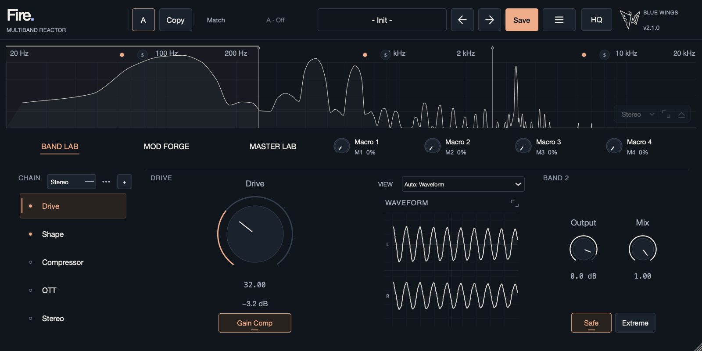

## 02. 介面與頻譜

頂欄提供 A/B 比較、Copy、Match、預設名稱、前後切換按鈕、Save、應用選單和 HQ。上方頻譜顯示輸入與處理後的音訊，同時提供頻段編輯功能。頻譜下方的三個工作區用於組織各類控制項。

| 工作區 | 用途 |
| --- | --- |
| **Band Lab** | 編輯當前所選頻段的效果鏈，以及該頻段的 Output 和 Mix。 |
| **Mod Forge** | 編輯 LFO 形狀、播放行為和 MIDI 配置，並開啟調變矩陣。 |
| **Master Lab** | 編輯所有頻段合併後訊號所經過的效果鏈。 |

每個音訊工作區都有一個 **CHAIN** 側欄。點選某一行即可開啟對應模組。處理模組旁的小開關用於啟用或停用模組，其外觀隨皮膚變化。原生 Band Shape 在 Serial 模式下存在一項相容性例外，詳見第 06 章。將滑鼠懸停在某一行上，或讓該行獲得焦點，即可顯示 **-** 移除控制項。使用 **+** 新增模組，使用 **...** 進行效果鏈複製、貼上和檔案操作。顯示 **Stereo**、**Mid** 或 **Side** 的緊湊按鈕用於開啟 Routing。

四個巨集控制項位於工作區標籤旁，便於隨時調整。巨集的數值和名稱隨聲音儲存。雙擊巨集名稱可重新命名，按 Enter 應用，按 Escape 取消。名稱最多 32 個字元；留空會恢復為“Macro 1”等預設名稱。雙擊巨集旋鈕會將數值歸零。重新命名不會改變該巨集在 DAW 中的自動化標識。

當圖表提供 **VIEW** 選單時，**Auto** 會根據當前模組自動選擇顯示內容。也可以手動選擇 Waveform、Transfer、Meters 或 Stereo，觀察同一訊號的不同特徵。例如，調整失真時可檢視傳輸曲線，判斷電平變化時則可選擇 Meters。OTT 使用專門的 **LIFT / PRESS** 顯示，包括在 Band 和 Master 中獨立新增的 OTT 例項。點選展開圖示可放大圖表；點選恢復圖示可回到正常控制項佈局。

### 頻譜控制項與頻段編輯

點選頻譜某個頻段的下半部分，可將其選中並在 Band Lab 中編輯。點選頻譜頂部條帶中的目標頻率位置，可建立分頻點，最多形成四個頻段。拖動分頻線可改變頻率，也可以編輯其頻率讀數。頻段開關和 **S** 控制項分別用於旁通或獨奏單個頻段。頻段的移除控制項可刪除該頻段；至少需要保留一個頻段。

當焦點位於頻譜背景本身時，按 **Return** 或 **+** 可拆分所選頻段，按 **Delete** 或 **Backspace** 可移除該頻段。如果焦點位於頻率輸入框等子控制項中，這些命令不會生效。

緊湊頻譜工具欄整合了聲道選擇、展開/恢復和摺疊控制項。閒置時工具欄會變為半透明；滑鼠懸停、鍵盤焦點進入或選單開啟時，會恢復為完整可見。摺疊頻譜可在三個工作區中釋放更多空間。工作區控制項旁的小型恢復按鈕可重新顯示頻譜。

| 頻譜模式 | 測量內容 |
| --- | --- |
| **Left / Right** | 單個輸入/輸出聲道。 |
| **Stereo** | 兩聲道合併後的能量；反極性聲道不會相互抵消。 |
| **Mono** | `(L + R) / 2`，包含單聲道求和產生的抵消。 |
| **Side** | `(L - R) / 2`，用於觀察立體聲差異。 |

此選項僅改變顯示。如果要改變音訊處理方式，請在效果鏈的 Routing 中選擇聲道。左右完全相同的音訊在 Side 中會消失；左右極性相反的音訊在 Mono 中會消失，這屬於正常現象。如果訊號僅出現在一個聲道，Stereo 讀數比該聲道單獨顯示時低約 3 dB，Mono 和 Side 則低約 6 dB。

### 讀懂控制項

旋鈕數值可能只在拖動、獲得焦點或編輯時顯示，而非始終可見。工具提示會說明控制項用途。調變會新增與調變源顏色對應的範圍標記和移動指示；基礎值與調變後的數值是兩個不同的概念。全屏圖表按鈕會放大當前檢視，並暫時隱藏其下方的控制項。收起檢視後，這些控制項會重新顯示。

編輯器保持 2:1 寬高比，支援從 1000 x 500 到 2000 x 1000 的尺寸。拖動視窗角落可調整大小；較大的視窗能為參數標籤和圖表細節提供更多空間。

## 03. 預設與 Sound Library

點選預設名稱可開啟 Sound Library。左側是分類，右側是具體預設。出廠預設庫共有 236 個預設：Vocals、Synths、Drums、Bass、Guitar、Keys、Spaces、Lo-Fi、Rhythm 和 Effects 各 20 個，Analog Drive 另有 36 個。使用者預設顯示在 **User** 中。出廠預設適合作為起點；編輯後請另存為使用者預設。

在搜尋框中輸入文字，可按預設的描述資訊篩選。點選某一行即可立即試聽。雙擊該行、點選 **Back to Reactor** 或按 Escape，可返回處理介面。搜尋框未獲得焦點時，使用上/下方向鍵可試聽相鄰預設。當前聲音保持高亮顯示。頂欄的前/後箭頭也可以逐個切換預設。

編輯器會在操作過程中記住當前分類、搜尋內容和滾動位置。**Recent** 最多儲存 24 個最近試聽過的預設。**Locate current** 會清空搜尋，並在對應分類中顯示當前播放的預設。最近記錄和瀏覽位置僅用於當前會話，不會寫入聲音檔案或 DAW 專案。

### 收藏、隱藏與恢復

點選預設旁的星形圖示，可將其加入 **Favourites** 或取消收藏。收藏記錄儲存在本地預設庫中。預設移除控制項的行為取決於預設來源：

| 預設型別 | 移除操作 | 恢復方式 |
| --- | --- | --- |
| 使用者預設 | 將檔案移入 Fire 的 **Recycle Bin**。 | 恢復到原有分類。 |
| 出廠預設 | 隱藏對應出廠條目。 | 從 Recycle Bin 恢復隱藏的預設。 |

恢復預設不會自動載入它，也不會覆蓋已有的使用者檔案。因此，移除預設條目與初始化當前聲音是不同的操作。需要回到初始聲音狀態時，請使用 **Menu > Init**。

### 標籤與描述

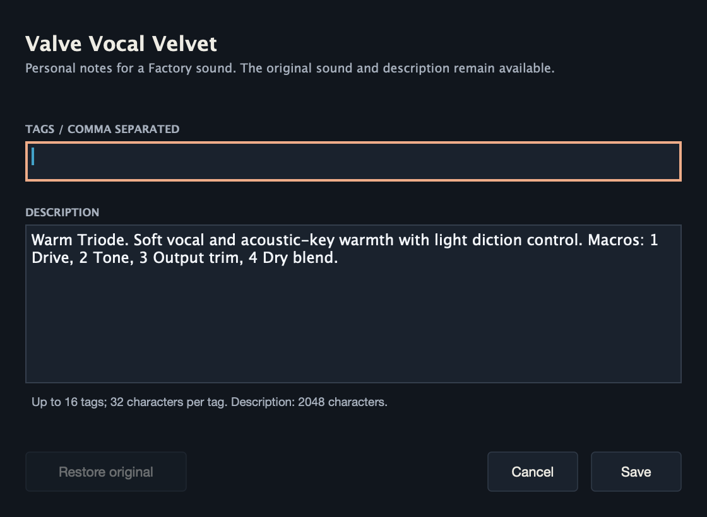

選中預設後，點選鉛筆/編輯詳情圖示，可修改標籤和描述。用逗號分隔標籤；如果標籤本身包含逗號，請將該標籤用引號括起來。Fire 最多接受 16 個標籤，每個標籤最多 32 個字元，描述最多 2,048 個字元。

使用者預設的這些資訊儲存在其 `.fire` 檔案內。編輯詳情會保留音訊設定及任何已凍結的錄音。覆蓋儲存預設會保留其備註；另存新版本時，則會繼承所選聲音的備註。對出廠預設的修改屬於個人預設庫的覆蓋資訊：點選 **Restore original** 可恢復原始標籤與描述。要編輯已歸檔使用者預設的詳情，請先將其恢復。如果詳情編輯器開啟期間檔案發生了變化，請重新開啟詳情後再儲存。

### 瀏覽預設時保留指定數值

> 多個模組具有同名控制項時，建議透過目標旋鈕的右鍵選單鎖定具體數值。鎖定會在載入聲音時保留基礎值；它不會凍結輸入音訊、停用調變，也不會自動鎖定整個模組。

預設參數鎖定可在載入或依次切換整個外掛的預設時，保留指定的**旋鈕基礎值**。例如，試聽不同聲音時，可以保持某個 Output 或 Mix 數值不變。

1. 右鍵點選支援鎖定的旋鈕，選擇 **Keep value when loading presets**。也可以開啟 **Menu > Preset parameter locks...**。
2. 在鎖定視窗中搜尋參數，並勾選需要保留的專案。**Locked only** 只顯示當前已鎖定的參數；**Unlock all** 可清除所有鎖定。
3. 載入另一個預設。已鎖定的基礎值將保留。由於當前聲音可能不同於已儲存的預設，名稱旁可能會出現正常的 `*` 已修改標記。

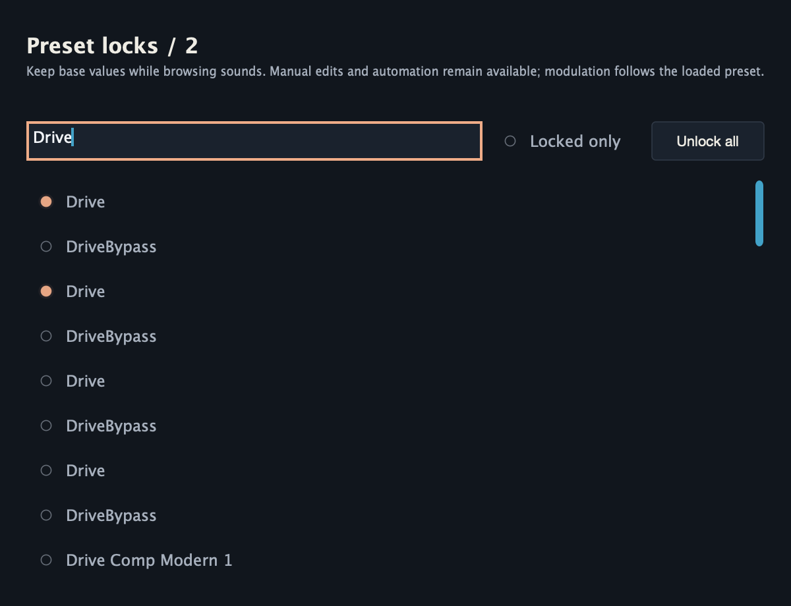

鎖定不會阻止手動編輯、宿主自動化或調變。新預設中的調變路由與源定義仍會載入，因此已鎖定的基礎值仍可能受到調變。結構性設定，包括頻段數量、分頻點、模組的存在與順序、路由模式和分支分配，均不能鎖定。鎖定偏好屬於例項的專案狀態，不屬於 `.fire` 預設。A/B 切換、撤銷/重做和專案恢復會還原完整狀態，而不會套用瀏覽預設時的鎖定規則。

### 不同內容儲存在哪裡？

| 儲存位置 | 主要內容 |
| --- | --- |
| 整個外掛的 `.fire` 預設 | 聲音參數、效果鏈、調變源與對映、巨集名稱、凍結音訊，以及使用者備註。 |
| `.firechain` 預設 | 一條效果鏈的模組與設定、聲道及並聯路由；可選擇包含指向該鏈參數的調變路由。 |
| DAW 專案 | 例項的完整狀態，包括 A/B Match 資訊和預設鎖定偏好。 |
| 本地偏好/預設庫 | 皮膚偏好、收藏、隱藏的出廠條目，以及出廠預設後設資料的覆蓋資訊。 |
| 當前編輯器會話 | 預設庫搜尋、滾動、最近瀏覽狀態，以及臨時檢測器監聽。 |

使用 **Menu > Open Preset Folder** 可開啟預設庫目錄；在 Fire 外部管理聲音檔案後，可使用 **Rescan Preset Folder** 重新掃描。請定期備份自己的預設和專案。

<!-- figure:landscape -->
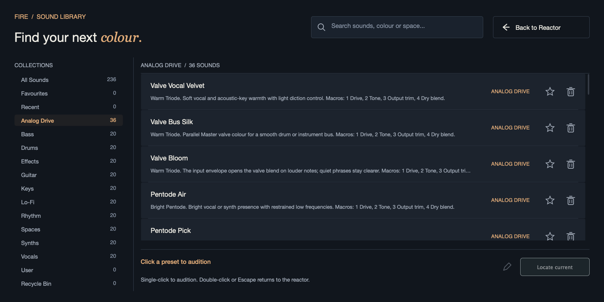

## 04. A/B、響度 Match 與編輯歷史

頂欄的 **A/B** 用於切換兩份完整聲音狀態。**Copy** 會將當前一側複製到另一側。這與並聯效果鏈內部的 **A/B 分支**不同：聲音狀態用於比較整套設定，而分支會同時處理音訊。

要進行等響度比較，請為兩份狀態迴圈播放同一段具有代表性的音訊。啟用 **Match**，讓當前一側學習約三秒鐘。切換 A/B，再讓另一側學習。每一側都會保留各自固定的 dB 補償值。Copy 也會複製該補償值。

點選數值/Learn 控制項可重新測量；測量期間再次點選可取消。關閉 Match 可聽到未經補償的電平。Match 不會移動 Output，也不會改動其自動化。宿主旁通會直接傳遞旁通訊號，並暫停學習。

顯示 **Play audio** 表示測量未獲得足夠的有效輸入與輸出；此前有效的結果會保留。顯示 **LIMIT** 表示所需補償超出了可用的 ±18 dB 範圍。Match 用於短時試聽比較，並非綜合 LUFS 測量儀。編輯過程中其補償保持固定，因此進行較大改動後應重新學習。載入聲音預設會清除該側的測量結果；如果 Match 仍處於啟用狀態，它會重新學習。Match 狀態和學習得到的增益儲存在專案中，獨立於 `.fire` 檔案。

### 撤銷與重做

使用 **Menu > Undo / Redo**、**Cmd/Ctrl-Z**、**Cmd/Ctrl-Shift-Z** 或 **Ctrl-Y**。撤銷會將一次常規旋鈕操作、模組複製或效果鏈替換等操作歸為有意義的編輯步驟。它也覆蓋 LFO 形狀、路由、EQ 節點和凍結素材的修改。關閉並重新開啟編輯器後，歷史記錄仍可使用；載入 DAW 專案則會重新開始記錄。音訊執行緒自動化不會為每次參數更新都建立一條撤銷記錄。Fire 在 64 MiB 快照預算內最多保留 100 次編輯；撤銷不會改變當前編輯器尺寸。

## 05. 效果鏈、並聯路由與 Mid/Side

Fire 將輸入劃分為一到四個頻率區域。所選 Band 效果鏈處理對應區域；各頻段輸出合併後，再交給 Master 效果鏈處理。

```text
輸入 -> 分頻 -> 各 Band 效果鏈 -> 合併 -> Master 效果鏈 -> 輸出
                  |  |  |  |
                 最多四個頻段
```

Band Lab 與 Master Lab 共用 Drive、Shape、Compressor、OTT、Stereo、EQ、Lo-Fi、Chorus、Flanger、Phaser、Delay、Reverb、Granular 和 Chord Resonator。原生模組與新增模組一樣，可以移除後重新新增。每條效果鏈最多有八個額外的獨立插入槽位。Analysis 是 Master 中可移除的顯示頁面，不處理音訊。

點選 **+** 並選擇模組。點選模組所在行可編輯它。拖動該行的名稱或主體區域可調整順序，插入線會預覽新位置。拖動時停留在側欄邊緣附近，可滾動到當前不可見的行。鬆開滑鼠即可確認。按 Escape、拖放到側欄外，或切換工作區/頻段，都會取消拖動。重排會保留模組的參數和路由。音訊模組按列表順序處理訊號，Band Output/Mix 位於該頻段效果鏈之後。

### 串聯、並聯與中置/側向處理

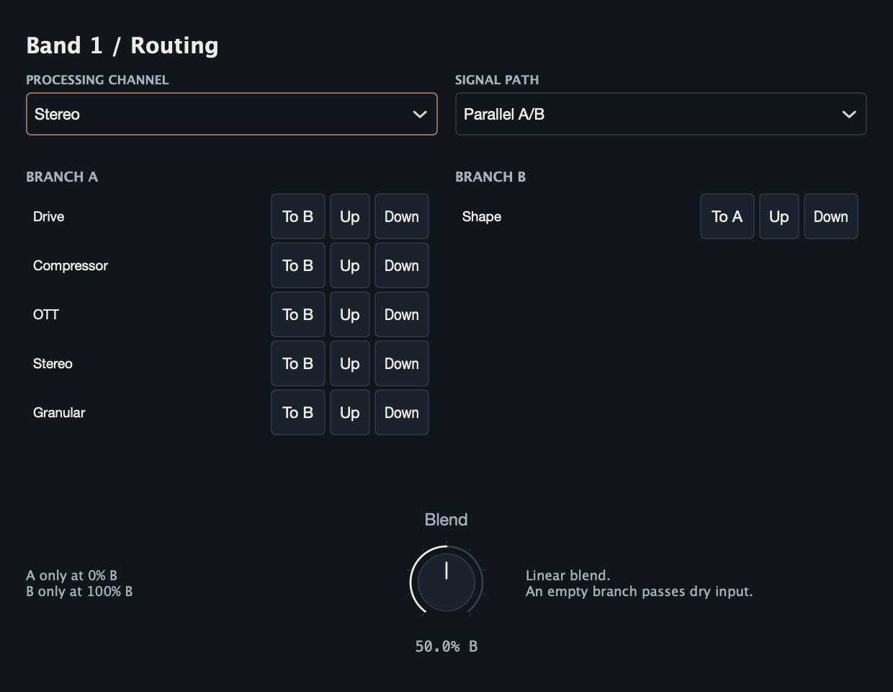

點選 CHAIN 旁緊湊的 Stereo/Mid/Side 按鈕，可開啟 Routing。

| 控制項 | 作用 |
| --- | --- |
| **Serial** | 模組依次串聯處理。 |
| **Parallel A/B** | 兩條分支接收同一個效果鏈輸入，再混合各自的輸出。 |
| **To A / To B** | 將模組移到另一條分支。模組行選單中也提供 **Move to Branch A/B**。 |
| **Up / Down** | 調整模組在分支內部的順序。 |
| **Blend** | 分支 B 的佔比：0% = 僅 A，100% = 僅 B。 |
| **Stereo** | 處理立體聲訊號。 |
| **Mid** | 處理中置分量，保留原始 Side 分量。 |
| **Side** | 處理側向差異分量，保留原始 Mid 分量。 |

並聯分支共用現有模組槽位，並不會額外生成另一組獨立的八槽效果架。空分支會原樣傳遞輸入。混合採用線性方式，因此兩條分支完全相同時，總體保持單位增益。即使 Blend 位於端點，兩條分支也會持續執行，使延遲和殘響的歷史狀態保持更新。分支會在合併前對齊延遲；所在頻段或母線的 Output/Mix 位於合併之後。Mid/Side 處理包裹整條效果鏈，包括兩條並聯分支。

進行並聯壓縮時，可將 Compressor 或 OTT 放在 B 分支，讓 A 保持為空，再從 0% 開始逐漸提高 Blend，直到細節與密度適合素材。要混合不同音色，可在 A、B 兩條分支中分別放置不同的 Shape 模組。Blend 支援常規調變和宿主自動化，可在矩陣中找到 **Routing / Blend**。切回 Serial 後，分支分配和 Blend 數值會保留，以便稍後使用。路由結構和分支分配支援宿主自動化，但不能作為外掛內部的調變目標。

選擇 Mid 或 Side 後，適用的頻段或母線輸出控制項僅作用於選中分量。立體聲效果的輸出會重新求平均並歸入該分量，避免處理結果洩漏到未處理的另一分量。對於單聲道輸入，Mid 的行為與 Stereo 相同，Side 則以相同延遲直通。頻譜分析器中的 **Side** 僅用於顯示差異，不會啟用這裡的處理模式。

### 複製單個模組

右鍵點選模組行，或讓該行獲得焦點後按 **Shift+F10**。

- **Copy settings**：複製模組設定，不包含指向該模組參數的調變路由。
- **Copy with routing**：同時包含上述調變路由。
- **Duplicate settings**：在源模組之後立即插入一份僅含設定的副本。
- **Paste ... after**：將已複製模組插入所選行之後。向空效果鏈貼上時，可使用 **+** 選單中的已複製模組條目。

複製的模組會保留其分支分配，但不會改變目標效果鏈的路由模式、Blend 或 Stereo/Mid/Side 模式。模組剪貼簿與效果鏈剪貼簿彼此獨立；在同一程序中，相同外掛格式的 Fire 例項可以共享這些剪貼簿。

### 複製或儲存整條效果鏈

開啟效果鏈的 **...** 選單。**Copy chain settings** 或 **Copy chain with routing** 會按順序複製音訊模組。**Paste chain** 僅替換目標效果鏈；其他頻段、Master、分頻點、Output/Mix 和全域性調變源均保持不變。複製一條空效果鏈，可用於清除另一條效果鏈中的音訊模組。Analysis 不會被包含在內。

使用 **Save chain preset...** 可儲存僅含設定的 `.firechain` 檔案；使用 **Save chain preset with routing...** 可同時包含對映。**Load chain preset - replace...** 會用檔案中的內容替換當前效果鏈。效果鏈檔案儲存在預設目錄中的 **Chains** 資料夾，包含聲道/並聯路由，以及模型、EQ 節點和凍結音訊等模組資料。

“With routing”會複製指向目標參數的對映、範圍、曲線，以及調變深度的巨集分配。它使用目標例項當前的 LFO、包絡、巨集和 MIDI CC 配置，不會覆蓋這些調變源定義。如果需要完整保留原始聲音，請使用整個外掛的預設。

Fire 會在修改目標前檢查整套貼上內容能否放入相容槽位。有些原生模組需要對應的相容核心實現：原生 Master Lo-Fi 使用不同的引擎；採用 Legacy Link 的 Drive 可能需要原生 Drive 槽位，或轉換為 Drive Comp。如果無法完整保留必要的設定或路由，Fire 會說明原因，並保持目標不變。

### 順序與三個層級的 Mix

順序同時影響音色和動態。失真前的 EQ 決定哪些頻率更強烈地驅動失真；失真後的 EQ 則用於調整已經生成的諧波。失真前的壓縮器可穩定驅動電平，失真後的壓縮器則控制處理後的訊號。將 Delay 放在失真前，可讓每次重複與失真相互作用；放在失真後，則重複已經失真的聲音。

模組的 **Mix** 通常混合該模組輸入與自身處理後的訊號。在原生 Band 中相鄰的 Drive > Shape 路徑下，Shape Mix 會混合整個組合失真級，包括 Drive。**Band Mix** 混合整條頻段效果鏈與該頻段的幹聲；全域性 **Mix** 混合整體效果與其幹聲路徑。這些混合比例會疊加：較低的模組 Mix 再接較低的 Band Mix，會讓效果變得很輕。**Output** 控制電平，而不是失真量。請使用輸出微調來平衡音量，並在修改效果鏈後重新檢查電平。

> 要把某條並聯分支作為真正的幹聲參照，請先移走或刪除其中的處理模組。Routing 示例截圖中的 A 分支包含模組，並非空的幹聲分支。原生 Band Shape 在 Serial 模式下保留了一條相容路徑，詳見第 06 章。

## 06. Drive 與 Shape

Drive 與 Shape 是 Fire 失真操作的核心。**Drive** 提高進入非線性處理級的電平。**Shape** 選擇傳輸曲線或模擬音色，並調整其不對稱性。在原生頻段效果鏈中，相鄰的 Drive > Shape 模組使用組合處理路徑。將二者分開後，它們會成為獨立處理級，因此插在中間的效果會影響送入 Shape 的訊號。

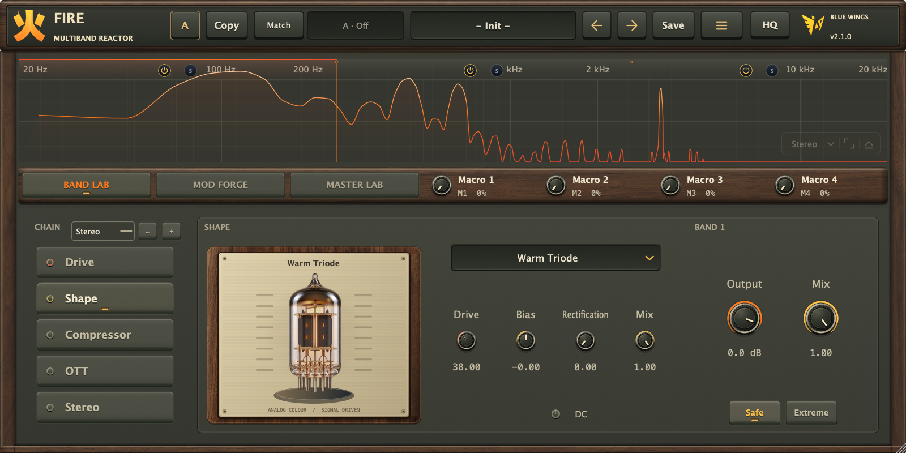

### Drive、Safe 與補償

| 控制項 | 實際作用 |
| --- | --- |
| Drive | 輸入增益量，控制項刻度為 0-100。通常數值越高，聲音越密集、失真越明顯，但結果取決於音源和 Shape。 |
| Safe | 根據輸入峰值限制實際 Drive，可能使實際施加的驅動量低於旋鈕設定值。 |
| Extreme | 大幅增加同一 Drive 設定所能提供的增益。啟用時請從較低數值開始。 |
| Gain Comp / Comp | 根據實際使用的驅動量估算電平衰減，便於比較，同時保持 Output 可獨立調整。 |
| Output | 對應效果鏈之後的手動電平微調，不是另一個失真控制。 |

Safe 用於管理驅動量，不是最終母線限幅器。Gain Comp 屬於估算，而非響度測量。其動態讀數反映實際施加的補償；無法獲取當前音訊遙測時，會用近似符號標明估算值。需要實際測量整條效果鏈的電平差異時，請使用頂欄的響度 Match 流程。

較早的聲音可能顯示 **Legacy Link**。該模式保留 Drive 與最終 Band Output 之間原有的關聯。點選 **Use Drive Comp** 會明確將該頻段切換至新的補償方式，並重新啟用已儲存的手動 Output 設定，因此聲音可能發生變化。在並聯效果鏈中，Legacy Link 會影響最終 Band Output，也就影響兩條分支；新的補償方式則只作用於 Drive。

### Shape 控制項

在 Shape 選擇器中選擇模型。**Bias** 讓訊號相對於整形曲線發生偏移，以產生不對稱性，範圍為 -1 至 +1。**Rectification** 改變整形後波形的負半部分：0 保留原有極性，0.5 移除負半部分，1 則將其翻轉為正。中間值在這些行為之間混合。Bias 和整流可能引入直流偏移，因此請按需啟用 **DC** 或 **DC Filter**。**Mix** 混合整形結果與輸入；在原生 Band 中相鄰的 Drive > Shape 路徑下，它作用於整個組合失真級，包括 Drive。

> **Serial 模式下的原生 Band Shape：**為保持相容性，關閉該模組時仍會保留選中的失真曲線，但會停用 Bias、Rectification 和 DC 濾波，並忽略已儲存的 Shape Mix。移除原生 Shape 行後，Serial 模式也會保留這一行為。因此，Shape 控制項變灰並不保證訊號完全乾淨。要進行幹聲比較，請將 Band Mix 設為零，或旁通整個頻段。獨立新增的 Shape 使用常規乾溼旁通；在 Parallel A/B 模式下，原生 Shape 關閉或移除時，其曲線也會被旁通。

原生 Band 的模擬頁面使用該頻段的 Drive 控制項。獨立新增的模擬 Shape 模組擁有各自的 Drive，因此可以在同一效果鏈中設定多個驅動量不同的音色處理級。在獨立模擬 Shape 中，區域性 Drive 會直接控制模型；不要將獨立 Drive 模組的開關誤認為屬於該 Shape 例項。

**HQ** 使用更高取樣率的失真處理路徑，以減少不需要的混疊。對於明亮、強驅動的素材，以及使用折返整形的設定，差異可能更明顯。HQ 會增加 CPU 用量，請按實際使用時的質量設定試聽。傳輸圖可幫助理解靜態波形整形曲線，但無法描述磁性模型或受供電狀態影響的模擬模型中所有隨時間變化的特徵。

### 數字 Shape 模型

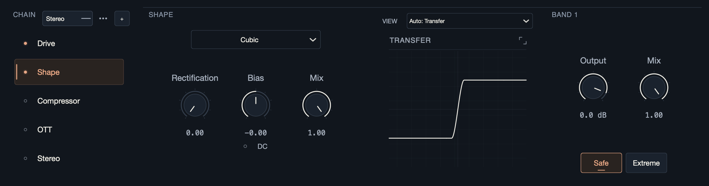

| 模型 | 特徵與建議起點 |
| --- | --- |
| Arctan | 圓潤、逐漸進入飽和的曲線，適合剋制的染色。 |
| Exp | 指數軟飽和，進入削波的過渡方式有所不同。 |
| Tanh | 平滑、對稱的飽和，適合通用的增厚處理。 |
| Cubic | 圓潤的多項式削波，也是預設數字模型。 |
| Hard | 在曲線極限處突然削波，產生較強的高次諧波。 |
| Sausage | 較為堅實的曲線，接近削波處的轉角經過軟化。 |
| Sin | 重複的正弦折返；提高 Drive 可能帶來複雜變化，而不僅是更多削波。 |
| Linear | 類似三角波的折返，轉折更有稜角。 |
| Limit | 將訊號削波到較窄的電平範圍。選擇後請憑聽感補償電平。 |
| Single Sin | 使用單個正弦形區域，並抑制該區域之外的樣本；高 Drive 時可產生特殊質感。 |
| Logic | 保留的歷史選項，當前穩定傳輸曲線與 Tanh 等效。 |
| Pit | 帶有高電平減法分量的飽和曲線，適合不常規的高驅動動態變化。 |

這些名稱描述 Fire 提供的曲線，並不承諾復現某款商業失真處理器的音色。進行受控比較時，請將 Bias 和 Rectification 均設為零，每次只選擇一條曲線，並在判斷前平衡輸出電平。

### Analog Hardware 模擬音色

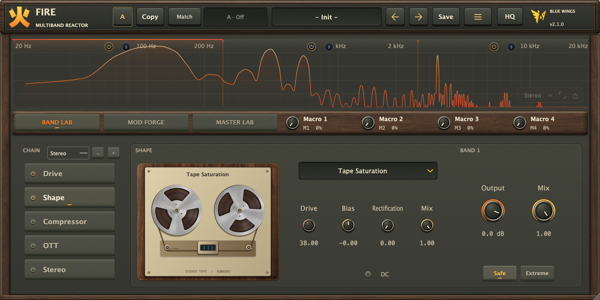

這些模型的音色設計參考了電路機制，但並不是對特定硬體的校準復刻。放大器模型包含供電和工作點行為；Transformer 與 Tape Saturation 包含磁性記憶。它們的響應取決於音訊的電平及歷史狀態，因此持續音與尖銳瞬態不一定產生相同的表現。

| 模型 | 建議用途 |
| --- | --- |
| Warm Triode | 為人聲、貝斯或鍵盤加入溫和、不對稱的電子管風格暖度。 |
| Bright Pentode | 更靠前的電子管音色，適合需要存在感的素材。 |
| Class A Console | 為單軌或母線加入細微的調音颱風格密度。 |
| Tweed Breakup | 柔和、有彈性的吉他風格破音與動態 crunch 質感。 |
| British Crunch | 更強、中頻更突出的 crunch 音色，適合吉他和節奏素材。 |
| Modern High Gain | 級聯、密集的失真，適合具有攻擊性的音色。 |
| Diode Overdrive | 集中的過載音色，適合主奏、貝斯清晰度或鼓組重音。 |
| Germanium Fuzz | 不對稱 fuzz，性格較柔和、偏暗。 |
| Silicon Fuzz | 更明亮、堅實的 fuzz，具有明顯的高次諧波。 |
| MOSFET Drive | 不對稱驅動音色，介於溫和飽和與較硬過載之間。 |
| Transformer | 磁性染色，以及受歷史狀態影響的飽和。 |
| Tape Saturation | 帶偏磁的磁記錄音色，包含錄音/回放與磁頭損耗整形。 |

這些描述用於指導試聽，並不保證固定的音色結果。Tape Saturation 是通用磁帶模型，不提供帶速、偏磁或磁頭型別選擇器。Lo-Fi 中獨立的 Tape/Wow/Flutter 控制項則服務於另一類效果。

電子管亮度同時跟隨輸入聲音與 Drive，因此僅將 Drive 調高，並不會讓無聲狀態下的電子管發亮。磁帶卷盤隨音訊活動轉動，處理停止後會逐漸停穩。圖形用於反饋活動狀態，並非經過校準的電氣儀表。Paper 與 Ink 使用這些顯示的線條示意版本，底層聲音保持不變。

## 07. Compressor 與 OTT

### Compressor 壓縮器

Compressor 按 **Ratio** 設定的比例，壓低超過 **Threshold** 的訊號。**Attack** 決定增益衰減開始響應的速度，**Release** 決定恢復的速度。較慢的起音通常能保留更多最初的衝擊；較快的起音則會捕捉更多初始峰值。可先將 Ratio 設在約 2:1 至 4:1，逐漸降低 Threshold，直到聽到壓縮效果，再結合節奏調整時間參數。

| 控制項 | 原生 Band Compressor | 新增 Compressor 例項 |
| --- | --- | --- |
| Threshold | -48 至 0 dB | -60 至 0 dB |
| Ratio | 1:1 至 20:1 | 1:1 至 20:1 |
| Attack | 0.1-200 ms | 0.1-200 ms |
| Release | 10-2000 ms | 1-1000 ms |
| Mix | 幹聲至完全處理後的訊號 | 幹聲至完全處理後的訊號 |

原生 Band 模組保留歷史參數範圍；在 Band 或 Master 中新增的例項使用上表的新增模組範圍。Ratio 為 1:1 時不會產生壓縮。Compressor 沒有專用補償增益旋鈕，請使用適當的 Output 控制項或效果鏈安排來恢復電平。降低 Mix 可在模組內部實現並聯壓縮；也可以使用效果鏈的並聯分支，分別處理幹聲與壓縮訊號。

### OTT：抬升輕微細節，壓低響亮峰值

原生 Band 模組將閾值標為 **Up Thresh** 和 **Down Thresh**，輸出微調標為 **Gain**。獨立新增的 OTT 則用 **Up**、**Down** 和 **Output** 表示相同的功能。

OTT 同時使用向上壓縮和向下壓縮。它會抬高低於 **Up / Up Thresh** 的較輕訊號，壓低高於 **Down / Down Thresh** 的較響訊號，而兩者之間的區域受影響較小。頻率分離由 Fire 本身的多頻段分頻完成：單個 Master OTT 處理其完整輸入訊號，不會在內部另外建立一套分頻頻段。

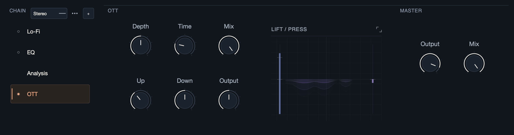

| 控制項 | 範圍與作用 |
| --- | --- |
| Depth | 總體動態處理強度，從零到最大。原生 Band 顯示 0-1，新增例項顯示百分比。 |
| Time | 10-400%，同時縮放起音與釋放時間。100% 對應 5 ms 起音和 100 ms 釋放。 |
| Up / Up Thresh | -72 至 -6 dB，較輕訊號的閾值。始終比向下壓縮閾值至少低 6 dB。 |
| Down / Down Thresh | -36 至 0 dB，較響訊號的閾值。 |
| Output / Gain | -24 至 +24 dB，動態處理之後的電平微調。 |
| Mix | 幹聲至完全處理後的訊號。 |

向上與向下壓縮使用固定的 4:1 和 8:1 比率，並具有軟拐點。向上增益受到限制，並會在接近噪聲底時逐漸消退；OTT 不會憑空生成噪聲。兩個聲道共用檢測器和增益，以保留立體聲關係。

**LIFT / PRESS** 檢視顯示所選模組的活動。向上抬起的帶狀圖形表示向上壓縮，向下壓動表示向下壓縮。每個獨立新增的 OTT 都有自己的讀數，包括 Master Lab 中的例項。動態圖形不包含 Output 微調，因此單獨轉動 Output 並不代表壓縮變強。

對於原生 Band OTT，還可以直接調整頻譜中的閾值線。上下拖動線條可修改閾值，雙擊可重置，獲得焦點後可用方向鍵精細調整。建議從適中的 Depth 開始；如果房間聲或噪聲變得過於突出，請適當減小。Time 低於 100% 時會強化快速響應，較長設定則讓變化更緩慢。

## 08. Stereo 立體聲

Stereo 包含 **Width**、**Pan** 和 **Mix**。Width 用於改變立體聲訊號中中置分量與差分分量的比例。原生 Band 模組的中性位置為 **0.50**，新增模組則為 **50%**。較低的設定偏重中置分量，較高的設定偏重側向分量。調至兩端時，另一種分量會被移除，因此 100% 並不只是“將普通立體聲拓寬到最大”。

Pan 向左或向右移動時，會衰減另一側聲道。Mix 將立體聲處理結果與模組輸入混合。拓寬需要訊號本身包含立體聲資訊：沒有差分分量的居中訊號，無法僅靠 Width 產生獨立的側向細節。單聲道處理匯流排會旁通這一立體聲處理。

使用較大的寬度時，可將頻譜顯示設為 **Mono**，並實際用單聲道監聽對比。強調差分訊號來拓寬立體聲，可能使單聲道疊加後的音量明顯降低。此時可減小 Width、降低模組 Mix 以保留更多幹聲，或讓低頻段的寬度更接近中性位置。

## 09. EQ 與動態均衡

每個 EQ 最多支援 **12 個頻點**。選中帶編號的頻點後，可編輯其 **Frequency**、**Gain**、**Q**、**Filter Type**，以及適用時的 **Slope**。用 **+** 新增頻點，用 **-** 刪除頻點。每個頻點都有獨立的開關。模組旁通時仍可編輯 EQ；新增頻點會啟用模組，便於試聽。

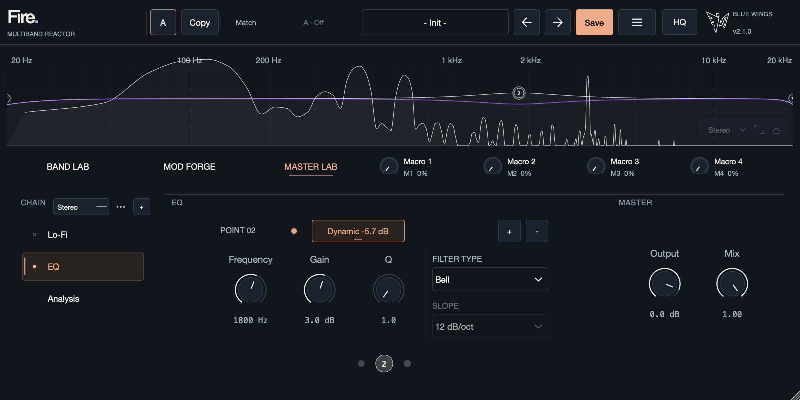

### 靜態 EQ

| 型別 | 用途 |
| --- | --- |
| Bell | 提升或衰減所選頻率附近的內容。 |
| Low cut | 移除截止頻率以下的低頻內容。 |
| High cut | 移除截止頻率以上的高頻內容。 |
| Low shelf | 調整較寬的低頻區域。 |
| High shelf | 調整較寬的高頻區域。 |
| Notch | 移除狹窄的頻率區域；Gain 不可用。 |
| Band pass | 保留中心頻率附近的區域；Gain 不可用。 |

Low cut 和 High cut 提供 **12、24、36 或 48 dB/oct** 的斜率。Q 控制頻寬或共振程度。Gain 範圍為 -24 至 +24 dB。Frequency 範圍為 20 Hz-20 kHz，實際可用的頻率響應還取決於宿主取樣率。新增 EQ 模組的頻點提供 0.1-20 的 Q 範圍。原生 Master EQ 的前三個頻點保留 1-5 的 Q 範圍，後續頻點的 Q 範圍則為 0.1-18。

原生 Master EQ 還支援直接在頻譜上編輯。在頻譜空白處雙擊，可在該位置新增 Bell 頻點；拖動頻點可改變頻率和增益，在頻點上滾動滑鼠可調整 Q。當該頻譜獲得焦點時，按 Delete/Backspace 可刪除所選頻點。這些操作屬於 Master EQ 編輯檢視，不要與在頻段頻譜上新增分頻點的操作混淆。

### 動態 EQ

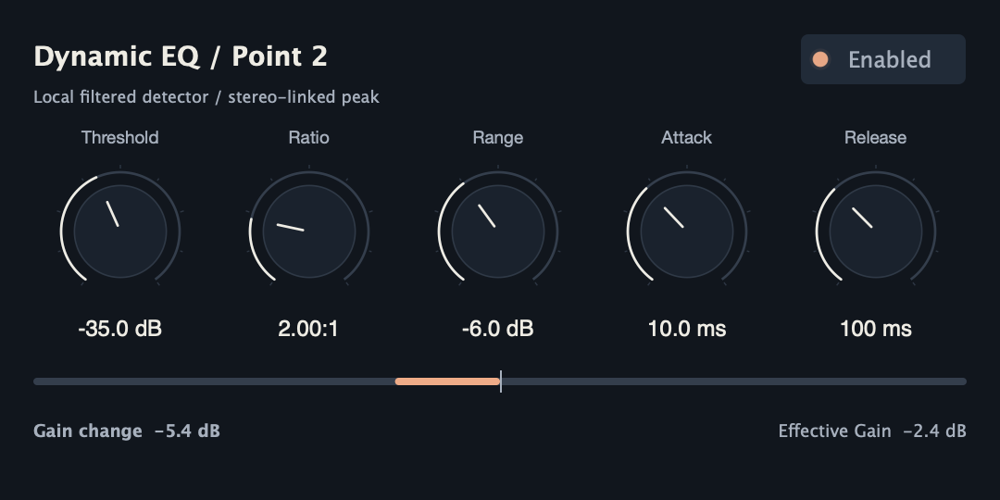

選擇 **Bell**、**Low shelf** 或 **High shelf**，然後在頻點標題欄開啟 **Dynamic** 並啟用。其他濾波器型別不提供動態處理。

| 控制項 | 含義 |
| --- | --- |
| Threshold，-60 至 0 dB | 電平高於此閾值時，檢測器開始請求增益變化。 |
| Ratio，1:1-20:1 | 控制隨電平變化的響應強度；1:1 時不產生變化。 |
| Range，-24 至 +24 dB | 帶方向的最大增益變化量：負值衰減，正值提升。 |
| Attack，0.1-200 ms | 對電平升高作出響應的速度。 |
| Release，5-2000 ms | 恢復速度。 |

檢測器監聽 EQ 模組的原始輸入，對該頻點頻率附近的訊號進行濾波，並取左右聲道中較高的峰值。它不是外部側鏈選擇器，也不會串聯接收同一 EQ 中前面頻點處理後的訊號。基礎 Gain 與動態增益之和保持在 ±24 dB 以內。

播放音訊時，可觀察動態增益變化量和實際增益讀數。原生 Master EQ 的即時曲線會跟隨實際增益變化，但可拖動的頻點和 Gain 旋鈕仍保留基礎設定。動態參數支援宿主自動化、預設、參數鎖定和鏈路複製；它們不能作為 Fire 內部調變的目標。Frequency、Gain 和 Q 仍支援常規調變。

## 10. Chorus、Flanger 與 Phaser

這些效果透過各自內部的週期性掃動，為聲音增加運動感。Rate 旋鈕以赫茲為單位；不要將這些內部振盪器與獨立的 LFO 庫混淆。Fire 的調變系統仍可改變這些效果對外提供的控制參數。

| 效果 | 控制項與範圍 |
| --- | --- |
| Chorus | Rate 0.05-8 Hz；Depth 0-100%；Delay 5-30 ms；Feedback -75 至 +75%；Width 0-100%；Mix 0-100%。 |
| Flanger | Rate 0.05-8 Hz；Depth 0-100%；Delay 0.1-10 ms；Feedback -90 至 +90%；Width 0-100%；Mix 0-100%。 |
| Phaser | Rate 0.05-8 Hz；Depth 0-100%；Center 40-6000 Hz；Feedback -85 至 +85%；Width 0-100%；Mix 0-100%。 |

Chorus 用不斷變化的短延遲增厚聲音，併產生音高運動。Flanger 使用更短的掃動延遲，與幹聲混合時形成帶金屬感的梳狀響應。Phaser 使用六級全通濾波鏈，讓移動的凹陷頻段形成較圓潤的掃動感。

Depth 設定掃動幅度。Chorus/Flanger 的 Delay 設定中心延遲時間；Phaser 的 Center 設定掃動所在的頻率區域。Feedback 增強共振，負值會帶來不同的音色。Width 改變兩個聲道之間的掃動偏移，設為零時兩側掃動對齊。Mix 決定幹聲與處理訊號如何相互作用。

若希望聽到明顯的 Flanger/Phaser 相消效果，可從約 50% Mix 開始。較慢的 Rate 和適中的 Depth 適合鋪底音色；較快的 Rate 可讓打擊樂或鍵盤更有動感。100% 溼聲時，由於幹聲不再參與相消，音色可能明顯不同。

## 11. Delay 延遲

Delay 提供 **Time**、**Feedback**、**Tone**、**Ping-Pong**、**Sync** 和 **Mix**。Sync 設為 **Free** 時，Time 範圍為 **10-2000 ms**。同步選項為 **1/16、1/8、1/8 D、1/4、1/4 D、1/2 和 1 Bar**，其中 D 表示附點。同步延遲跟隨宿主速度，但受兩秒延遲容量限制。宿主速度較慢時，較長的時值可能達到這一上限，無法實現完整的標稱時長。

Feedback 範圍為 0-90%，控制回聲的重複程度。Tone 範圍為 500 Hz-18 kHz，對反饋路徑進行濾波：值越低，後續回聲越暗。Ping-Pong 範圍為 0-100%，從普通立體聲延遲逐步變為在兩個聲道之間交替的延遲。Mix 設定回聲相對於幹聲輸入的比例。

製作人聲短回聲時，可使用 Free 模式，將 Time 設為約 80-130 ms，並採用較低的 Feedback 和較小的 Mix。製作節奏性運動時，可選擇附點八分音符和適中的 Feedback；如果回聲與原聲爭搶空間，再降低 Tone。在專用返回軌上，可從 100% Mix 開始；作為插入效果時，建議從低得多的 Mix 開始。

## 12. Reverb 殘響

可選擇 **Classic、Room、Hall、Plate、Spring 或 Chamber**。它們共用相同的六個控制項，比較不同模型時不必重新熟悉另一套面板。

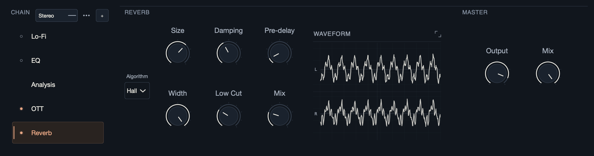

| 控制項 | 含義 |
| --- | --- |
| Size，0-100% | 改變空間與衰減特性；它不是經過標定的衰減時間讀數。 |
| Damping，0-100% | 數值越高，迴圈反饋的殘響尾音越暗。 |
| Pre-delay，0-200 ms | 殘響訊號出現前的延遲，有助於將聲源與尾音分開。 |
| Width，0-100% | 殘響的立體聲擴充程度。 |
| Low Cut，20-1500 Hz | 移除進入殘響的低頻能量。 |
| Mix，0-100% | 幹聲與殘響的比例。 |

**Classic** 保留 Fire 原有的殘響特性。**Room** 適合從緊湊的環境感和可辨識的早期反射入手。**Hall** 適合更寬廣、隨時間展開的空間。**Plate** 能為人聲、軍鼓或持續音構建密集的尾音。**Spring** 帶有色散感和彈簧式音色，適合吉他與聲音設計。**Chamber** 提供另一種早期反射與衰減結構，質感介於貼近與寬闊之間。這些都是演算法殘響，不是對特定房間或硬體進行卷積取樣的結果。

切換模型時，外掛會在經過幹聲的淡變過程中清除前一模型的延遲歷史，因此不要期待舊尾音原樣延續。若要提高人聲清晰度，可先嚐試增大 Pre-delay 和 Low Cut，再考慮直接降低 Mix。若要保留鼓的衝擊力，可選擇聽感更短的 Size，少量加入殘響，或將它放在並聯分支上。

## 13. Lo-Fi 低傳真

Lo-Fi 將取樣率降低、量化和磁帶式運動結合起來。**Rate** 是降取樣倍數：數值越大，取樣保持的時間越長，聲音也越粗糙，更有低取樣率質感。**Bits** 降低振幅解析度。**Jitter** 改變取樣保持的時序，並非額外加入一條噪聲軌。

**Tape** 增加飽和並柔化高頻。**Wow** 增加緩慢的音高漂移，**Flutter** 增加較快的變化。**Mix** 混合完整的 Lo-Fi 處理結果。可先將 Tape/Wow/Flutter 設為零，清楚地聽辨降取樣與位元深度降低的效果，再逐項新增音色變化。

原生 Master Lo-Fi 保留 **1-64** 的 Rate 範圍和 **4-32** 的 Bits 範圍。新增 Lo-Fi 模組使用 **1-32** 的 Rate 範圍和 **4-24** 的 Bits 範圍，Tape、Wow、Flutter 和 Jitter 均可從零調至最大。原生控制項可能顯示正規化的 0-1 數值，而新增模組以百分比顯示；它們在聲音設計中的作用相同。

製作老化的鍵盤音色時，可採用輕度降取樣、較高的 Bits、少量 Tape 和緩慢的 Wow。製作粗糲的鼓聲時，可先降低 Bits，再提高 Rate 和 Jitter，直到起音呈現所需的顆粒感。Lo-Fi 中的 Tape 是簡潔的染色控制；專用的 **Shape > Tape Saturation** 則採用更細緻的磁性模型。

## 14. Chord Resonator 和弦共振器

Chord Resonator 用輸入音訊激勵一組經過調諧的諧波共振單元。它尤其適合打擊樂、噪聲及諧波豐富的素材。它不會識別歌曲的調性，也不會把任意音符重新調音到某個音階。

**Root** 可選 **C2 至 C5**；**Chord** 可選 **Major、Minor、Major 7、Minor 7、Sus 2、Sus 4、Fifth 或 Octave**。音符讀數顯示和弦配置。在 Fire 的命名中，中央 C 為 C4。

**Color** 調整基音與高次諧波的比例。**Decay** 設定標稱衰減 60 dB 所需的時間，範圍為 **0.05-3 秒**。**Width** 將各聲部分散到立體聲空間中；設為零時，每個聲部的左右權重相同，同時保留輸入訊號的立體聲聲道。**Mix** 平衡聲源起音與持續共振的和弦聲。

可在打擊樂迴圈上從預設的 C3 Minor 7、適中的 Decay 和較低的 Mix 開始。選擇與歌曲相符的 Root。如果希望低頻基音保持直接，可將它放在中高頻段。不需要 MIDI 輸入，激勵訊號來自音訊。沒有新的輸入音訊時，只會繼續播放已有尾音。

## 15. Granular、Freeze 與取樣檔案

Granular 使用 Fire 改編的 Mutable Instruments Clouds **普通粒子模式**。它將輸入音訊錄入短時滾動緩衝區，再重疊播放其中的聲音片段。引擎採用 **32 kHz、立體聲、16-bit** 音訊，並在輸入與輸出時轉換至宿主取樣率。這是其音色的一部分；透明的幹聲訊號則單獨保留。

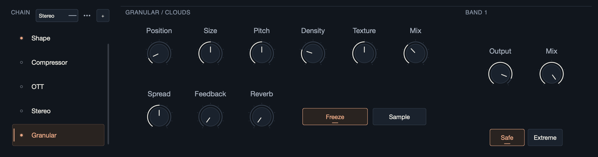

### 粒子控制項

| 控制項 | 操作 |
| --- | --- |
| Position | 選擇錄音中的位置；順時針轉動會移向更早的音訊。 |
| Size | 粒子長度控制，範圍為 0-100%。 |
| Pitch | 將粒子移調 -24 至 +24 個半音。 |
| Density | 負值一側規律地安排粒子，正值一側隨機安排粒子；中心位置不產生新粒子。 |
| Texture | 從較銳利的粒子包絡逐漸變為較平滑的包絡；較高設定增加擴散。 |
| Spread | 粒子在立體聲空間中的分佈。 |
| Feedback | 將粒子處理的輸出反饋至處理路徑。 |
| Reverb | 新增 Clouds 引擎自身的殘響。 |
| Mix | 輸入幹聲與粒子處理輸出的比例。 |
| Freeze | 停止更新錄音，粒子則繼續播放。 |

如果啟用 Freeze 後沒有聲音，請確認已有錄音、Density 不在中心位置，且 Mix 大於零。Freeze 保留的是素材，並不會自動將每個粒子或殘響尾音都固定在完全相同的狀態。錄音為空時，模組會先捕獲新的音訊，再將其凍結。

### 捕獲即時音色

1. 關閉 Freeze，讓一段短素材透過 Granular 模組播放。
2. 將 Density 調離中心，並將 Mix 提高到能聽清粒子的程度。
3. 在想要保留的時刻按下 **Freeze**。
4. 凍結素材繼續播放時，嘗試調整 Position、Size 和 Pitch。
5. 加入適量 Feedback 或 Reverb，讓音色更持久。
6. 儲存預設或宿主專案，將凍結錄音與音色一同儲存。

完成捕獲的凍結錄音會嵌入預設、專案狀態、A/B 快照和可移植的模組/鏈路檔案。重新載入時會恢復錄音，包括其立體聲內容和環形緩衝區位置；已安排的粒子以及延遲/殘響歷史則會重新開始。凍結音色要繼續播放，宿主必須持續處理音訊。

### 匯入檔案

點選 Freeze 旁的 **Sample**，開啟 **Granular / Sample**，再點選 **Choose audio**。透過檔案選擇器選擇支援的單聲道或立體聲檔案；可解碼的檔案格式取決於構建版本和平台。支援原始檔取樣率 **8-384 kHz**。單聲道素材會複製到兩個聲道。

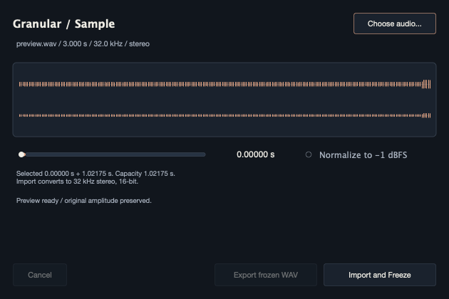

錄音最長為 **1.02175 秒**，即 **32 kHz 下的 32,696 個立體聲幀**。這一上限不會隨宿主取樣率提高而增長。對於較長的原始檔，可移動起始位置控制項或輸入起始時間，再檢查所選片段的波形。波形只提供匯入區段的視覺預覽，並不是獨立的試聽播放按鈕。

**Normalize to -1 dBFS** 預設關閉。啟用後，會在取樣率轉換後按左右聲道共用的峰值進行正規化，且不改變兩者的相對平衡。保持關閉可保留振幅；若源峰值超出目標格式的範圍，可能發生削波。片段準備好後，點選 **Import and Freeze**。Fire 只替換當前模組的錄音，並啟用 Freeze；播放期間會對溼聲進行短暫過渡。

一次匯入對應一步 Undo。撤銷可以恢復此前的凍結錄音及其設定。如果模組先前處於即時錄音狀態，撤銷會恢復即時模式，但無法重建之前的滾動音訊。匯入的錄音會直接嵌入，因此原始檔不必繼續保留在磁碟上。關閉編輯器或替換目標模組時，會取消尚未完成的匯入，而不會將其改送至其他位置。

### 匯出凍結素材

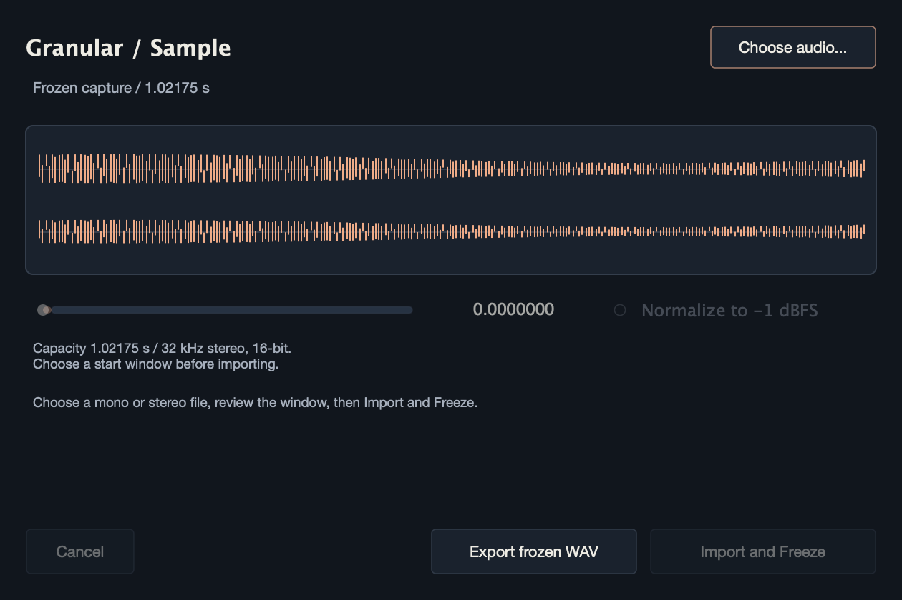

存在有效的凍結錄音時，開啟 Sample 並點選 **Export frozen WAV**。選擇目標位置；如果檔案已存在，確認是否覆蓋。Fire 會在目標位置選擇器開啟前取得錄音快照，因此之後的參數變化不會改變此次匯出內容。

WAV 按時間順序包含 **立體聲、16-bit / 32 kHz** 音訊。它匯出的是錄音本身，**不包含**粒子排程、Pitch、Feedback、Reverb 或 Mix 的處理結果，匯出時也不會額外正規化。若要儲存處理後的粒子演奏，應在宿主中錄製或渲染 Fire 的輸出。較短的捕獲錄音只匯出已有幀，不會人為擴充到完整容量。

Clouds 的其他時間拉伸、迴圈延遲和頻譜模式並未包含在內，硬體觸發輸入和其他低傳真模式也不在其中。利用 Freeze 配合調變，即可在當前提供的普通粒子模式中創造豐富變化。

## 16. 調變路由與巨集

Fire 最多提供 16 個 LFO、四個包絡跟隨器、四個巨集和四個 MIDI CC 調變源。調變矩陣將這些調變源連線到支援調變的目標控制項。多個路由可以共同控制同一個目標；各路貢獻相加後，最終結果會限制在該參數的有效範圍內。

### 第一次分配 LFO

1. 開啟 **Mod Forge**，在左側欄中選擇一個 LFO。如果列表為空，使用 **+** 新增。
2. 設定 Rate。啟用 **BPM** 可使用跟隨宿主速度的節拍時值；關閉時則按獨立速度執行。
3. 點選 **Assign**，再點選 Band Lab 或 Master Lab 中的目標控制項。也可以右鍵點選支援調變的旋鈕，選擇 **Add modulation source** 下的調變源。
4. 開啟網格圖示對應的 Matrix 控制項，檢查路由。調整 Depth，並選擇 **Bi** 或 **Uni**。
5. 觀察旋鈕周圍以調變源顏色顯示的範圍。基準刻線表示基礎值，移動的空心圓點表示調變後的值。

矩陣中的 **Add routing** 用於建立另一條連線。每一行包括 Source、Destination、Depth、極性、啟用/旁通和刪除控制項。旁通路由會保留它的設定，但停止其調變作用。右鍵點選已分配調變的旋鈕，可選擇 **Edit modulation in matrix** 或 **Clear all modulation**。點選代表多個路由或自定義範圍的調變源徽標，可開啟相應路由。

點選 Destination 可開啟支援搜尋的目標選擇器。你可以按控制項、模組、參數 ID 或頻段搜尋，並按作用範圍或模組篩選。**Active chain** 突出顯示當前鏈中的模組；**All targets** 則包含尚未新增的模組和未啟用的頻段。暫不可用的分配可以保留，但檢視它不會自動插入或啟用對應模組。**Show control** 會開啟目標頁面並聚焦相應旋鈕。在選擇器中，向下方向鍵可將焦點從搜尋框移到結果，Enter 選擇，Escape 取消。

### 路由對映參考

| 欄位 | 含義 |
| --- | --- |
| **Depth** | -100% 至 +100%；按比例縮放對映的偏移量。 |
| **Bi** | 標準雙極性偏移，為目標正規化範圍的 -50% 至 +50%。 |
| **Uni** | 標準單極性偏移，為 0% 至 +100%。 |
| **From / To** | 相對於旋鈕基礎值的自定義偏移，兩者均為 -100% 至 +100%。編輯任一值即啟用自定義範圍。 |
| **Curve** | Linear、Ease in、Ease out 或 S curve；在兩個端點之間插值前應用該曲線。 |
| **Depth via** | 可選擇 Fixed，或選擇一個巨集，將路由的 Depth 從零縮放到完整強度。 |

偏移量以參數的**正規化範圍**為單位，並不一定對應線性變化的 Hz 或 dB 數值。例如，當 From 為 -20%、To 為 +30%、Depth 為 100% 時，調變範圍就是相對於旋鈕基礎值的這兩個偏移。Depth 為 50% 時，兩個偏移都會減半。點選 Bi/Uni 會恢復其標準端點。Depth via 巨集用於縮放路由強度，不會替換原來的調變源。需將該巨集設為大於零，路由才會產生可聽見的作用。

調變源控制項不能遞迴調變自身。路由模式和模組結構分配不屬於普通的內部調變目標。若要動態改變並聯平衡，應調變 Blend，而不是路由模式。

<!-- figure:landscape -->
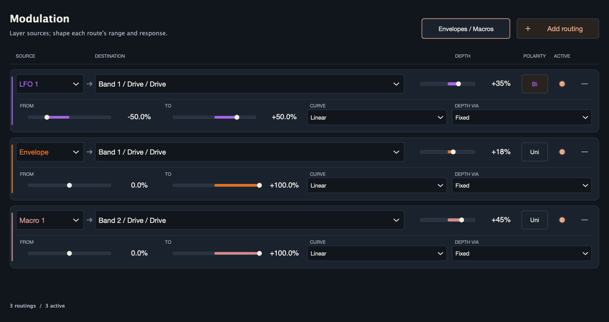

## 17. LFO 波形與播放方式

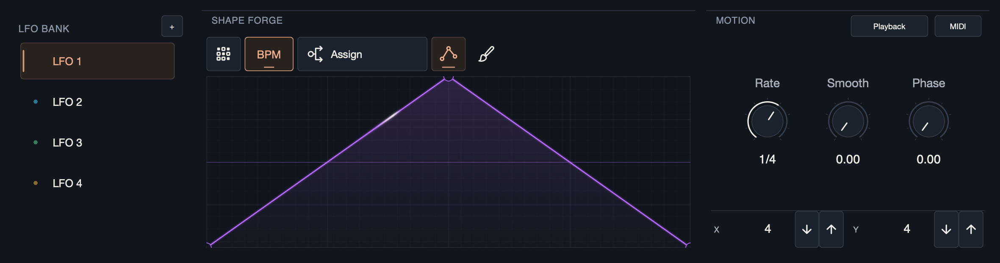

Fire 初始提供四個 LFO，最多允許 16 個。在可滾動的 LFO BANK 中選擇需要編輯的源。刪除一個調變源會清除它的路由，但不會重新編號其他源。重新使用空閒槽位時，波形和時序設定會從初始狀態開始。所有 LFO 都可以刪除；包絡跟隨器、巨集和 MIDI CC 仍可使用。

編輯器提供 **Edit** 和 **Brush** 模式。在 Edit 模式下，雙擊空白處新增點，拖動點改變位置，雙擊點將其刪除。第一個和最後一個點不能刪除。拖動線段可調整曲線彎曲程度。按住 Shift 拖動可框選多個點；拖動選中的點會移動整組選區。在 macOS 上按住 Cmd，或在 Windows 上按住 Ctrl 拖動，可吸附到網格。X/Y 網格控制項用於設定各方向的分格數。

右鍵點選編輯器可使用 **Select All**、**Clear**、**Copy**、**Paste**、**Invert Horizontally** 和 **Invert Vertically**。Clear 會恢復為預設直線形狀。Brush 模式使用滑鼠左鍵繪製所選的預設片段，可選 Saw Up、Saw Down、Sine Convex、Sine Concave、Square High 和 Square Low。

Rate 設定速度，BPM 選擇是否同步，Smooth 使繪製的波形更平滑，Phase 偏移波形的讀取位置。移動的高亮位置反映實際用於音訊處理的相位。只要音訊回撥仍在執行，即使宿主停止播放，高亮仍可能繼續移動；回撥停止後，高亮會保持位置並逐漸淡出。

### 播放方式與可重複的隨機變化

為當前選中的 LFO 點選 **Playback**。

| 設定 | 行為 |
| --- | --- |
| **Loop** | 按獨立速度或宿主同步速度持續迴圈播放。 |
| **Retrigger** | 匹配的 MIDI Note On 或手動 Trigger 會重新啟動週期，之後繼續迴圈。 |
| **One-shot** | 每次觸發播放一個週期，隨後保持最終值。 |
| **Shape** | 讀取繪製的波形；Smooth 對此模式有效。 |
| **Random Hold** | 在隨機值之間階梯式切換。 |
| **Random Glide** | 在隨機值之間平滑插值。 |

Trigger Note 可選 0-127 或 **Any**，通道可選 1-16 或 **Omni**。Note Off 不會觸發。**Trigger** 可以手動啟動 Retrigger 或 One-shot，無需輸入 MIDI。Seed 範圍為 0-65535；相同的種子和觸發序列可以復現相同的隨機序列。每次觸發都會推進隨機序列，而不是總從相同的第一個值重新開始。

繪製的曲線和 Smooth 隻影響 Shape。隨機模式下的 One-shot 忽略 Phase：Hold 保持一個隨機值，Glide 則完成一次過渡。Shape 的 One-shot 從 Phase 指定的位置開始，但仍播放完整的一個週期。播放設定和種子會隨音色儲存，手動 Trigger 操作本身不會儲存。

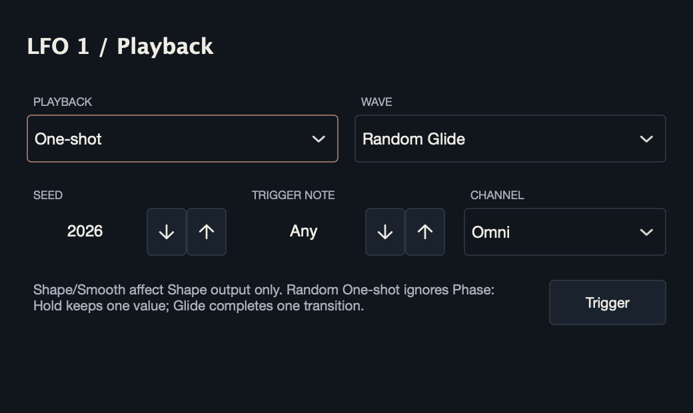

## 18. 包絡跟隨器與外部側鏈

開啟 **Matrix  >  Envelopes / Macros**，再選擇 **ENV 1-4**。每個檢測器都有獨立的輸入、濾波器、Attack、Release 和 Sensitivity 設定。

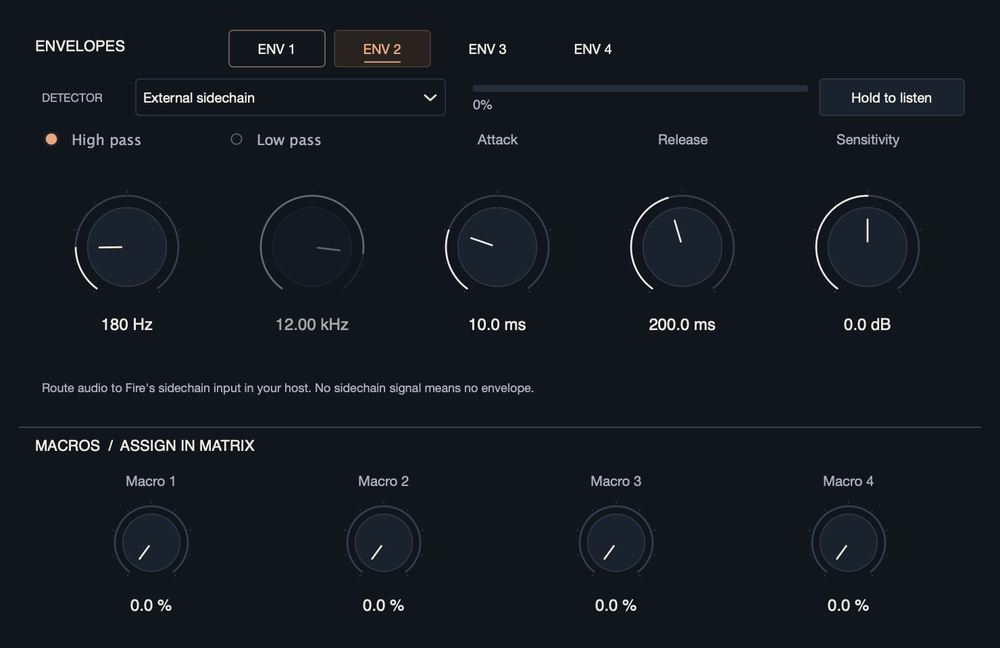

| 控制項 | 範圍 / 用途 |
| --- | --- |
| **Detector** | Main input、External sidechain 或 Band 1-4。 |
| **High Pass** | 20 Hz-20 kHz，有獨立啟用開關；預設 80 Hz，處於旁通狀態。 |
| **Low Pass** | 20 Hz-20 kHz，有獨立啟用開關；預設 12 kHz，處於旁通狀態。 |
| **Attack** | 0.1-500 ms；預設 10 ms。 |
| **Release** | 5-2,000 ms；預設 200 ms。 |
| **Sensitivity** | -24 至 +24 dB；預設 0 dB。 |
| **Hold to listen** | 按住時臨時監聽所選檢測器經過濾波的訊號。 |

主輸入和頻段輸入均取自效果處理之前。頻段檢測器使用獨立的 24 dB/oct 濾波，跟隨當前分頻邊界，取樣位置也在 Solo 和輸出增益之前。未啟用的頻段或未連線的側鏈會提供靜音訊號。立體聲能量檢測仍能響應左右聲道極性相反的輸入。檢測器濾波器改變的是包絡跟隨器所檢測的內容，不是處理聲音的 EQ 控制項。

若希望音色隨演奏力度變化，可選擇 Main input，設定較快的 Attack 和適中的 Release，再以較小的正向深度將該 ENV 路由到 Shape Mix 或 Drive。提高 Sensitivity，直到較輕的演奏也能產生合適的變化。調整 Release，使音符之間平滑恢復，然後細調 Depth，避免效果過強。

若要使用外部訊號控制，在宿主中將另一條軌道路由到 Fire 的側鏈輸入，選擇 **External sidechain**，再在矩陣中分配該 ENV。將負向深度的路由分配給合適的電平或 Mix 控制項，可在側鏈訊號增強時壓低該目標。具體路由方式取決於 DAW 和外掛格式；僅選擇 External sidechain 不會自動建立宿主連線。

用滑鼠按住 **Listen**，或在該控制項獲得焦點時按住 Space/Return，可檢查經過濾波的檢測訊號。鬆開後返回正常輸出。隱藏或關閉面板也會結束監聽。這是臨時監聽狀態，不會儲存，也不支援自動化。

第一個檢測器在調變源選單中可能顯示為 **Envelope**，而控制標籤使用 **ENV 1**。其餘檢測器都是獨立調變源，不是 ENV 1 的副本。

## 19. MIDI 控制

開啟 **Mod Forge  >  MIDI**。四個槽位各自可以監聽指定通道或 Omni 上的 CC 0-127。選擇 **Off** 可禁用該槽位。

1. 在宿主中，將控制器或軌道的 MIDI 路由到 Fire。
2. 點選某個槽位的 **Learn**，再移動所需的硬體控制項。Fire 會記錄它的 CC 編號和通道。再次點選 Learn 或關閉面板可取消學習。
3. 開啟 Matrix，為目標選擇對應的 **MIDI CC 1-4** 調變源。
4. 像設定 LFO 路由一樣設定範圍、曲線和深度。如果希望同一控制器在任意通道上都有效，使用 Omni。

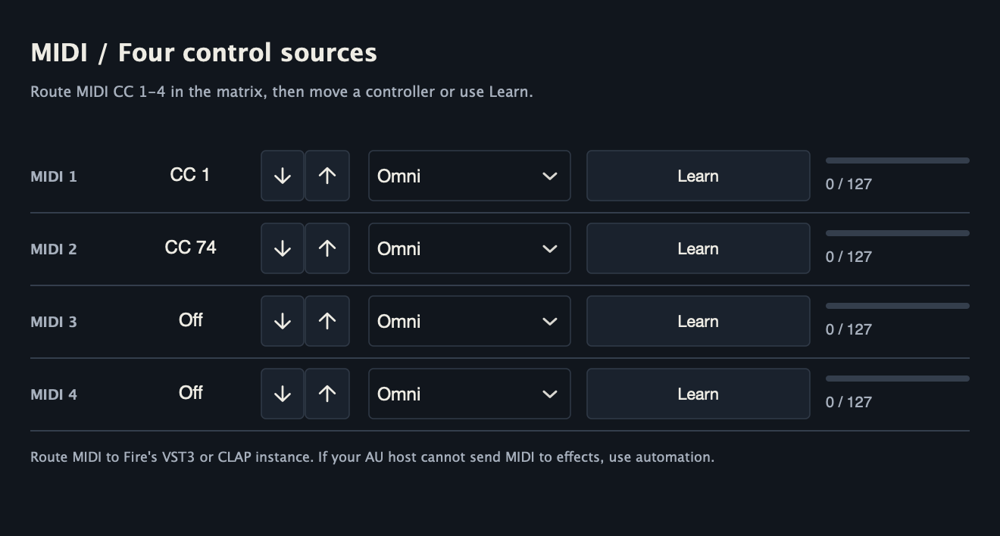

MIDI CC 配置會儲存，傳入的控制器位置則屬於即時演奏資料。宿主必須將 MIDI 傳入 Fire。Fire 保留了 AU 效果器身份，因此某些 AU 宿主無法向它傳送 MIDI。在宿主支援效果器 MIDI 路由時，可以使用 VST3 或 CLAP；也可以使用普通參數自動化。MIDI 音符可以觸發 LFO，但不會將 Fire 變成合成器。

## 20. 實用聲音設計示例

以下示例用於提供起點，並非 Factory 預設的參數規範。先將聲源調至合適的監聽電平，再平衡處理後的響度。編輯前先選擇目標頻段，並確認其模組開關已啟用。

### 吉他：隨演奏力度變化的輕度失真

1. 從單頻段開始，將 Drive 放在 Shape 之前。
2. 選擇 **Tweed Breakup**，先使用適中的 Drive，開啟 Safe，關閉 Extreme。
3. 尋找基本音色時，讓 Bias 和 Rectification 接近零。交替輕彈和重彈，同時調整 Drive。
4. 如果低音過度主導失真，在 Shape 之前新增 EQ；如果生成的音色過暗或過尖，則在 Shape 之後新增 EQ。
5. 新增 **Spring** Reverb，使用較小的 Mix；如果殘響尾音使低頻渾濁，提高 Low Cut。
6. 匹配處理前後的電平。Fire 的吉他風格音色屬於失真處理級，不是完整的箱體/麥克風模擬器。

### 貝斯：保留低頻分量，增加清晰度

1. 對聲源分頻，讓低頻基音區域可以保持相對乾淨；用聽感決定分頻點。
2. 選擇高頻段，嘗試 **Warm Triode**、**Diode Overdrive** 或 **Transformer**。
3. 增加 Drive，直到音符在小揚聲器上也足夠清晰；如果結果太刺耳，降低該頻段的 Mix。
4. 如果高頻音符的動態變化過大，使用適中的 Compressor 壓縮比。
5. 關閉 Solo，在完整混音和單聲道下檢查。低頻段避免使用極端的 Width 設定。

### 人聲：增加厚度，同時避免持續刺耳

1. 使用單頻段，或對指定頻段進行輕微處理。新增 **Class A Console** 或 Warm Triode，並使用較低的 Drive。
2. 在 Shape 之後放置 EQ，透過聽感找到刺耳頻率，再在該處建立 Bell。
3. 啟用該點的 Dynamic 控制項，選擇負向 Range，並降低 Threshold，直到只有較強的樂句需要衰減。
4. 新增 **Plate** Reverb，設定足夠的 Pre-delay，讓字頭與尾音分離，同時使用 Low Cut 保持清晰。
5. 在響度匹配後進行對比，確認子音仍然自然。

要抑制刺耳的人聲共振，在問題頻率處使用 Bell，基礎 Gain 保持在 0 dB 附近，設定負向 Range，再降低 Threshold，直到響亮的音節觸發衰減。先從較小的 Range 開始：通常只需偶爾控制幾 dB，而不是持續進行大幅削減。

### 鼓：並聯增強力度

1. 開啟處理鏈的 Routing，選擇 **Parallel A/B**。
2. 將 A 分支上已有的全部處理模組移走或刪除，使其成為直通訊號路徑，再將 **OTT** 放到 B 分支，按需加入 Shape。
3. 使用適中的 OTT Depth，調整 Up / Up Thresh 以突出較輕的擊打，調整 Down / Down Thresh 以控制峰值。
4. 將 Blend 從接近 A 端的位置開始調節，逐漸加入 B，直到節奏更飽滿，同時保留幹聲的起音。
5. 嘗試在 B 上使用 Lo-Fi 增加質感，再以相近的輸出電平對比完整迴圈。

### 鋪底音色與過渡：凍結的粒子云

1. 新增 Granular，向其輸入持續和弦，或使用 **Sample** 匯入合適的片段。
2. 啟用 Freeze，將 Density 調離中心，並選擇較平滑的 Texture。
3. 降低 Pitch 可得到更暗的鋪底音色，提高則可獲得更輕盈的聲部；調整 Position，避開不需要的咔嗒聲或不穩定片段。
4. 為 Position 或 Size 新增緩慢調變，並控制好調變範圍。
5. 在後面新增 Hall Reverb，或將其放在同一並聯分支，再用 Blend 逐漸引入這一層質感。
6. 將預設連同凍結錄音一起儲存。只有需要原始素材時才匯出原始 WAV；若要保留完整且持續變化的效果，應在宿主中渲染。

### 演奏巨集：同時塑造多個參數

為每個目標分別新增一條路由，併為它們選擇同一個 Macro 調變源。分別設定深度和極性：例如，一個巨集可以提高失真 Drive、降低 Output，同時輕微增加殘響 Mix。從零開始，邊聽邊緩慢轉動。明確用途後，在主頁面為巨集重新命名。四個巨集均為可由宿主自動化的 0-100% 控制項，數值變化帶有短暫的平滑過渡。名稱、數值和路由都會隨音色、A/B 和專案儲存。

## 21. 設定、效能與故障排查

選擇 **Menu  >  Skin  >  Modern / Vintage / Paper / Ink**，或使用 Settings 中的四個外觀按鈕。切換不會改變聲音或撤銷歷史。Modern 採用石墨色和鋁質風格；Vintage 使用木質元素和實體控制項；Paper 與 Ink 使用精細線條圖形，分別搭配淺色和深色配色。皮膚是本地偏好設定；新例項會使用已儲存的選擇，已開啟的例項保留各自的皮膚。從編輯器角落拖動可調整尺寸，介面會在支援的尺寸範圍內保持 2:1 佈局。

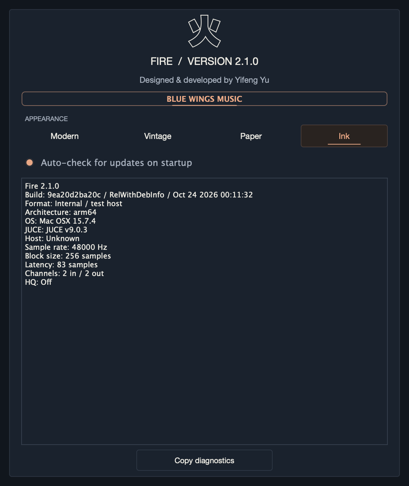

**Menu  >  Settings** 顯示版本、修訂/構建資訊、格式、架構、宿主、取樣率、緩衝區大小、通道、延遲和 HQ 狀態。**Copy diagnostics** 會重新整理資訊並將其複製到本地剪貼簿，方便貼上到問題報告中。外掛不會自動傳送這些內容。Settings 還提供 **Auto-check for updates on startup**；選單中另有 **Check for New Version**。

| 現象 | 檢查方法 |
| --- | --- |
| 宿主中找不到 Fire | 安裝宿主支援的格式，重啟或重新掃描，並檢查宿主的驗證結果或禁用外掛列表。在 macOS 上，AU 和 VST3 是獨立的外掛套件。 |
| 仍然顯示舊版本 | 替換後重啟宿主。檢查 Settings 中已載入的版本/修訂資訊，以及宿主載入的格式和路徑；電腦上可能同時存在多個安裝副本。 |
| 沒有聲音 | 確認音訊已到達軌道、樂器位於 Fire 之前，且宿主路由和輸出已啟用。檢查頻段的 Solo/開關、Output/Mix，以及極端的調變或凍結粒子設定。 |
| Side 檢視為空 | 單聲道或左右完全相同的訊號沒有 Side 內容。選擇 Stereo 檢視合併能量。 |
| 圖表停止或看起來為空 | 確認音訊回撥仍在執行、相關檢視處於可見狀態，並已恢復頻譜顯示。隱藏檢視或關閉編輯器時，圖形有意暫停採集；音訊處理仍會繼續。 |
| 路由沒有效果 | 檢查路由啟用開關、調變源是否存在、Depth、目標是否可用，以及 Depth via 巨集是否為零。外部 ENV 需要實際的側鏈訊號。 |
| MIDI Learn 沒有反應 | 檢查宿主 MIDI 路由、格式支援、通道以及實際發出的訊息型別。Learn 需要的是 MIDI CC。 |
| 編輯 LFO 曲線沒有效果 | 檢查 Playback 中的 Wave 模式。Random Hold/Glide 使用隨機生成器，不讀取已儲存的曲線或 Smooth。 |
| 無法貼上 | 目標必須有相容的空閒槽位，並能保留源模組的表示方式；檢視提示中的具體原因。合適時可嘗試僅複製設定。 |
| Match 顯示 Play audio 或 LIMIT | 播放具有代表性且輸入/輸出電平可用的片段；其最大補償為 ±18 dB。 |
| CPU 佔用升高 | 對同一片段關閉 HQ 進行比較，減少未必需要的高負載效果例項，並關閉或摺疊分析檢視。確認宿主緩衝區大小適合當前專案。 |

HQ 對 Shape 處理使用 4 倍過取樣，也包括新增 Shape 模組。其開銷取決於音色和啟用的處理引擎數量；磁帶等非線性模型可能比簡單的數字波形更耗資源。不存在適用於所有電腦、取樣率、緩衝區大小和預設的統一 CPU 百分比。應在相同條件下比較，並在聽感收益值得時保留 HQ。摺疊分析檢視會減少圖形處理工作，但不會關閉音訊效果，也不會凍結延遲或殘響尾音。

提交可復現的問題報告時，請附上診斷資訊、預設或最小處理鏈、操作順序、預期結果和實際現象。說明問題是否也會出現在新建例項中，以及重新開啟專案後是否仍然存在。

### 相同音色，不同皮膚

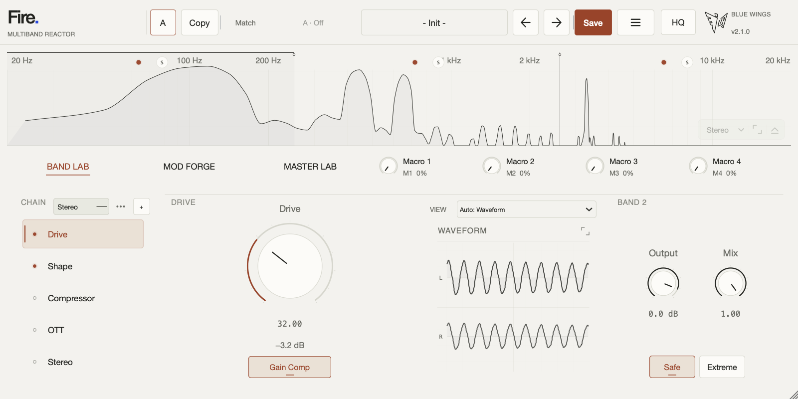

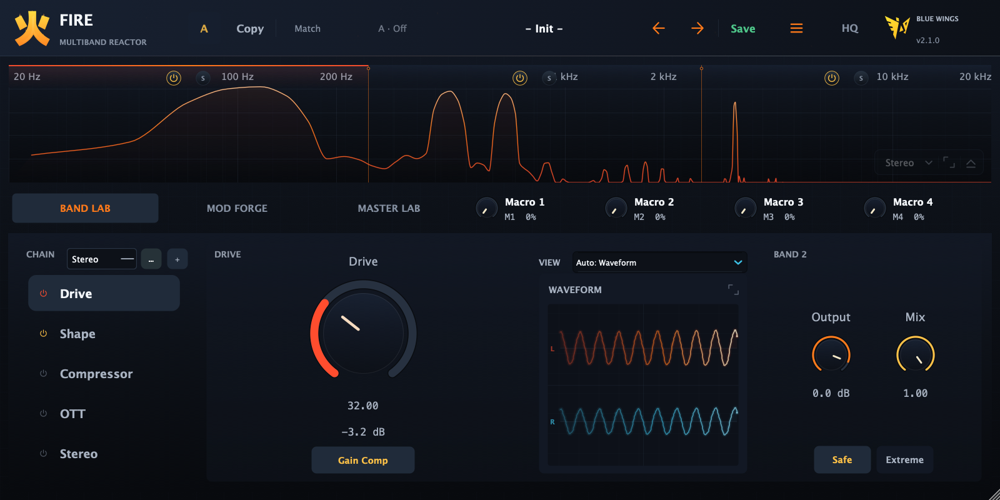

## 22. 速查與支援

### 鍵盤與滑鼠操作參考

以下快捷操作作用於獲得焦點的 Fire 介面。DAW 或正在編輯的文字框可能會以其他方式處理相同按鍵。

| 操作 | 手勢 / 快捷鍵 |
| --- | --- |
| 撤銷 | Cmd/Ctrl-Z，或 Menu > Undo |
| 重做 | Cmd/Ctrl-Shift-Z；平台支援時可使用 Ctrl-Y；或 Menu > Redo |
| 試聽相鄰預設 | 當預設庫搜尋框未獲得焦點時，按向上/向下方向鍵 |
| 從預設庫返回 | Escape、Back to Reactor，或雙擊預設 |
| 重新命名巨集 | 雙擊名稱；Enter 應用，Escape 取消 |
| 重置巨集數值 | 雙擊巨集旋鈕 |
| 新增/刪除 LFO 點 | 在 Edit 模式下雙擊空白處/可刪除的點 |
| 使 LFO 點吸附網格 | 在 macOS 上按住 Cmd，或在 Windows 上按住 Ctrl 拖動 |
| 選擇多個 LFO 點 | 按住 Shift 拖出選擇矩形 |
| 開啟區域性選項 | 右鍵點選對應旋鈕、模組行或 LFO 編輯器 |
| 取消模組拖動 | 按 Escape，或將模組放到處理鏈之外 |
| 拆分所選頻段 | 頻譜背景獲得焦點時，按 Return 或 + |
| 刪除所選頻段 | 頻譜背景獲得焦點時，按 Delete/Backspace |
| 監聽檢測器 | 按住 Listen；或在 Listen 控制項獲得焦點時按住 Space/Return |

### 本手冊術語

| 術語 | 在 Fire 中的含義 |
| --- | --- |
| Band / 頻段 | 一個頻率區域及其處理鏈。 |
| Master / 母線 | 各頻段訊號重新合併後的處理鏈。 |
| Module / insert / 模組 | 處理鏈中的一個處理器；新增例項彼此獨立。 |
| Base value / 基礎值 | 加入內部調變之前的旋鈕數值。宿主自動化可以改變它。 |
| Modulation source / 調變源 | LFO、包絡檢測器、巨集或 MIDI CC 訊號。 |
| Depth / 深度 | 一個調變源對目標的作用量及其正負方向。 |
| Normalized range / 正規化範圍 | 控制項內部的 0-1 位置，不一定與 Hz、ms 或 dB 呈線性關係。 |
| A/B sound memories / A/B 音色記憶 | 在頂部欄中選擇的兩份完整對比音色。 |
| Parallel branches A/B / 並聯分支 A/B | 一個 Band 或 Master 處理鏈內同時執行的兩條路徑。 |
| Mid / Side / 中置與側向 | 立體聲音訊的中置分量 `(L+R)/2` 與差分分量 `(L-R)/2`。 |
| Freeze / 凍結 | 保持 Granular 錄音內容，同時讓粒子繼續播放。 |
| Raw frozen WAV / 原始凍結 WAV | 儲存的錄音素材，不包含後續粒子演變或效果處理。 |
| HQ | 以更高取樣率執行的 Shape 處理路徑；不會增加 Granular 的錄音容量。 |
| Latency compensation / 延遲補償 | 宿主將外掛延遲與其他訊號路徑對齊的機制。 |

### 規格速查

| 專案 | 當前版本 |
| --- | --- |
| 頻段數量 | 最多四個 |
| 新增模組例項 | 每個 Band/Master 處理鏈可在原生模組之外，額外新增最多八個 |
| Factory 場景預設 | 十一個分類，共 236 個，其中 Analog Drive 場景預設有 36 個 |
| 調變源 | 最多 16 個 LFO、四個包絡跟隨器、四個巨集和四個 MIDI CC 調變源 |
| 巨集名稱長度 | 最多 32 個字元 |
| 編輯器尺寸 | 1000 x 500 至 2000 x 1000，寬高比 2:1 |
| HQ Shape 路徑 | 4 倍過取樣 |
| Loudness Match 響度補償 | 最大 +/-18 dB；音色記憶 A 和 B 各自儲存獨立的學習值 |
| 凍結錄音容量 | 32,696 個立體聲取樣幀；32 kHz 下為 1.02175 s |
| 可匯入取樣率 | 8-384 kHz，單聲道或立體聲 |
| 凍結音訊匯出格式 | 立體聲 PCM WAV，16-bit，32 kHz |
| 撤銷 | 在 64 MiB 的快照預算內，最多保留 100 次編輯 |

### 關於本版本與支援

本手冊介紹的是 2.1.0 正式版的操作方式，不代表早期發行版包含相同功能。新預設可能無法在舊版 Fire 中載入。將正式製作專案遷移到其他版本前，請保留重要原始預設和專案的副本。

原生模組與獨立新增模組有時具有不同的參數範圍或相容行為。本手冊會在影響操作的位置說明這些差異。模擬風格音色屬於建模和創意處理器，不保證精確復刻某一具體型號的硬體。Fire 不包含吉他箱體/麥克風模擬器。

截圖由真實產品元件渲染，使用生成的演示音訊和獨立的預設庫，不包含使用者專案或錄製演奏。截圖採集所用的產品原始碼修訂為 **9ea20d2**，已包含 Master/新增 OTT 顯示修復。

- [Fire 產品頁面](https://www.bluewingsmusic.com/fire.html)
- [官方版本與發行說明](https://github.com/jerryuhoo/Fire/releases)
- [問題跟蹤](https://github.com/jerryuhoo/Fire/issues)

報告問題時，請提供已載入的版本和格式、複製的診斷資訊、可復現步驟，並儘可能附上最小預設或處理鏈。說明預期結果與實際現象。診斷資訊只會複製到本地；請透過你選擇的支援渠道自行提交。
