# Fire 2.1 User Manual

**English / Development edition / 24 October 2026**

[English](Fire-2.1-User-Manual.md) | [简体中文](Fire-2.1-User-Manual-zh-CN.md) | [日本語](Fire-2.1-User-Manual-ja.md) | [Français](Fire-2.1-User-Manual-fr.md) | [Español](Fire-2.1-User-Manual-es.md)

Detailed operating instructions with genuine screenshots. Product-source reference: `9ea20d2`. The PDF edition includes a clickable contents page and bookmarks. Keep this Markdown file beside its `images` directory when sharing it.

## Contents

- [01. Getting started](#01-getting-started)
- [02. Interface and spectrum](#02-interface-and-spectrum)
- [03. Presets and the Sound Library](#03-presets-and-the-sound-library)
- [04. A/B, loudness Match and edit history](#04-ab-loudness-match-and-edit-history)
- [05. Chains, parallel routing and Mid/Side](#05-chains-parallel-routing-and-midside)
- [06. Drive and Shape](#06-drive-and-shape)
- [07. Compressor and OTT](#07-compressor-and-ott)
- [08. Stereo](#08-stereo)
- [09. EQ and Dynamic EQ](#09-eq-and-dynamic-eq)
- [10. Chorus, Flanger and Phaser](#10-chorus-flanger-and-phaser)
- [11. Delay](#11-delay)
- [12. Reverb](#12-reverb)
- [13. Lo-Fi](#13-lo-fi)
- [14. Chord Resonator](#14-chord-resonator)
- [15. Granular, Freeze and sample files](#15-granular-freeze-and-sample-files)
- [16. Modulation routes and macros](#16-modulation-routes-and-macros)
- [17. LFO shapes and playback](#17-lfo-shapes-and-playback)
- [18. Envelopes and external sidechain](#18-envelopes-and-external-sidechain)
- [19. MIDI control](#19-midi-control)
- [20. Practical sound-design recipes](#20-practical-sound-design-recipes)
- [21. Settings, performance and troubleshooting](#21-settings-performance-and-troubleshooting)
- [22. Quick reference and support](#22-quick-reference-and-support)

<!-- manual:body -->

## 01. Getting started

This edition describes **Fire 2.1.0 in development**, including the extended modulation system, Dynamic EQ, parallel chains, sample import/export, and the unified OTT display. It was prepared on **24 October 2026** against product source **9ea20d2**. Check **Menu > Settings** to identify the version loaded by your host. A public download may have an earlier feature set.

The examples use genuine interface captures from the current plug-in, with generated demonstration audio. Screenshots are illustrative settings, not calibrated presets or mandatory values. Most figures use Ink; Vintage illustrates the hardware-style displays. Appearance does not change the sound.

### Install and load Fire

Fire is supplied in plug-in formats supported by compatible hosts. Choose a format your DAW accepts; Audio Unit is a macOS format. Keep the plug-in bundle intact when copying it.

| Platform | Format | Typical installation folder |
| --- | --- | --- |
| macOS | Audio Unit | `~/Library/Audio/Plug-Ins/Components/` |
| macOS | VST3 | `~/Library/Audio/Plug-Ins/VST3/` |
| macOS | CLAP | `~/Library/Audio/Plug-Ins/CLAP/` |
| Windows | VST3 | `C:\Program Files\Common Files\VST3\` |
| Windows | CLAP | `C:\Program Files\Common Files\CLAP\` |
| Linux | VST3 | `~/.vst3/` |
| Linux | CLAP | `~/.clap/` |

1. Download the appropriate build from the [official Fire releases](https://github.com/jerryuhoo/Fire/releases). Verify the package's stated operating system and processor architecture. Local development builds may contain only the architecture of the machine that built them.
2. Close the DAW before replacing an existing installation. Copy the format you need to its plug-in folder; create a missing user folder if necessary. System folders on Windows may require administrator access.
3. Restart the DAW and rescan its plug-ins if required. Look for **Fire** as an **audio effect**, under Blue Wings Music where your host groups plug-ins by manufacturer.
4. Insert it on an audio track, after a software instrument, or on an audio bus. Verify that the track is routed to an audible output.
5. Open Settings and confirm the loaded version. If an older version appears, inspect the host's chosen format and search folders before making another copy.

On macOS, a downloaded development/ad-hoc-signed build may require the system's security approval. Follow the release's signing instructions and the operating system's prompt. If a bundle fails validation, obtain a fresh official copy; changing its internal files invalidates its signature.

<!-- pagebreak -->

### A five-minute first session

Fire is an audio effect. It needs an incoming audio signal: insert it after a software instrument, on an audio track, or on a bus that receives audio. It does not generate an instrument sound from MIDI notes alone. MIDI can control modulation when the host sends it to the plug-in.

1. Play or loop a short passage containing both quieter and louder moments. Start with a comfortable monitoring level.
2. Click the sound name in Fire's header. This opens the full-page **Sound Library**. Choose **Analog Drive** and click a scene such as **Valve Bloom**, **Tweed Touch**, **Iron Program Bus**, or **Tape Studio Print**. A single click loads the sound and leaves the library open.
3. Click **Back to Reactor**. Fire selects the scene's relevant Shape page; some scenes place their colour stage in Master Lab, while others use one or more bands.
4. Turn the four macro knobs near the workspace tabs. In Analog Drive scenes these are **Drive**, **Tone**, **Output trim**, and **Dry blend**. The names describe the particular scene's assignments; they are not four extra effect processors.
5. Turn **Match** on and play approximately three seconds of the loop. Wait for a compensation value. This helps you compare tone without being persuaded only by a louder output.
6. Press **Copy**, switch **A/B**, and edit the second sound memory. Click Match's value/Learn control, then replay the same passage to learn a new compensation value. Switch A/B to compare the two.
7. Click **Save** to keep your result as a user preset. Save the DAW project too if you want to retain project-specific comparison settings, locks, and the complete host session.

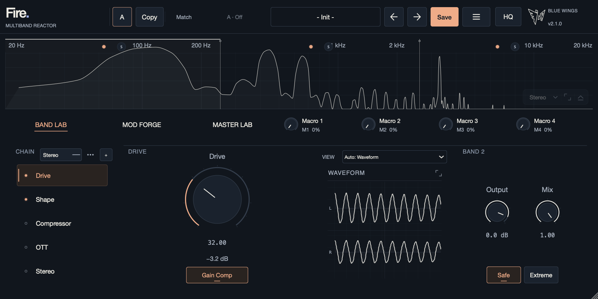

## 02. Interface and spectrum

The header provides A/B comparison, Copy, Match, the preset name and previous/next controls, Save, the application menu, and HQ. The upper spectrum shows input and processed audio and provides the frequency-band editor. Below it, three workspaces organize the controls.

| Workspace | Purpose |
| --- | --- |
| **Band Lab** | Edit the chain of the currently selected frequency band, plus its Output and Mix. |
| **Mod Forge** | Edit LFO shapes, playback behavior and MIDI configuration; open the modulation matrix. |
| **Master Lab** | Edit the chain that processes the combined band output. |

Each audio workspace has a **CHAIN** rail. Click a row to open that module. The small switch beside a processing row changes its enabled state; its appearance varies with the skin. The original Band Shape has a Serial-mode compatibility exception described in Chapter 06. Hover or focus a row to reveal its **-** remove control. Use **+** to add a module and **...** for chain copy, paste, and file operations. The compact button showing **Stereo**, **Mid**, or **Side** opens Routing.

Four macro controls remain readily available beside the workspace tabs. Their values and names belong to the sound. Double-click a macro name to rename it, press Enter to apply, or Escape to cancel. Names may contain up to 32 characters; an empty name restores "Macro 1," and so on. Double-clicking a macro knob returns its value to zero. Renaming does not change its DAW automation identity.

Where a graph **VIEW** menu is available, **Auto** follows the selected module. Explicit Waveform, Transfer, Meters, and Stereo selections let you inspect another aspect of the same signal. For example, a transfer plot helps when adjusting distortion, while Meters makes level changes easier to judge. OTT has its own **LIFT / PRESS** display, including independently inserted Band and Master OTT instances. An expand icon enlarges a graph; use its restore icon to return to the control layout.

### Spectrum controls and band editing

Click in the lower part of a spectrum band to select it for Band Lab. Click the upper strip of the spectrum at a desired frequency to create a crossover, up to a total of four bands. Drag a crossover line to change its frequency, or edit its frequency readout. Band power and **S** controls let you bypass or solo individual bands. The band's remove control removes that band; at least one band must remain.

With the spectrum background itself focused, **Return** or **+** splits the selected band, while **Delete** or **Backspace** removes it. These commands do not apply while a child control, such as a frequency field, has focus.

The compact spectrum toolbar combines a channel selector, expand/restore and fold controls. It becomes translucent when idle and fully readable on hover, keyboard focus, or while its menu is open. Folding the spectrum frees space in all three workspaces. A small restore control beside the workspace controls brings it back.

| Spectrum mode | What it measures |
| --- | --- |
| **Left / Right** | One input/output channel. |
| **Stereo** | Combined channel energy; opposite-polarity channels do not cancel. |
| **Mono** | `(L + R) / 2`, including any cancellation in the mono sum. |
| **Side** | `(L - R) / 2`, revealing stereo differences. |

This selection changes the display only. Choose the chain's Routing channel when you want to change audio processing. Identical left/right audio disappears in Side; opposite-polarity audio disappears in Mono. That is expected. For a signal on only one channel, Stereo reads about 3 dB below that channel's solo trace, and Mono/Side about 6 dB below it.

### Read the controls

The knob's value may appear while you drag, focus or edit it, rather than remaining visible at all times. A tooltip describes the control. Modulation adds a source-coloured range and moving marker; the base value and modulated value are distinct. The full-screen graph button enlarges the selected view and temporarily hides controls beneath it. Collapse the view to restore those controls.

The editor keeps a 2:1 aspect ratio and supports sizes from 1000 x 500 to 2000 x 1000. Resize from its corner; a larger window gives parameter labels and graph details more room.


## 03. Presets and the Sound Library


Click the preset name to open the Sound Library. Collections sit on the left and individual sounds on the right. The factory catalogue contains 236 scenes: 20 each in Vocals, Synths, Drums, Bass, Guitar, Keys, Spaces, Lo-Fi, Rhythm, and Effects, plus 36 in Analog Drive. User sounds appear in **User**. Factory sounds are starting points: save an edited scene as a user preset.

Type in the search field to narrow sounds by their descriptive information. Click a row to audition immediately. Double-click a row, click **Back to Reactor**, or press Escape to return to processing. When the search field is not focused, Up/Down auditions neighboring sounds. The current sound remains highlighted. The header's previous/next arrows also step through presets.

The editor remembers its current collection, search, and scroll position while you work. **Recent** holds up to 24 recently auditioned sounds. **Locate current** clears the search and reveals the playing preset in its collection. Recent history and browsing position are session conveniences, not part of sound files or DAW projects.

### Favourites, hiding and restoring

Click a sound's star to add or remove it from **Favourites**. Favourites are remembered in the local library. A preset's removal control behaves differently according to its origin:

| Sound type | Remove action | Recovery |
| --- | --- | --- |
| User preset | Moves the file into Fire's **Recycle Bin**. | Restore it to its original collection. |
| Factory preset | Hides the factory entry. | Restore the hidden sound from Recycle Bin. |

Restoring a sound does not load it and does not overwrite an existing user file. Removing an entry is therefore different from initializing the currently playing sound. Use **Menu  >  Init** when you want the initial sound state.

### Tags and descriptions

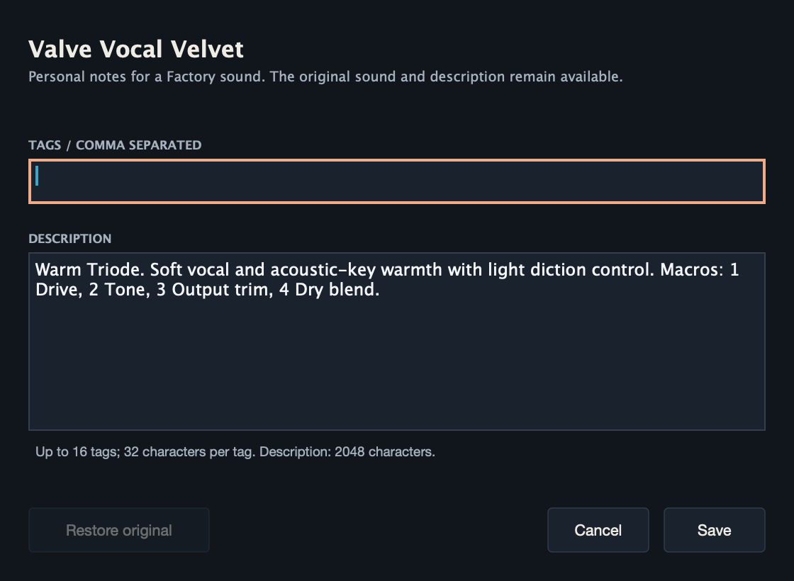

Select a sound and click the pencil/edit-details icon to edit its tags and description. Separate tags with commas; quote a tag if the tag itself contains a comma. Fire accepts up to 16 tags, 32 characters per tag, and a description of up to 2,048 characters.

For a user preset, this information travels inside its `.fire` file. Editing details preserves the audio settings and any frozen granular recording. Saving over the preset keeps its notes; saving a new version inherits the selected sound's notes. Factory edits are personal library overrides: **Restore original** returns to the supplied tags and description. Restore an archived user preset before editing its details. If the file changed while the details editor was open, reopen it before saving.

### Keep selected values while browsing

> When several modules have the same control name, prefer the target knob's context menu to lock a specific value. A lock preserves the base value while loading a sound; it does not freeze incoming audio, disable modulation, or lock an entire module automatically.

Preset parameter locks retain chosen **base knob values** when you load or step through whole-plugin presets. They are useful, for example, when auditioning sounds while retaining a particular Output or Mix value.

1. Right-click an eligible knob and choose **Keep value when loading presets**. Alternatively, open **Menu  >  Preset parameter locks...**.
2. In the lock window, search for parameters and enable the ones to retain. **Locked only** limits the list to current locks; **Unlock all** clears them.
3. Load another preset. Locked base values remain. The sound may show the normal `*` modified marker because it differs from the saved preset.

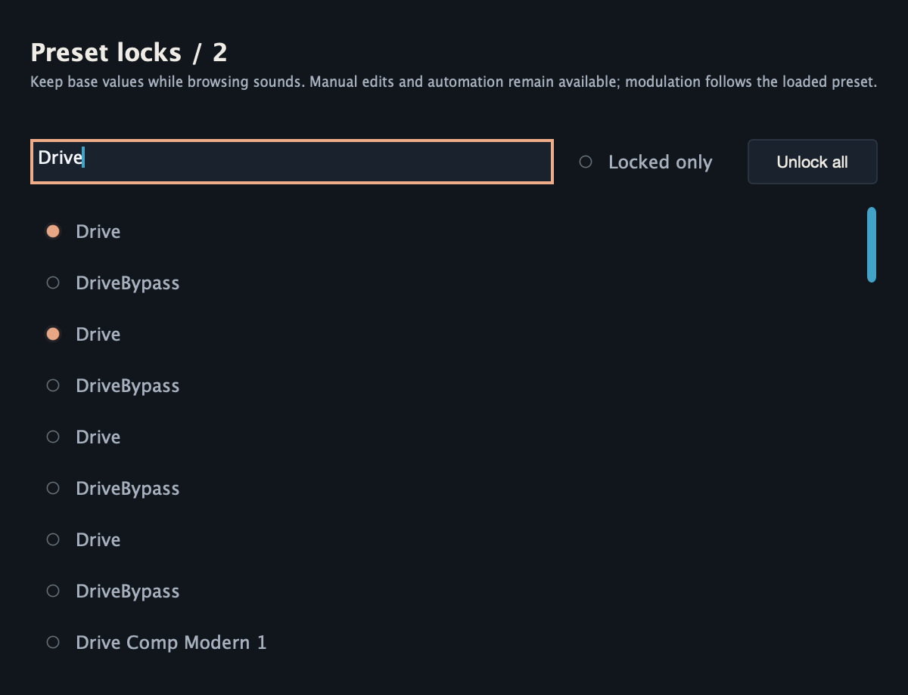

Locks do not disable manual editing, host automation, or modulation. Incoming modulation routes and source definitions still load, so a locked base value can still move under modulation. Structural settings (band count, crossovers, module presence/order, routing mode, and branch assignments) cannot be locked. Lock preferences belong to the instance's project state, not `.fire` sounds. A/B switching, Undo/Redo, and project restoration restore complete states rather than applying browsing locks.

### What is saved where?

| Storage | Main contents |
| --- | --- |
| Whole-plugin `.fire` preset | Sound parameters, chains, sources and mappings, macro names, frozen granular audio, and user notes. |
| `.firechain` preset | One chain's modules/settings, channel and parallel routing; optionally its destination modulation routes. |
| DAW project | Full instance state, including A/B Match information and preset lock preferences. |
| Local preferences/library | Skin preference, favourites, hidden factory entries, and factory metadata overrides. |
| Current editor session | Library search/scroll/recent browsing state; temporary detector listening. |

Use **Menu  >  Open Preset Folder** to find your library and **Rescan Preset Folder** after managing sound files outside Fire. Keep backups of your own presets and projects.

<!-- figure:landscape -->
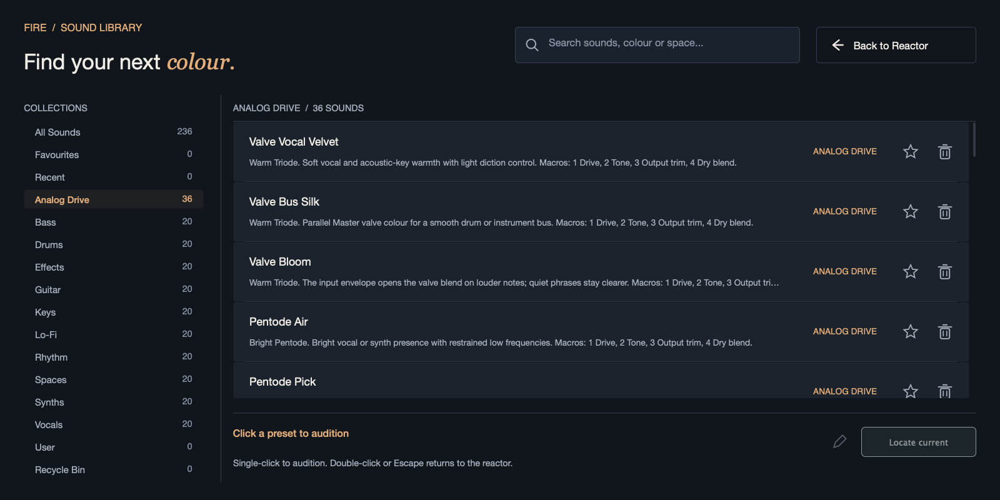

## 04. A/B, loudness Match and edit history

Header **A/B** switches between two complete sound memories. **Copy** copies the current side to the other side. This is separate from the **A/B branches** inside a parallel effect chain: sound memories compare whole states, while branches process audio simultaneously.

For an equal-loudness comparison, loop the same representative passage for both memories. Enable **Match** and let the current side learn for about three seconds. Switch A/B and let the other side learn. Each side retains its own fixed dB compensation. Copy also copies that compensation.

Click the value/Learn control to measure again; click during a measurement to cancel it. Turning Match off lets you hear the uncorrected level. Match does not move Output or its automation. Host bypass passes the bypass signal and pauses learning.

**Play audio** means the measurement did not receive enough usable input and output; a previous valid result is retained. **LIMIT** means the correction would exceed the available ±18 dB. Match is a short-window audition tool, not an integrated LUFS meter. Its compensation stays fixed while you edit, so relearn after a large change. Loading a sound preset clears that side's measurement and learns again if Match remains enabled. Match and learned gains are saved in projects, separately from `.fire` files.

### Undo and redo

Use **Menu  >  Undo / Redo**, **Cmd/Ctrl-Z**, **Cmd/Ctrl-Shift-Z**, or **Ctrl-Y**. Undo groups normal knob gestures and operations such as module duplication or chain replacement into meaningful edits. It also covers LFO shapes, routes, EQ nodes, and frozen-material changes. History stays available when you close and reopen the editor, but loading a DAW project starts fresh history. Audio-thread automation does not create an undo entry for every parameter update. Fire retains up to 100 edits within a 64 MiB snapshot budget; undo does not change the current editor size.

## 05. Chains, parallel routing and Mid/Side

Fire divides the input into one to four frequency regions. The selected Band chain processes its region; the band outputs are combined, then processed by the Master chain.

```text
Input -> frequency split -> Band chains -> recombine -> Master chain -> Output
                              |  |  |  |
                            up to four bands
```

Band Lab and Master Lab share Drive, Shape, Compressor, OTT, Stereo, EQ, Lo-Fi, Chorus, Flanger, Phaser, Delay, Reverb, Granular, and Chord Resonator. Original rows can be removed and added again, just like additional modules. Each chain has up to eight additional independent insert slots. Analysis is a removable Master display page and does not process audio.

Click **+** and choose a module. Click its row to edit it. Drag the row's name/body to reorder; the insertion line previews the new position. Hold near the rail's edge to scroll to hidden rows. Release to commit. Escape, dropping outside the rail, or changing workspace/band cancels the drag. Reordering preserves the module's parameters and routes. Audio modules process in the listed order; Band Output/Mix follows its chain.

### Serial, parallel, Mid and Side

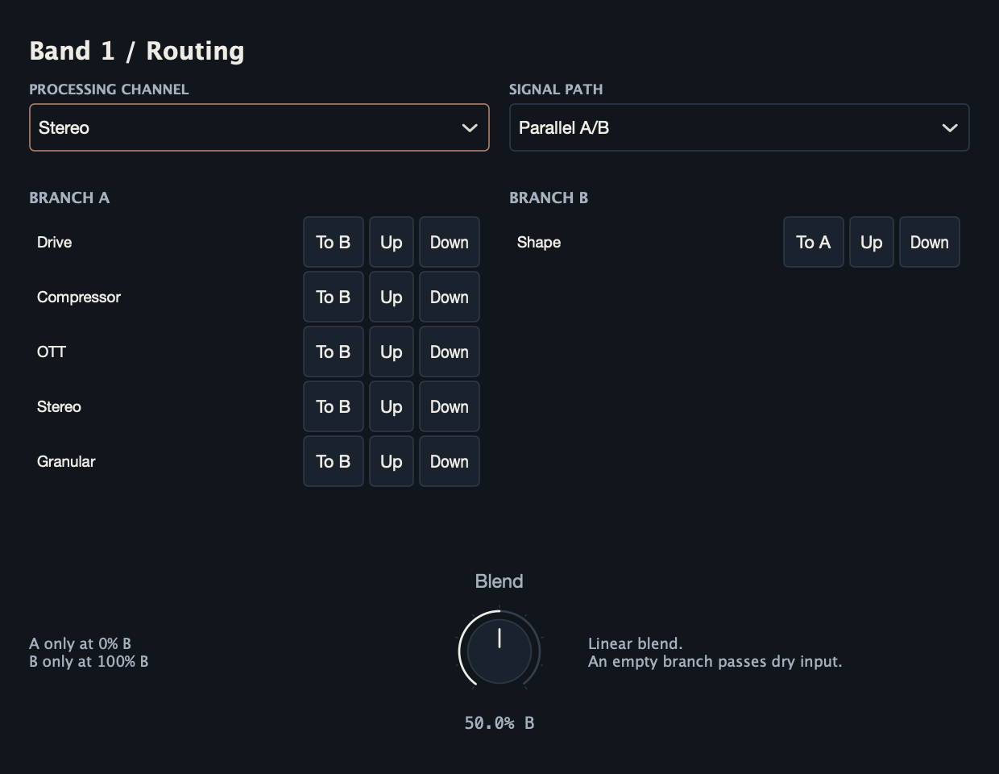

Click the compact Stereo/Mid/Side button beside CHAIN to open Routing.

| Control | Operation |
| --- | --- |
| **Serial** | Modules run one after another. |
| **Parallel A/B** | Both branches receive the same chain input; their outputs are blended. |
| **To A / To B** | Move a module to the other branch. The row menu offers **Move to Branch A/B** too. |
| **Up / Down** | Change module order within a branch. |
| **Blend** | Percentage of Branch B: 0% = A only, 100% = B only. |
| **Stereo** | Process the stereo signal. |
| **Mid** | Process its centre component, retaining the original Side component. |
| **Side** | Process its difference component, retaining the original Mid component. |

Parallel branches share the existing module slots; they do not create a second independent eight-slot rack. An empty branch passes the input unchanged. The blend is linear, so identical branches retain unity gain. Both branches keep running at the endpoints, allowing delay/reverb histories to remain current. Branches are delay-aligned before merging; the scope's Output/Mix follows the merge. Mid/Side wraps the complete chain, including both branches.

For parallel compression, place Compressor or OTT on B and leave A empty, then raise Blend from 0% until the detail and density suit the source. For contrasting colour, put two different Shape modules on A and B. Blend accepts ordinary modulation and host automation; find **Routing / Blend** in the matrix. Serial mode remembers its branch assignments and Blend for later. Structural routing and branch assignment are host-automatable but not internal modulation destinations.

With Mid or Side selected, applicable scope output controls act on that component. Stereo effects are averaged back into the selected component so processing cannot spill into the untouched one. On mono input, Mid acts like Stereo and Side passes through with the same latency. Choosing **Side** in the analyser only displays differences; it does not enable this processing mode.

### Copy a module

Right-click a module row, or focus the row and press **Shift+F10**.

- **Copy settings** captures the module without destination modulation routes.
- **Copy with routing** includes those routes.
- **Duplicate settings** inserts a settings-only copy immediately after the source.
- **Paste ... after** inserts the copied module after the chosen row. To paste into an empty chain, use the copied-module entry in **+**.

A copied module retains its branch assignment but does not change the destination's routing mode, Blend, or Stereo/Mid/Side mode. Module and chain clipboards are separate. They can be shared between Fire instances of the same plug-in format within one process.

### Copy or save a whole chain

Open the chain **...** menu. **Copy chain settings** or **Copy chain with routing** captures audio modules in order. **Paste chain** replaces only the destination chain; other bands, Master, crossovers, Output/Mix, and global modulation sources remain. Copying an empty chain can clear another chain's audio modules. Analysis is excluded.

Use **Save chain preset...** for a settings-only `.firechain`, or **Save chain preset with routing...** to include mappings. **Load chain preset - replace...** replaces the current chain from a file. Chain files use the **Chains** folder within the preset folder. They include channel/parallel routing and module data such as models, EQ points, and frozen audio.

"With routing" copies destination mappings, ranges, curves, and depth-macro assignments. It uses the destination instance's current LFOs, envelopes, macros, and MIDI CC configuration; it does not overwrite those source definitions. Use a whole-plugin preset when you need the complete originating sound.

Fire checks whether a complete paste fits compatible slots before changing the destination. Some original modules need their compatible core representation: original Master Lo-Fi uses a different engine, and a Drive using Legacy Link may need its original Drive slot or conversion to Drive Comp. If a paste cannot preserve the required settings or routing, it explains the problem and leaves the destination unchanged.

### Order and the three Mix levels

Order affects both tone and dynamics. An EQ before distortion determines which frequencies drive it hardest; EQ afterward shapes the harmonics it has already generated. A compressor before distortion steadies the drive level, while a compressor afterward controls the resulting signal. Delay before distortion can make each repeat interact with the distortion; delay afterward repeats the distorted sound.

A module's **Mix** generally blends its input with that module's processed signal. In the original adjacent Band Drive  >  Shape path, Shape Mix blends the complete joined distortion stage, including Drive. **Band Mix** blends the complete band chain with the band's dry signal, and the global **Mix** blends the overall effect with its dry path. These layers accumulate: a low module Mix followed by a low Band Mix can make an effect very subtle. **Output** controls level rather than distortion amount. Use output trim for level balancing, and revisit it after changing the chain.

> For a genuinely dry parallel branch, move or remove its processing modules before treating it as the reference path. In the example Routing screenshot, A contains modules and is not an empty dry branch. The original Band Shape in Serial mode retains a compatibility path; see Chapter 06.


## 06. Drive and Shape

Drive and Shape form the core of Fire's distortion workflow. **Drive** raises the level entering the nonlinear stage. **Shape** chooses the transfer curve or analog colour and adjusts its asymmetry. In the original band chain, adjacent Drive  >  Shape modules use their joined processing path. Moving them apart makes them separate stages, so effects inserted between them influence what reaches Shape.

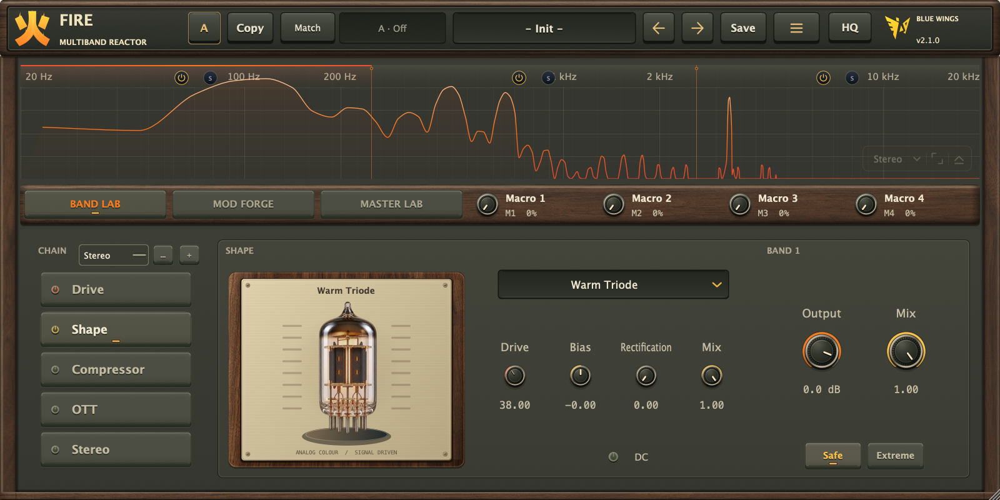

### Drive, Safe and compensation

| Control | Practical meaning |
| --- | --- |
| Drive | Amount of input gain, on a 0-100 control scale. More is usually denser and more distorted, but the result depends on the source and Shape. |
| Safe | Restrains the effective drive in response to incoming peaks. It can make the applied drive lower than the knob's requested value. |
| Extreme | Greatly increases the gain available from the same Drive setting. Begin at a low value when enabling it. |
| Gain Comp / Comp | Applies an estimated level reduction based on the drive actually used. It helps comparisons while leaving Output independently adjustable. |
| Output | Manual level trim after the relevant chain. It is not another distortion control. |

Safe is a drive-management feature, not a final master limiter. Gain Comp is an estimate, not a loudness measurement. Its running readout follows the applied compensation; the approximation symbol identifies an estimate when current audio telemetry is unavailable. Use the top bar's loudness Match workflow when you need an actual whole-chain level comparison.

Older sounds may show **Legacy Link**. That mode retains their original relationship between Drive and the final Band Output. **Use Drive Comp** explicitly switches the band to the newer compensation method and reactivates its stored manual Output setting. This can change the sound. In a parallel chain, Legacy Link affects the final Band Output and therefore both branches; modern compensation stays with Drive.

### Shape controls

Choose a model from the Shape selector. **Bias** offsets the signal around the shaping curve to create asymmetry; its range is -1 to +1. **Rectification** alters the negative part of the shaped waveform: 0 leaves its polarity, 0.5 removes the negative half, and 1 flips that half positive. Intermediate settings blend between those behaviours. Bias and rectification can introduce DC offset, so enable **DC** or **DC Filter** where appropriate. **Mix** blends the shaping result with its input; in the original adjacent Band Drive  >  Shape path, it wraps the complete joined distortion stage, including Drive.

> **Original Band Shape in Serial mode:** its off state preserves the selected distortion curve for compatibility, while disabling Bias, Rectification and DC filtering and ignoring the stored Shape Mix. Removing that original Shape row retains this Serial behaviour too. Consequently, greyed-out Shape controls do not guarantee a clean signal. Use Band Mix at zero or bypass the complete band for a dry comparison. An independently added Shape has a conventional wet/dry bypass, and Parallel A/B mode bypasses the original Shape curve when it is off or removed.

The original Band analog page uses the band's Drive control. Independently added analog Shape modules have their own Drive control, allowing multiple colour stages with different drive levels in one chain. In that independent analog Shape, the local Drive controls the model directly; separate Drive-module switches should not be mistaken for controls belonging to that Shape instance.

**HQ** uses a higher-rate distortion path to reduce unwanted aliasing. It can matter most on bright, strongly driven material and foldback settings. It requires more CPU; audition at the quality setting you expect to use. A transfer graph helps explain a static waveshaping curve, but does not describe every time-dependent feature of a magnetic or supply-sensitive analog model.

### Digital Shape models

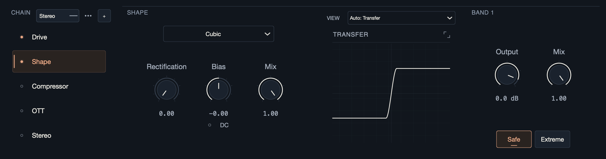

| Model | Character and useful starting point |
| --- | --- |
| Arctan | Rounded, progressively saturating curve; useful for restrained colour. |
| Exp | Exponential soft saturation with a different transition into clipping. |
| Tanh | Smooth, symmetrical saturation for general-purpose thickening. |
| Cubic | Rounded polynomial clipping; the default digital selection. |
| Hard | Abrupt clipping at the curve's limits for strong upper harmonics. |
| Sausage | A firm curve with softened corners near clipping. |
| Sin | Repeated sine foldback; increasing Drive can create complex changes rather than only more clipping. |
| Linear | Triangle-like foldback with angular transitions. |
| Limit | Clips to a narrow level range. Compensate level by ear after choosing it. |
| Single Sin | Uses one sine-shaped region and suppresses samples outside it, producing unusual textures at high drive. |
| Logic | Historical selector whose current stable transfer curve is equivalent to Tanh. |
| Pit | A saturating curve with a subtractive high-level component; useful for less conventional high-drive movement. |

Names describe the curves available in Fire. They do not promise a specific commercial distortion processor's sound. For a controlled comparison, keep Bias at zero, Rectification at zero, select one curve at a time and balance output level before deciding.

### Analog Hardware colours

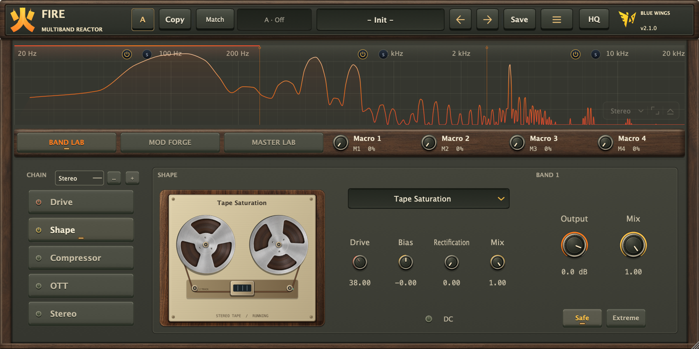

These models are circuit-inspired colours, not calibrated replicas of named hardware. Amplifier models include supply and operating-point behaviour; Transformer and Tape Saturation include magnetic memory. Their response depends on the audio's level and history, so a sustained note and a sharp transient need not behave identically.

| Model | Suggested use |
| --- | --- |
| Warm Triode | Gentle, asymmetric valve-style warmth on vocals, bass or keys. |
| Bright Pentode | A more forward valve colour when the source needs presence. |
| Class A Console | Subtle console-style density on individual tracks or a bus. |
| Tweed Breakup | Soft, yielding guitar-style breakup and dynamic crunch. |
| British Crunch | Stronger mid-focused crunch for guitars and rhythmic material. |
| Modern High Gain | Cascaded, dense distortion for aggressive tones. |
| Diode Overdrive | Focused overdrive for leads, bass articulation or drum accents. |
| Germanium Fuzz | Asymmetric fuzz with softer, darker character. |
| Silicon Fuzz | Brighter, firmer fuzz with pronounced upper harmonics. |
| MOSFET Drive | An asymmetric drive colour between gentle saturation and harder overdrive. |
| Transformer | Magnetic colour and history-dependent saturation. |
| Tape Saturation | Biased magnetic recording colour with record/playback and head-loss shaping. |

These descriptions are audition guides, not guaranteed tonal outcomes. Tape Saturation is a generic tape model; it does not provide tape-speed, bias or head-type selectors. Lo-Fi's separate Tape/Wow/Flutter controls serve a different purpose.

Tube brightness follows both the incoming sound and Drive, so silence does not light a tube merely because Drive is high. Tape reels respond to audio activity and settle when processing stops. Artwork is feedback about activity, not a calibrated electrical meter. Paper and Ink use schematic versions of these displays; the underlying sound is unchanged.

## 07. Compressor and OTT

### Compressor

Compressor reduces signal above **Threshold** according to **Ratio**. **Attack** sets how quickly gain reduction responds, and **Release** sets how quickly it recovers. A slower attack often preserves more initial impact; a faster attack catches more of it. Start with Ratio around 2:1 to 4:1, lower Threshold until compression is audible, then adjust timing while listening to the rhythm.

| Control | Original Band Compressor | Additional Compressor instance |
| --- | --- | --- |
| Threshold | -48 to 0 dB | -60 to 0 dB |
| Ratio | 1:1 to 20:1 | 1:1 to 20:1 |
| Attack | 0.1-200 ms | 0.1-200 ms |
| Release | 10-2000 ms | 1-1000 ms |
| Mix | Dry to fully processed | Dry to fully processed |

The original Band module retains its historical ranges; an added instance in Band or Master uses the inserted ranges above. Ratio 1:1 produces no compression. Compressor has no dedicated makeup-gain knob: use an appropriate Output control or your chain arrangement to restore level. Reduce Mix for parallel compression within the module, or use the chain's parallel branches for separately processed dry and compressed paths.

### OTT: lift quiet detail, press loud peaks

The original Band module labels its thresholds **Up Thresh** and **Down Thresh**, and its output trim **Gain**. Independently added OTTs use **Up**, **Down** and **Output** for the same roles.

OTT combines upward and downward compression. It raises quieter material below **Up / Up Thresh**, reduces louder material above **Down / Down Thresh**, and leaves a region between them less affected. Fire's multiband split supplies any frequency separation: one Master OTT instance acts on its full incoming signal rather than secretly creating another set of crossover bands.

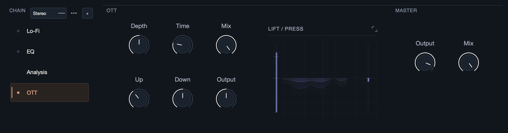

| Control | Range and operation |
| --- | --- |
| Depth | Overall dynamics strength, zero to full. Native Band displays 0-1; added instances display percent. |
| Time | 10-400%; scales attack and release together. 100% corresponds to 5 ms attack and 100 ms release. |
| Up / Up Thresh | -72 to -6 dB; quiet-signal threshold. Kept at least 6 dB below Downward. |
| Down / Down Thresh | -36 to 0 dB; loud-signal threshold. |
| Output / Gain | -24 to +24 dB; level trim after the dynamics. |
| Mix | Dry to fully processed. |

The fixed upward and downward ratios are 4:1 and 8:1 with soft knees. Upward gain is limited and fades away near the noise floor; OTT is not a noise generator. Both channels share its detector and gain, preserving the stereo relationship.

The **LIFT / PRESS** display shows the selected module's activity. Lifting ribbons indicate upward compression; pressing motion indicates downward compression. Each independently added OTT has its own readings, including instances in Master Lab. Dynamics motion excludes Output trim, so turning Output alone is not an indication of stronger compression.

For the original Band OTT, the spectrum's threshold lines also provide direct adjustment. Drag a line vertically, double-click to reset, or use arrow keys for precise changes when focused. Start with moderate Depth and back off if room tone or noise becomes too prominent. Time values below 100% exaggerate fast response; longer settings make the movement slower.

## 08. Stereo

Stereo contains **Width**, **Pan** and **Mix**. Width changes the balance between the centre and difference components of a stereo signal. Its neutral position is **0.50** in the original Band module, or **50%** in added instances. Lower settings favour the centre; higher settings favour the sides. At the extremes, the opposite component is removed, so 100% is not simply "normal stereo at maximum width."

Pan attenuates the opposite channel as it moves left or right. Mix blends the stereo treatment with the module input. The effect needs stereo information to widen: a centred signal with no difference component cannot acquire independent side detail from Width alone. A mono processing bus bypasses this stereo operation.

Check wide settings with the spectrum set to **Mono**, and compare by ear in mono. Widening by emphasising the difference signal can make the mono sum much quieter. Use less Width, more module dry Mix, or keep the low band closer to its neutral width.

## 09. EQ and Dynamic EQ

Every EQ supports up to **12 points**. Select a numbered point to edit its **Frequency**, **Gain**, **Q**, **Filter Type** and **Slope** where applicable. Use **+** to add a point and **-** to remove it. Each point has its own power control. The EQ can be edited while its module is bypassed; adding a point enables the module for audition.

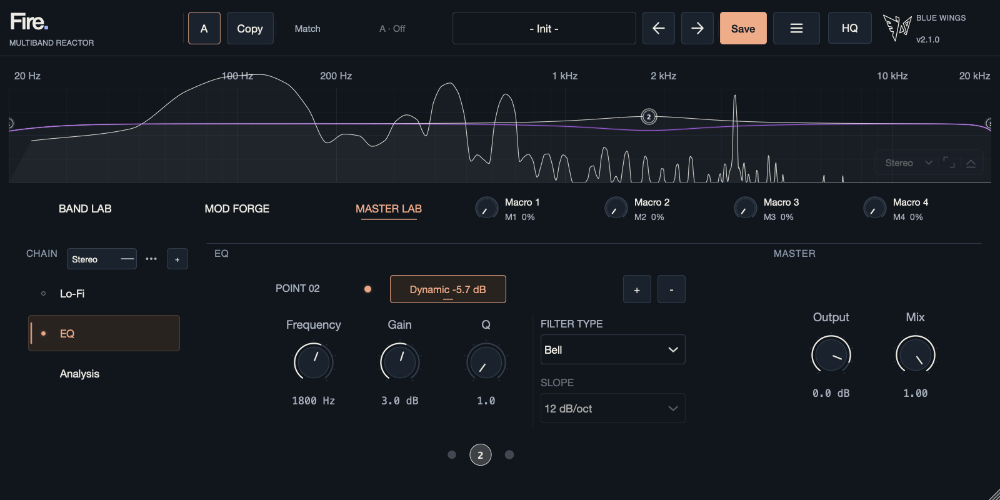

### Static EQ

| Type | Use |
| --- | --- |
| Bell | Boost or cut around a chosen frequency. |
| Low cut | Remove low-frequency content below the cutoff. |
| High cut | Remove high-frequency content above the cutoff. |
| Low shelf | Adjust a broad low-frequency region. |
| High shelf | Adjust a broad high-frequency region. |
| Notch | Remove a narrow frequency region; Gain is unavailable. |
| Band pass | Retain a region around the centre frequency; Gain is unavailable. |

Cut filters offer **12, 24, 36 or 48 dB/oct** slopes. Q shapes bandwidth or resonance. Gain spans -24 to +24 dB. Frequency covers 20 Hz-20 kHz, with the usable response also depending on the host sample rate. Inserted EQ points offer Q 0.1-20. In the original Master EQ, its first three points retain Q 1-5, while later points offer Q 0.1-18.

The original Master EQ additionally supports editing on the spectrum. Double-click empty spectrum space to add a bell at that position, drag a point to change frequency/gain, and scroll over it to adjust Q. Delete/Backspace removes the selected point when that spectrum has focus. These gestures belong to the Master EQ editing view; they should not be confused with adding crossovers in the band spectrum.

### Dynamic EQ

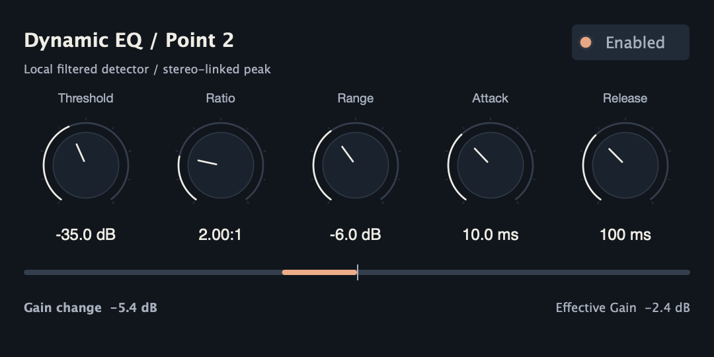

Select a **Bell**, **Low shelf** or **High shelf**, then open **Dynamic** in the point header and enable it. Other filter types do not provide dynamics.

| Control | Meaning |
| --- | --- |
| Threshold, -60 to 0 dB | Level above which the detector requests a gain change. |
| Ratio, 1:1-20:1 | Strength of the level-dependent response; 1:1 gives no change. |
| Range, -24 to +24 dB | Maximum signed gain change: negative reduces, positive boosts. |
| Attack, 0.1-200 ms | Speed of response to increasing level. |
| Release, 5-2000 ms | Speed of recovery. |

The detector listens to the EQ module's original input filtered around that point's frequency, using the stronger left/right peak. It is not an external-sidechain selector and is not serially fed by preceding points in the same EQ. Base Gain plus dynamic gain stays within ±24 dB.

Watch the dynamic gain-change and effective-gain readouts while playing audio. The original Master EQ's live curve follows the effective gain, but its draggable point and Gain knob retain the base setting. Dynamics settings support host automation, presets, parameter locks and chain copying; they are not destinations for Fire's internal modulation. Frequency, Gain and Q retain their ordinary modulation support.


## 10. Chorus, Flanger and Phaser

These effects add periodic movement with their own internal sweeps. Their Rate knobs are in hertz; do not confuse those internal oscillators with the separate LFO bank. Fire's modulation system can still move the exposed effect controls.

| Effect | Controls and ranges |
| --- | --- |
| Chorus | Rate 0.05-8 Hz; Depth 0-100%; Delay 5-30 ms; Feedback -75 to +75%; Width 0-100%; Mix 0-100%. |
| Flanger | Rate 0.05-8 Hz; Depth 0-100%; Delay 0.1-10 ms; Feedback -90 to +90%; Width 0-100%; Mix 0-100%. |
| Phaser | Rate 0.05-8 Hz; Depth 0-100%; Center 40-6000 Hz; Feedback -85 to +85%; Width 0-100%; Mix 0-100%. |

Chorus uses a moving short delay for thickening and pitch movement. Flanger uses a shorter swept delay to create a metallic, comb-like pattern when mixed with dry audio. Phaser uses a six-stage all-pass chain for a rounded sweep of moving notches.

Depth sets sweep amount. Delay sets the centre delay for Chorus/Flanger; Center sets the sweep's frequency region for Phaser. Feedback strengthens resonance; negative values provide a different character. Width offsets the sweep between channels, while zero aligns the two sweeps. Mix determines how the dry and affected signals interact.

Begin around 50% Mix for pronounced Flanger/Phaser cancellation. A slow Rate and moderate Depth suit pads; a faster Rate can make percussion or keys more animated. At 100% wet, the character can change substantially because the dry signal is no longer participating in the cancellations.

## 11. Delay

Delay provides **Time**, **Feedback**, **Tone**, **Ping-Pong**, **Sync** and **Mix**. In **Free** sync mode, Time spans **10-2000 ms**. Sync choices are **1/16, 1/8, 1/8 D, 1/4, 1/4 D, 1/2 and 1 Bar**, where D means dotted. Synced times follow host tempo, within the two-second delay capacity. At slow tempos, a long division can reach that limit rather than its full nominal duration.

Feedback, from 0-90%, controls repeated echoes. Tone, 500 Hz-18 kHz, filters the feedback path: lower values darken later repeats. Ping-Pong, 0-100%, moves from ordinary stereo delay towards alternation between the channels. Mix sets the echo level relative to dry input.

For a vocal slap, use Free mode around 80-130 ms, low Feedback and a small Mix. For rhythmic movement, select a dotted eighth note and moderate Feedback, then reduce Tone if the repeats compete with the original. On a dedicated return track, 100% Mix is a useful starting point; on an insert, begin much lower.

## 12. Reverb

Select **Classic, Room, Hall, Plate, Spring or Chamber**. All use the same six controls, so you can compare models without learning a different panel each time.

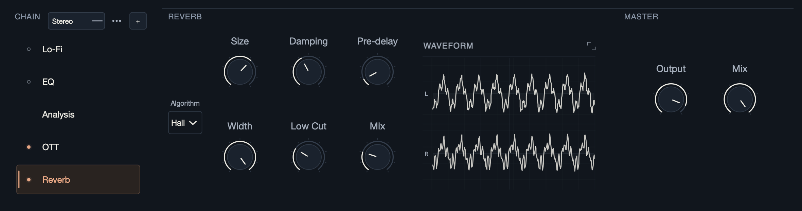

| Control | Meaning |
| --- | --- |
| Size, 0-100% | Changes the space/decay character. It is not a calibrated decay-time readout. |
| Damping, 0-100% | Higher values darken the recirculating tail. |
| Pre-delay, 0-200 ms | Delay before the reverberant signal, helping separate the source from its tail. |
| Width, 0-100% | Stereo spread of the reverb. |
| Low Cut, 20-1500 Hz | Removes low-frequency energy entering the reverb. |
| Mix, 0-100% | Dry/reverberant balance. |

**Classic** retains Fire's original reverb character. **Room** is a good starting point for compact ambience and audible early reflections. **Hall** suits broader, evolving spaces. **Plate** builds a dense tail for vocals, snares or sustained tones. **Spring** adds dispersive, spring-like colour useful with guitar and sound design. **Chamber** offers another early-reflection and decay pattern between intimate and spacious textures. These are algorithmic spaces, not convolution captures of specific rooms or hardware.

Changing a model clears the previous model's delay history while fading through dry audio, so do not expect the old tail to continue unchanged. To make a vocal clearer, try more Pre-delay and Low Cut before simply lowering Mix. To retain drum punch, choose a shorter-feeling Size and use the reverb sparingly or on a parallel branch.

## 13. Lo-Fi

Lo-Fi combines sample-rate reduction, quantization and tape-like motion. **Rate** is a reduction factor: larger values hold samples longer, creating a rougher, lower-rate character. **Bits** reduces amplitude resolution. **Jitter** varies the sample-hold timing rather than adding a separate noise track.

**Tape** adds saturation and high-frequency softening. **Wow** adds slow pitch drift; **Flutter** adds faster variation. **Mix** blends the full Lo-Fi result. Start with Tape/Wow/Flutter at zero to hear the rate and bit reduction clearly, then add one colour at a time.

The original Master Lo-Fi retains Rate **1-64** and Bits **4-32**. Added Lo-Fi instances use Rate **1-32** and Bits **4-24**, with Tape, Wow, Flutter and Jitter each spanning zero to full amount. Native controls may show normalized 0-1 values where inserted controls show percentages; the sound-design roles are the same.

For worn keys, use mild rate reduction, fairly high Bits, a little Tape and slow Wow. For crunchy drums, lower Bits first, then increase Rate and Jitter until the attack takes on the desired grain. Lo-Fi Tape is a compact colouring control; the dedicated **Shape  >  Tape Saturation** is the more detailed magnetic model.

## 14. Chord Resonator

Chord Resonator excites a tuned harmonic bank with incoming audio. It works particularly well with percussion, noise and harmonically rich material. It does not detect the song's key or retune arbitrary notes to a scale.

Choose **Root**, from **C2 to C5**, and a **Chord**: **Major, Minor, Major 7, Minor 7, Sus 2, Sus 4, Fifth or Octave**. The note readout displays the voicing. In Fire's naming, middle C is C4.

**Color** balances the fundamental and upper harmonics. **Decay** sets the nominal 60 dB decay time from **0.05-3 seconds**. **Width** spreads voices across stereo; at zero, each voice receives equal left/right weighting while the incoming stereo channels are retained. **Mix** balances the source's attack with the ringing chord.

Start with the default C3 Minor 7, moderate Decay and a low Mix on a percussion loop. Choose a Root that fits the song. Place it in a mid/high band if you want the low fundamentals to remain direct. No MIDI input is needed: the excitation is audio. Without new audio, only the existing tail continues.

## 15. Granular, Freeze and sample files

Granular uses Fire's adaptation of Mutable Instruments Clouds' **normal granular mode**. It records incoming audio into a short rolling buffer and plays overlapping fragments from it. The engine uses **32 kHz stereo, 16-bit** audio with conversion to and from the host rate. This is part of its texture; the transparent dry signal is retained separately.

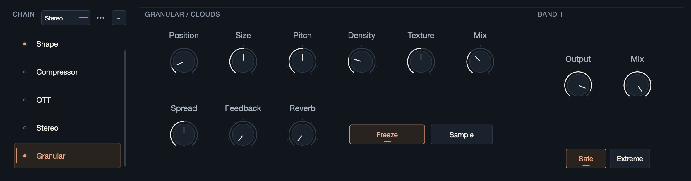

### Grain controls

| Control | Operation |
| --- | --- |
| Position | Selects the region in the recording; clockwise moves towards older audio. |
| Size | Grain-length control, 0-100%. |
| Pitch | Transposes grains from -24 to +24 semitones. |
| Density | Negative side schedules regular grains; positive side randomizes them. The centre produces no new grains. |
| Texture | Moves through sharper to smoother grain envelopes; higher settings add diffusion. |
| Spread | Stereo distribution of grains. |
| Feedback | Returns granular output into the processing path. |
| Reverb | Adds the Clouds engine's own ambience. |
| Mix | Balance of incoming dry audio and granular output. |
| Freeze | Stops updating the recording while grains continue playing. |

If Freeze is on but there is no sound, check that a recording exists, Density is away from its centre and Mix is above zero. Freeze holds material; it does not automatically hold every grain or reverb tail in exactly the same state. With an empty recording, the module captures fresh audio before holding it.

### Capture a live texture

1. Play a short source through the Granular module with Freeze off.
2. Set Density away from its centre and raise Mix enough to hear the grains.
3. Press **Freeze** at the moment you want to retain.
4. Explore Position, Size and Pitch while the held material continues to play.
5. Add modest Feedback or Reverb for a more sustained texture.
6. Save the preset or host project to keep the frozen recording with the sound.

Completed frozen recordings are embedded in presets, project state, A/B snapshots and portable module/chain files. Reloading restores the recording, including its stereo content and ring position; scheduled grains and delay/reverb histories restart. The host must continue processing audio for a frozen texture to play.

### Import a file

Click **Sample** beside Freeze to open **Granular / Sample**, then **Choose audio**. Choose a supported mono or stereo file from the file chooser; available decoder formats depend on the build/platform. Source sample rates from **8-384 kHz** are accepted. Mono material is copied to both channels.

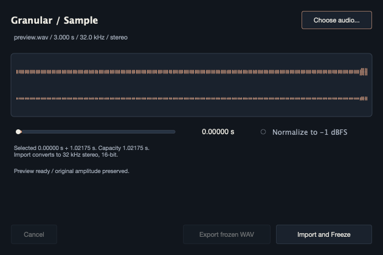

The maximum recording length is **1.02175 seconds**: **32,696 stereo frames at 32 kHz**. This limit does not grow with the host sample rate. For a longer source, move the start control or enter a start time, then review the waveform of the selected excerpt. The waveform is a visual preview of the imported window, not a separate preview-play button.

**Normalize to -1 dBFS** is off by default. Enable it to set a shared stereo peak after conversion without changing the left/right balance. Leave it off to preserve amplitude; source peaks above the destination's range can clip. Click **Import and Freeze** when the excerpt is ready. Fire replaces only this module's recording and enables Freeze, with a short wet transition during playback.

Import is one Undo step. Undo can restore a prior frozen recording and its settings. If the module was previously recording live, Undo restores live mode but cannot reconstruct the old rolling audio. The imported recording is embedded, so the source file does not need to remain on disk. Closing the editor or replacing the target module cancels a pending import instead of redirecting it elsewhere.

### Export frozen material

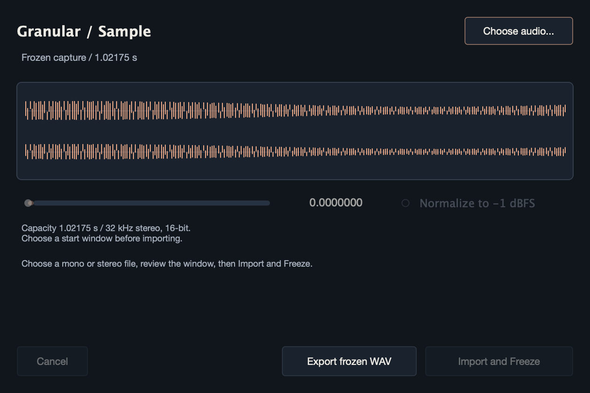

With a valid frozen recording, open Sample and click **Export frozen WAV**. Choose a destination and confirm replacement if that file already exists. Fire captures the recording before the destination chooser opens, so later parameter changes do not alter the export snapshot.

The WAV contains **stereo 16-bit / 32 kHz** audio in chronological order. It exports the recording itself, **without** grain scheduling, Pitch, Feedback, Reverb, Mix or normalization. To print the processed granular performance, record or render Fire's output in the host instead. A shorter captured recording exports its available frames; it is not artificially extended to the full capacity.

The alternate Clouds stretch, looping-delay and spectral modes are not included. Nor are the hardware trigger input or alternate low-fidelity modes. Freeze plus modulation can create extensive variation within the supplied normal granular mode.

## 16. Modulation routes and macros

Fire offers up to 16 LFOs, four envelopes, four macros, and four MIDI CC sources. The modulation matrix connects these sources to eligible destination controls. Several routes may control one destination; their contributions are summed and the final result is limited to that parameter's range.


### First LFO assignment

1. Open **Mod Forge** and select an LFO in the left rail. Use **+** if the bank is empty.
2. Set its Rate. Enable **BPM** for host-tempo divisions, or leave it off for free-running speed.
3. Click **Assign**, then click the destination control in Band Lab or Master Lab. Alternatively, right-click an eligible knob and choose an **Add modulation source** entry.
4. Open the grid/Matrix control and inspect the route. Adjust Depth and choose **Bi** or **Uni**.
5. Observe the source-colored range around the knob. The neutral notch marks its base value; a moving outlined dot shows the modulated value.

The matrix's **Add routing** creates another connection. A row contains Source, Destination, Depth, polarity, active/bypass, and removal controls. Bypassing a route preserves it but stops its contribution. Right-click an assigned knob for **Edit modulation in matrix** or **Clear all modulation**. A multi-route or custom-range source badge opens the relevant routes.

Click Destination to open a searchable picker. Search by control, module, parameter ID, or band, and narrow by scope/module. **Active chain** emphasizes current modules; **All targets** includes absent modules and inactive bands. An unavailable assignment can remain stored, but revealing it does not insert or enable the module. **Show control** opens the target page and focuses the knob. In the picker, Down moves from search to results, Enter selects, and Escape cancels.

### Route mapping reference

| Field | Meaning |
| --- | --- |
| **Depth** | -100% to +100%; it scales the mapping's offsets. |
| **Bi** | Standard bipolar offsets, -50% to +50% of the target's normalized range. |
| **Uni** | Standard unipolar offsets, 0% to +100%. |
| **From / To** | Custom offsets from the base knob, each -100% to +100%. Editing either enables a custom range. |
| **Curve** | Linear, Ease in, Ease out, or S curve, applied before interpolation between endpoints. |
| **Depth via** | Fixed, or a macro that scales the route's Depth from zero to full strength. |

Offsets are percentages of the parameter's **normalized range**, not necessarily a linear number of Hz or dB. For example, From -20% and To +30% at 100% Depth spans those offsets relative to the base knob. At 50% Depth, both offsets halve. Clicking Bi/Uni restores its standard endpoints. A Depth via macro scales the route; it does not replace its source. Set that macro above zero to hear the route.

Source controls cannot modulate themselves recursively. Routing mode and structural module assignments are not ordinary internal modulation targets. For moving a parallel balance, target Blend rather than routing mode.

<!-- figure:landscape -->
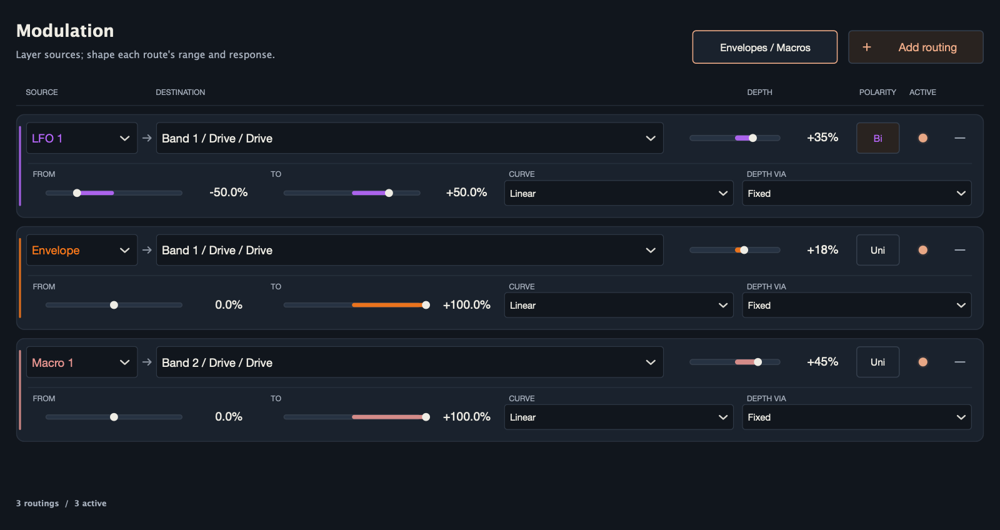

## 17. LFO shapes and playback

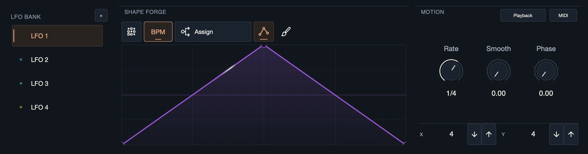

Fire starts with four LFOs and allows up to 16. Select one in the scrollable LFO BANK. Removing a source clears its routes but does not renumber other sources. A reused slot begins with fresh shape/timing settings. All LFOs may be removed; envelopes, macros, and MIDI CC remain available.

The editor has **Edit** and **Brush** modes. In Edit mode, double-click empty space to add a point, drag a point to move it, or double-click a point to remove it. The first and last points cannot be removed. Drag a segment to bend its curve. Shift-drag creates a selection marquee; dragging a selected point moves the selection. Hold Cmd on macOS or Ctrl on Windows while dragging to snap to the grid. X/Y grid controls set divisions.

Right-click the editor for **Select All**, **Clear**, **Copy**, **Paste**, **Invert Horizontally**, and **Invert Vertically**. Clear returns to a straight default shape. Brush mode paints a selected preset segment using the left mouse button; choices include Saw Up, Saw Down, Sine Convex, Sine Concave, Square High, and Square Low.

Rate sets speed, BPM chooses synchronization, Smooth softens the drawn shape, and Phase offsets its reading position. The moving highlight follows the phase actually used for audio. It can continue while host transport is stopped if audio callbacks continue, and holds/fades when callbacks stop.

### Playback and repeatable random motion

Click **Playback** for the selected LFO.

| Setting | Behavior |
| --- | --- |
| **Loop** | Continuous free-running or tempo-synchronized playback. |
| **Retrigger** | A matching MIDI Note On or manual Trigger restarts the cycle, which then loops. |
| **One-shot** | One cycle per trigger, then hold the final value. |
| **Shape** | Read the drawn shape; Smooth affects this mode. |
| **Random Hold** | Step between random values. |
| **Random Glide** | Interpolate between random values. |

Choose a Trigger Note from 0-127 or **Any**, and a channel from 1-16 or **Omni**. Note Off does not trigger. **Trigger** manually starts Retrigger or One-shot without requiring incoming MIDI. Seed accepts 0-65535; the same seed and trigger sequence reproduce the random sequence. Each trigger advances the random sequence rather than always restarting at an identical first value.

Drawing and Smooth affect Shape only. Random One-shot ignores Phase: Hold retains one random value, while Glide completes one transition. Shape One-shot begins at Phase and still plays a full cycle. Playback settings and seeds are stored with the sound; a manual Trigger gesture is not.

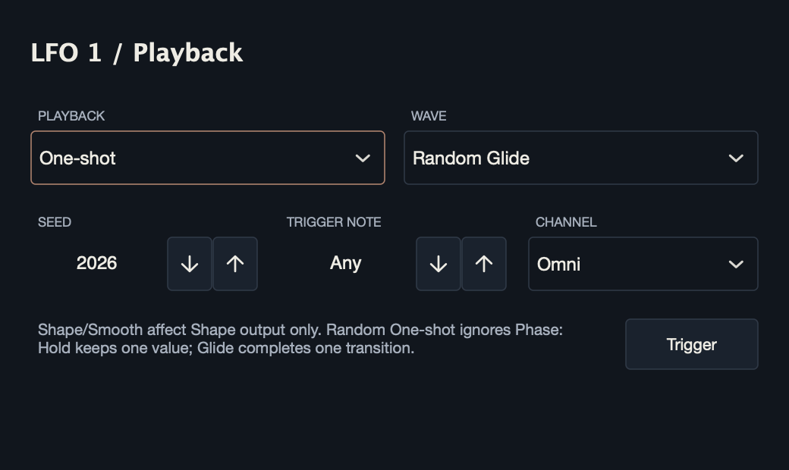

## 18. Envelopes and external sidechain

Open **Matrix  >  Envelopes / Macros**, then select **ENV 1-4**. Each detector has independent input, filters, Attack, Release, and Sensitivity.

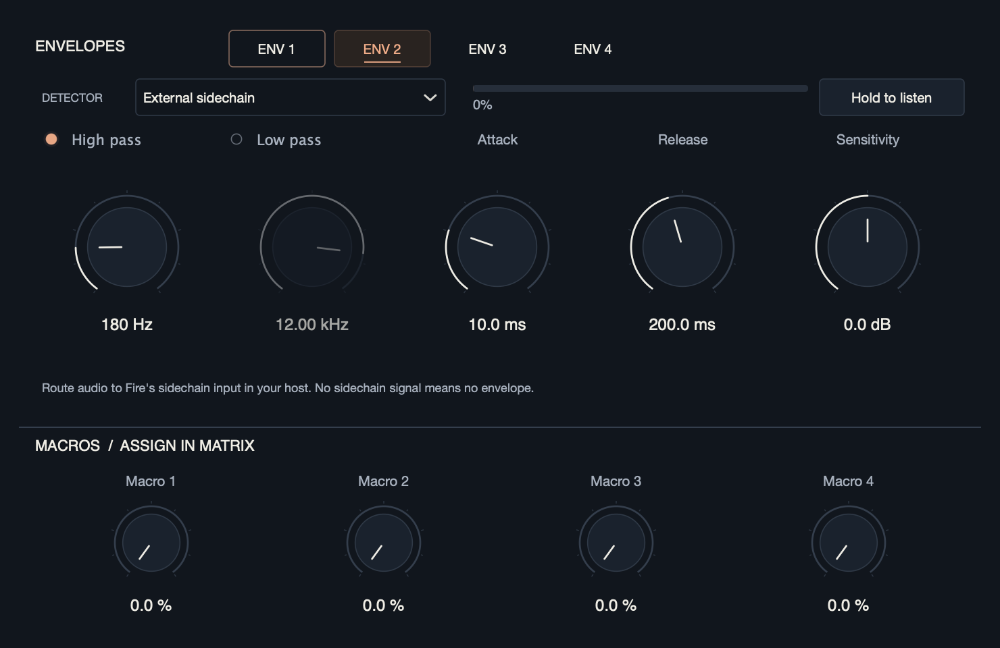

| Control | Range / use |
| --- | --- |
| **Detector** | Main input, External sidechain, or Band 1-4. |
| **High Pass** | 20 Hz-20 kHz, with its own enable switch; default 80 Hz, bypassed. |
| **Low Pass** | 20 Hz-20 kHz, with its own enable switch; default 12 kHz, bypassed. |
| **Attack** | 0.1-500 ms; default 10 ms. |
| **Release** | 5-2,000 ms; default 200 ms. |
| **Sensitivity** | -24 to +24 dB; default 0 dB. |
| **Hold to listen** | Momentarily audition the selected filtered detector signal. |

Main and band sources are taken before effects. Band detectors follow current crossover boundaries with their own 24 dB/oct filtering, before solo and output gains. An inactive band or disconnected sidechain is silent. Stereo energy detection remains responsive to opposite-polarity input. Detector filters shape what the envelope hears; they are not EQ controls for the processed sound.

To make colour respond to performance, select Main input, set a quick Attack and moderate Release, and route that ENV to a Shape Mix or Drive with a modest positive depth. Increase Sensitivity until quieter playing produces useful motion. Adjust Release for smooth recovery between notes, then refine Depth to avoid overdoing the effect.

For external control, route another track into Fire's sidechain input using your host, choose **External sidechain**, and assign that ENV in the matrix. A negative-depth route to an appropriate level or Mix control can duck it as the sidechain grows. Exact routing depends on your DAW and plug-in format; merely selecting External sidechain does not create a host connection.

Hold **Listen** with the mouse, or hold Space/Return while it has focus, to check the filtered detector. Release to return to normal output. Hiding/closing the panel also ends listening. It is a temporary audition state, not saved or automated.

The first detector may appear as **Envelope** in a source menu, while the control tabs use **ENV 1**. The remaining detectors are separate sources, not copies of ENV 1.


## 19. MIDI control

Open **Mod Forge  >  MIDI**. Each of four slots can listen to CC 0-127 on one channel or Omni. **Off** disables the slot.

1. Route MIDI from your controller/track to Fire in the host.
2. Click **Learn** for a slot and move the desired hardware control. Fire captures its CC number and channel. Click Learn again, or close the panel, to cancel.
3. Open Matrix and choose the corresponding **MIDI CC 1-4** source for a destination.
4. Set its range, curve, and depth just like an LFO route. Use Omni if the same controller should work on any channel.

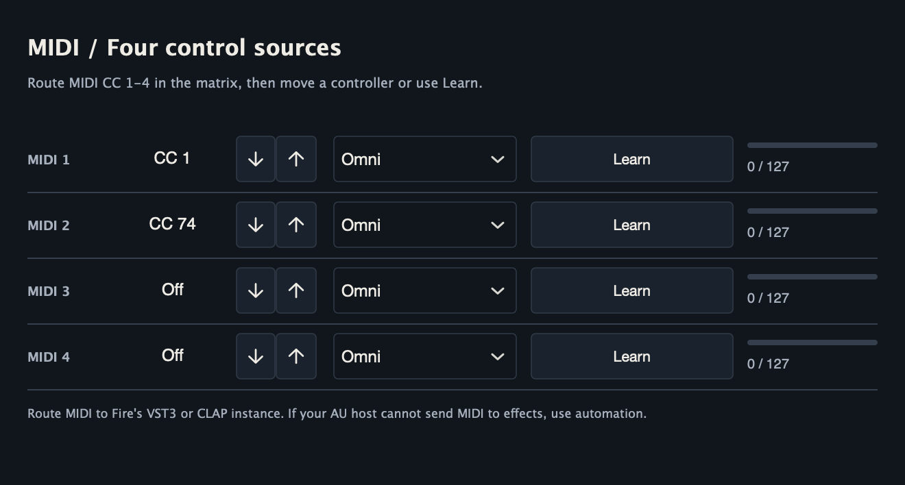

MIDI CC configuration is saved; incoming controller positions are live performance data. The host must deliver MIDI to Fire. Its AU effect identity is retained, so some AU hosts cannot send it MIDI. Use VST3 or CLAP where the host supports effect MIDI routing, or use normal parameter automation. A MIDI note can trigger an LFO but does not turn Fire into a synthesizer.

## 20. Practical sound-design recipes

These are starting points, not factory-preset specifications. First reduce the source to a sensible listening level, then balance loudness after processing. Select the intended band before editing and verify that its module power is on.

### Guitar: touch-sensitive breakup

1. Begin with one band and place Drive before Shape.
2. Select **Tweed Breakup** and start with modest Drive, Safe on and Extreme off.
3. Keep Bias and Rectification near zero while finding the basic character. Adjust Drive while playing both softly and strongly.
4. Add EQ before Shape if low notes dominate the distortion, or after it if the generated tone is too dark or sharp.
5. Add **Spring** Reverb with a small Mix and raise Low Cut if the tail clouds the low end.
6. Level-match the result. Fire's guitar-style colours are distortion stages, not a complete cabinet/microphone simulator.

### Bass: keep weight, add articulation

1. Split the source so the low fundamental region can remain relatively clean; choose the crossover by ear.
2. Select the upper band and try **Warm Triode**, **Diode Overdrive** or **Transformer**.
3. Increase Drive until notes read clearly on small speakers, then lower that band's Mix if the result becomes too abrasive.
4. Use a modest Compressor ratio if upper-note dynamics vary too much.
5. Check the full mix without Solo and in mono. Avoid extreme Width in the low band.

### Vocal: density without constant harshness

1. Use a single band or a gentle band-specific treatment. Add **Class A Console** or Warm Triode at low Drive.
2. Place an EQ after Shape and create a Bell at the harsh frequency found by listening.
3. Enable that point's Dynamic control, select a negative Range and lower Threshold until only stronger phrases need reduction.
4. Add **Plate** Reverb with enough Pre-delay to separate the words from the tail, plus Low Cut to keep it clear.
5. Compare at matched level and confirm that consonants still sound natural.

To tame a harsh vocal resonance, use a Bell at the offending frequency, leave base Gain near 0 dB, set a negative Range, and lower Threshold until loud syllables trigger a reduction. Set Range modestly first: the goal is often a few dB of occasional control rather than continuous deep cutting.

### Drums: parallel energy

1. Open the chain's Routing and choose **Parallel A/B**.
2. Move or remove all existing processing modules from A for a direct path, then put **OTT** and optionally Shape on B.
3. Use moderate OTT Depth, adjust Up / Up Thresh to reveal quieter hits and Down / Down Thresh to control peaks.
4. Start Blend near the A end and add B until the groove gains density without losing the dry attack.
5. Try Lo-Fi on B for texture, then compare the complete loop at a similar output level.

### Pads and transitions: a frozen cloud

1. Add Granular and feed it a sustained chord, or import a suitable excerpt with **Sample**.
2. Enable Freeze, set Density away from centre and choose a smoother Texture.
3. Lower Pitch for a dark bed or raise it for a lighter layer; adjust Position to avoid an unwanted click or unstable portion.
4. Add slow modulation to Position or Size, keeping the modulation range controlled.
5. Follow with Hall Reverb, or put it on the same parallel branch and use Blend to introduce the texture gradually.
6. Save the preset with the frozen recording. Export its raw WAV only if you need the source material; render in the host to retain the complete evolving effect.

### Performance macro: shape several destinations

Add one route per destination and select the same Macro source for each. Set individual depths and polarities: one macro could raise distortion Drive, reduce Output, and increase a reverb Mix slightly. Start at zero and turn it gradually while listening. Rename it from the main page once its purpose is clear. The four macros are host-automatable 0-100% controls with a short value ramp. Names, values, and routes are saved with sounds, A/B, and projects.

## 21. Settings, performance and troubleshooting

Choose **Menu  >  Skin  >  Modern / Vintage / Paper / Ink**, or use Settings' four appearance buttons. The sound and undo history do not change. Modern uses graphite/aluminium; Vintage uses wood and physical controls; Paper and Ink use fine-line diagrams with light and dark palettes. A skin is a local preference; new instances use the saved choice, while existing open instances retain theirs. Resize the editor from its corner; it maintains a 2:1 layout within supported dimensions.

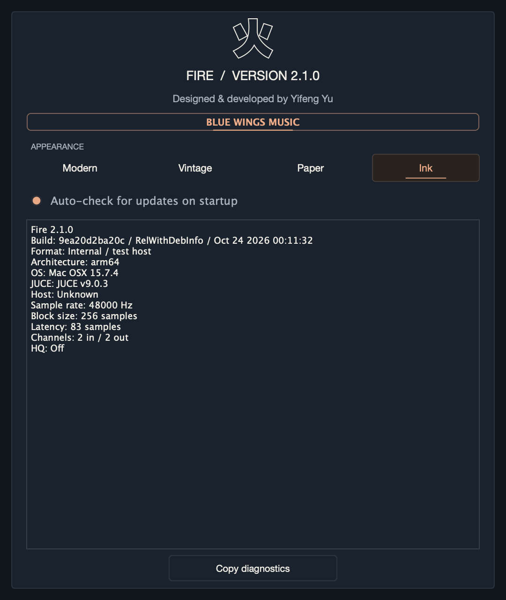

**Menu  >  Settings** displays version, revision/build information, format, architecture, host, sample rate, block size, channels, latency, and HQ state. **Copy diagnostics** refreshes and copies this locally so you can paste it into a report. Nothing is automatically sent. Settings also provides **Auto-check for updates on startup**; the menu offers **Check for New Version**.

| Symptom | Check |
| --- | --- |
| Fire is missing from the host | Install a format the host supports, restart/rescan, and inspect the host's validation or disabled-plugin list. On macOS, AU and VST3 are separate bundles. |
| Old version still appears | Restart the host after replacement. Check Settings' loaded version/revision and which format/path the host loaded; multiple installations can coexist. |
| No sound | Confirm audio reaches the track, the instrument precedes Fire, and host routing/output is active. Check band solo/power, Output/Mix, and any extreme modulation or frozen granular setup. |
| Side view is empty | A mono or identical-left/right signal has no Side content. Select Stereo to inspect combined energy. |
| A graph stops or looks empty | Ensure audio callbacks continue, the relevant view is visible, and the spectrum is restored. Hidden/editor-closed displays pause their capture intentionally; audio processing continues. |
| A route has no effect | Check its active switch, source presence, Depth, destination availability, and a possible Depth via macro at zero. An external ENV needs an actual sidechain signal. |
| MIDI Learn does nothing | Check host MIDI routing, format support, channel, and the actual outgoing message type. Learn expects a MIDI CC. |
| LFO curve edits do nothing | Check Playback's Wave mode. Random Hold/Glide use their random generator, not the stored curve or Smooth. |
| Paste is rejected | The destination must have compatible free slots and preserve the source representation; read the reported reason. Try a settings-only copy where appropriate. |
| Match says Play audio or LIMIT | Supply a representative passage with usable input/output; ±18 dB is its maximum correction. |
| CPU rises | Compare the same passage with HQ off, reduce unused heavy effect instances, and close/fold analysis views. Confirm your host buffer size suits the session. |

HQ applies 4x oversampling to Shape processing, including added Shape modules. Its cost depends on the sound and number of active engines; tape and other nonlinear models can cost more than simple digital shapes. There is no single useful CPU percentage for every computer, sample rate, buffer size, and preset. Compare under the same conditions, and retain HQ where the audible result warrants it. Folding analysis reduces visual work; it does not disable audio effects or freeze delay/reverb tails.

For a reproducible report, include diagnostics, the preset or a minimal chain, the sequence of actions, the expected result, and what actually occurred. Mention whether the issue appears in a newly created instance and after reopening the project.

### The same sound, different skins

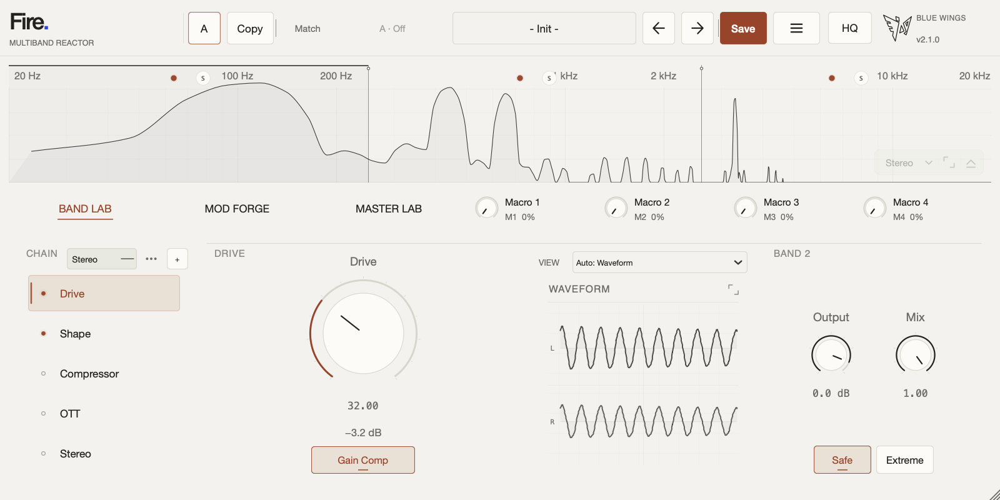

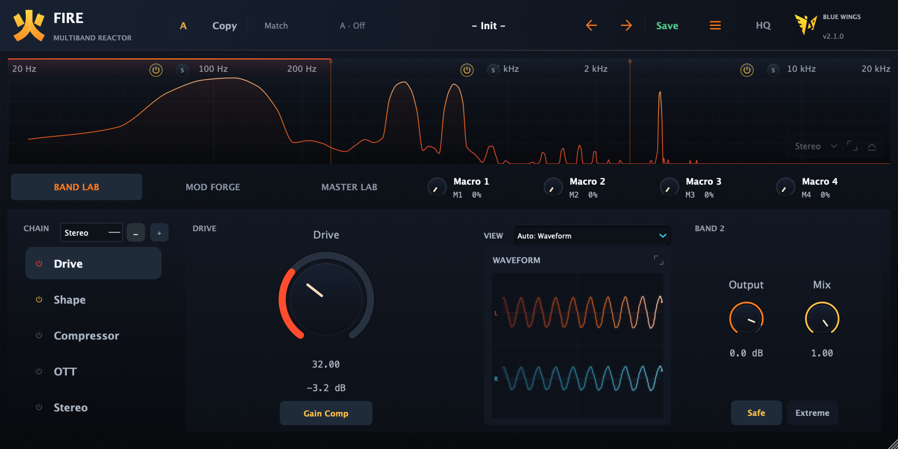

## 22. Quick reference and support

### Keyboard and pointer reference

These shortcuts belong to Fire's focused interface. Your DAW or an active text field may handle the same key differently.

| Action | Gesture |
| --- | --- |
| Undo | Cmd/Ctrl-Z, or Menu > Undo |
| Redo | Cmd/Ctrl-Shift-Z; Ctrl-Y where handled by the platform; or Menu > Redo |
| Audition neighboring presets | Up/Down when the library search field is not focused |
| Return from the library | Escape, Back to Reactor, or double-click a preset |
| Rename a macro | Double-click its name; Enter applies, Escape cancels |
| Reset a macro value | Double-click the macro knob |
| Add/delete an LFO point | Double-click empty space/an eligible point in Edit mode |
| Snap an LFO point | Hold Cmd on macOS or Ctrl on Windows while dragging |
| Select several LFO points | Shift-drag a selection rectangle |
| Open local options | Right-click the relevant knob, module row or LFO editor |
| Cancel module drag | Escape or drop outside the chain |
| Split selected band | Return or + while the spectrum background has focus |
| Remove selected band | Delete/Backspace while the spectrum background has focus |
| Audition detector | Hold Listen; Space/Return while the Listen control is focused |

### Terms used in this manual

| Term | Meaning in Fire |
| --- | --- |
| Band | A frequency region and its processing chain. |
| Master | The chain after the band signals are recombined. |
| Module / insert | One processor in a chain; added instances are independent. |
| Base value | The knob's value before internal modulation is added. Host automation can move it. |
| Modulation source | An LFO, envelope detector, macro or MIDI CC signal. |
| Depth | The amount and sign of a source's contribution to a destination. |
| Normalized range | A control's internal 0-1 position. It is not necessarily linear in Hz, ms or dB. |
| A/B sound memories | Two complete comparison sounds selected in the header. |
| Parallel branches A/B | Two simultaneous paths inside one Band or Master chain. |
| Mid / Side | Centre `(L+R)/2` and difference `(L-R)/2` components of stereo audio. |
| Freeze | Hold a Granular recording while its grains continue playing. |
| Raw frozen WAV | The stored recording, without the downstream granular performance or effects. |
| HQ | The higher-rate Shape processing path; it does not increase the Granular recording capacity. |
| Latency compensation | The host's alignment of plug-in delay with other paths. |

### Reference facts

| Item | Current edition |
| --- | --- |
| Frequency bands | Up to four |
| Additional module instances | Up to eight per Band/Master chain, alongside its original modules |
| Factory scenes | 236 in eleven collections, including 36 Analog Drive scenes |
| Modulation sources | Up to 16 LFOs, four envelopes, four macros and four MIDI CC sources |
| Macro name length | Up to 32 characters |
| Editor sizes | 1000 x 500 through 2000 x 1000, 2:1 aspect |
| HQ Shape path | 4x oversampling |
| Loudness Match correction | Up to +/-18 dB; separate learned values for sound memories A and B |
| Frozen recording capacity | 32,696 stereo frames; 1.02175 s at 32 kHz |
| Imported sample rates | 8-384 kHz, mono or stereo |
| Exported frozen audio | Stereo PCM WAV, 16-bit, 32 kHz |
| Undo | Up to 100 edits within a 64 MiB snapshot budget |

### About this edition and support

This is an operation guide for the 2.1.0 development implementation, not a promise that an earlier release contains the same features. New presets may not load in older Fire versions. Retain copies of important original presets and projects before moving a production session to another version.

Native/original modules and independently added modules sometimes have different ranges or compatibility behavior. This guide identifies those differences where they affect operation. The analog colours are models and creative processors, not guarantees of an exact named hardware unit. Fire does not include a guitar cabinet/microphone simulator.

The screenshots were rendered by genuine product components using generated demonstration audio and an isolated preset library. They contain no user's session or recorded performance. The product-source reference is **9ea20d2**, with the Master/inserted OTT display correction included.

- [Fire product page](https://www.bluewingsmusic.com/fire.html)
- [Official releases and release notes](https://github.com/jerryuhoo/Fire/releases)
- [Issue tracker](https://github.com/jerryuhoo/Fire/issues)

When reporting a problem, include the loaded version and format, copied diagnostics, reproducible steps, and a minimal preset or chain where possible. Describe what you expected and what happened. Diagnostics are copied locally; submit them only through your chosen support channel.
